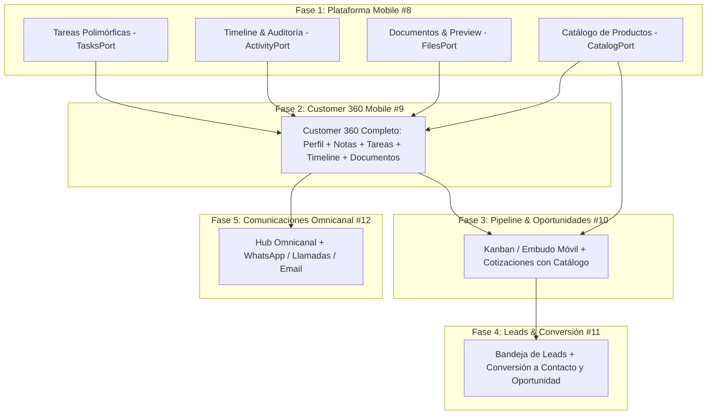

# Roadmap de Paridad Multiplataforma CRM (Desktop ➔ Mobile)

**Estado:** Aprobado / En Ejecución  
**Última actualización:** 2026-09-15  
**Autor:** Equipo LoopDev Core & CRM Platform  
**Alcance:** Paridad funcional completa entre la suite CRM Desktop y la aplicación Mobile basada en arquitectura Foundation-First.

---

## 1. Visión y Enfoque Arquitectónico (Foundation-First)

Para garantizar estabilidad y evitar dependencias circulares o código duplicado, el roadmap se ejecuta bajo una estrategia **Foundation-First**:

1. **Primero se construyen y prueban todas las Capacidades de Plataforma para Mobile** (Tareas, Timeline, Documentos/Preview y Catálogo).
2. **Luego se ensambla el Customer 360 Completo en Mobile** consumiendo estas capacidades maduras.
3. **Posteriormente se habilitan los flujos comerciales avanzados** (Pipeline, Leads y Comunicaciones).

---

## 2. Issues de GitHub por Fase

| Fase | Título del Hito / Issue | Enlace GitHub | Estado |
| :---: | :--- | :---: | :---: |
| **Fase 1** | **Capacidades de Plataforma para Mobile (Foundation Parity)** | [#8](https://github.com/minoveaz/loopdev-v2/issues/8) | 🟡 **En Progreso** |
| **Fase 2** | **Customer 360 Completo en Mobile (Experiencia 360)** | [#9](https://github.com/minoveaz/loopdev-v2/issues/9) | ⏳ Pendiente |
| **Fase 3** | **CRM Pipeline & Oportunidades en Mobile** | [#10](https://github.com/minoveaz/loopdev-v2/issues/10) | ⏳ Pendiente |
| **Fase 4** | **Gestión de Leads y Conversión Atómica en Mobile** | [#11](https://github.com/minoveaz/loopdev-v2/issues/11) | ⏳ Pendiente |
| **Fase 5** | **Comunicaciones Omnicanal en Mobile** | [#12](https://github.com/minoveaz/loopdev-v2/issues/12) | ⏳ Pendiente |

---

## 3. Detalle de Fases y Entregables

### **[Fase 1: Capacidades de Plataforma para Mobile (#8)](https://github.com/minoveaz/loopdev-v2/issues/8)**
> *Objetivo:* Dejar todos los contratos, adaptadores (Supabase + fallback local) y hooks de plataforma 100% listos para ser consumidos en Mobile.
- [ ] **1.1 Tareas Polimórficas (`TasksPort`)**:
  - Contrato multi-inquilino de tareas (`TaskRecord`, prioridades, estados, fechas de vencimiento `dueAt`).
  - Adaptador Supabase (`crm_tasks` / `platform_tasks`) con fallback local inmutable.
  - Hooks y componentes UI táctiles de tareas.
- [ ] **1.2 Timeline & Auditoría (`ActivityTimelinePort`)**:
  - Contrato de auditoría cronológica (`ActivityRecord`).
  - Feed unificado de actividad (cambios de etapa, notas creadas, tareas completadas).
- [ ] **1.3 Gestor de Documentos & Preview (`FilesPort`)**:
  - Contrato de archivos adjuntos y subida (`UploadSession`, metadatos, control MIME).
  - Componente de visualización/preview embebido (soporte PDF, imágenes, identificaciones).
- [ ] **1.4 Catálogo de Productos & Ofertas (`CatalogPort`)**:
  - Contrato y adaptador para consulta de productos, coberturas/servicios y ofertas de precios.

---

### **[Fase 2: Customer 360 Completo en Mobile (#9)](https://github.com/minoveaz/loopdev-v2/issues/9)**
> *Objetivo:* Ensamblar la ficha integral del cliente en Mobile consumiendo todas las capacidades de plataforma de la Fase 1.
- [ ] Pestaña **Perfil**: Datos demográficos, canales de contacto y edición vía motor de formularios.
- [ ] Pestaña **Notas**: Creación y edición de anotaciones con visibilidad privada/equipo.
- [ ] Pestaña **Tareas**: Visualización de pendientes, creación de tarea rápida y marcar completadas.
- [ ] Pestaña **Timeline**: Historial cronológico de eventos del cliente.
- [ ] Pestaña **Documentos**: Lista de adjuntos, subida desde móvil y previsualización.

---

### **[Fase 3: CRM Pipeline & Oportunidades en Mobile (#10)](https://github.com/minoveaz/loopdev-v2/issues/10)**
> *Objetivo:* Gestión del embudo comercial y cotización en movimiento.
- [ ] Tablero Kanban / Lista de etapas optimizada para pantallas táctiles.
- [ ] Transición y avance rápido de etapas de una oportunidad comercial.
- [ ] Creación de cotización seleccionando productos desde el `CatalogPort` móvil.
- [ ] Pestaña **Oportunidades** activa en Customer 360.

---

### **[Fase 4: Gestión de Leads y Conversión Atómica en Mobile (#11)](https://github.com/minoveaz/loopdev-v2/issues/11)**
> *Objetivo:* Captura ágil y calificación de prospectos.
- [ ] Bandeja móvil de prospectos (Leads) con filtros y scoring.
- [ ] Calificación de interés (`Qualified` / `Unqualified`).
- [ ] Flujo de conversión atómica (Lead ➔ Contacto + Oportunidad).

---

### **[Fase 5: Comunicaciones Omnicanal (#12)](https://github.com/minoveaz/loopdev-v2/issues/12)**
> *Objetivo:* Interacción directa con el cliente y registro automático.
- [ ] Acciones directas desde la ficha del cliente (Abrir WhatsApp, Llamar, Enviar Email).
- [ ] Historial de conversaciones e interacciones vinculadas al contacto.

---

## 4. Criterios de Calidad y Certificación

- [ ] Cobertura de pruebas unitarias al 100% en `@contracts/*`.
- [ ] Aislamiento estricto por organización (`tenant_id`).
- [ ] Adaptadores con fallback local garantizado para pruebas y modo offline.
- [ ] Diseño responsive y accesible en resoluciones móviles (360px a 430px).
