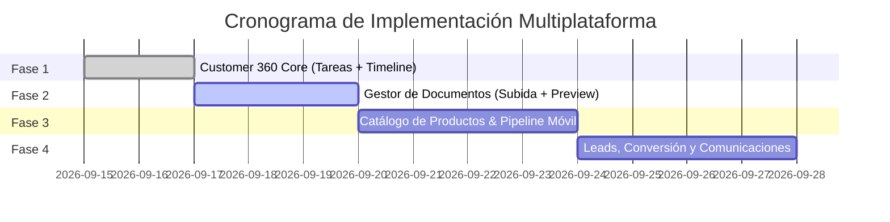

# Roadmap de Paridad Multiplataforma CRM (Desktop ➔ Mobile)

**Estado:** Aprobado / En Ejecución  
**Última actualización:** 2026-09-15  
**Autor:** Equipo LoopDev Core & CRM Platform  
**Alcance:** Paridad funcional completa entre la suite CRM Desktop y la aplicación Mobile.

---

## 1. Visión y Objetivos

El objetivo principal es lograr que los agentes, ejecutivos y supervisores comerciales cuenten con las mismas capacidades operativas tanto en la consola web de escritorio (**Desktop**) como en sus dispositivos móviles (**Mobile**).

La arquitectura se fundamenta en **Capacidades de Plataforma Transversales** (Auth, Formularios, Notas, Tareas, Timeline, Archivos/Documentos y Catálogo de Productos) que alimentan de manera desacoplada los módulos de negocio de CRM.

```mermaid
flowchart TD
    subgraph Platform Engines [Capacidades de Plataforma]
        AUTH[1. Multi-Tenant Auth & Scope]
        FORM[2. Motor de Formularios Dinámicos]
        NOTES[3. Notas Polimórficas]
        TASKS[4. Tareas y Asignaciones]
        TIMELINE[5. Timeline y Auditoría]
        DOCS[6. Documentos & Preview]
        CATALOG[7. Catálogo de Productos & Ofertas]
        COMM[8. Hub de Comunicaciones]
    end

    subgraph CRM Domain [Dominio CRM]
        CONTACTS[Contactos CRM]
        C360[Customer 360]
        LEADS[Leads & Conversión]
        PIPELINE[Pipeline & Oportunidades]
        OPERATIONS[Operaciones & Posventa]
    end

    AUTH --> CRM Domain
    FORM --> CONTACTS & LEADS
    NOTES --> C360 & PIPELINE
    TASKS --> C360 & OPERATIONS
    TIMELINE --> C360
    DOCS --> C360 & PIPELINE & OPERATIONS
    CATALOG --> PIPELINE & OPERATIONS
    COMM --> C360
```

---

## 2. Inventario de Capacidades de Plataforma

| Capacidad de Plataforma | Contrato / Puerto | Descripción | Integración en CRM | Estado Actual |
| :--- | :--- | :--- | :--- | :---: |
| **1. Multi-Tenant Auth** | `AuthPort`, `TenantContextPort` | Sesión Supabase, switch atómico de organización (`tenant_id`), workspaces y control de acceso (RBAC). | Aislamiento y contexto organizacional de todos los datos. | ✅ **100% (Desktop & Mobile)** |
| **2. Motor de Formularios** | `ContactFormDefinition`, `useFormLifecycle` | Esquemas declarativos de campos, validación modular (`email-or-phone`), dirty-state tracking y layout por secciones. | Formularios de creación y edición de contactos y prospectos. | ✅ **100% (Desktop & Mobile)** |
| **3. Notas Polimórficas** | `NotesPort` | Anotaciones TipTap / Markdown con visibilidad (`private`/`team`) vinculadas a cualquier entidad (`contact`, `lead`, `deal`). | Pestaña **Notas** en Customer 360 y ficha de oportunidad. | ✅ **100% (Desktop & Mobile)** |
| **4. Tareas Polimórficas** | `TasksPort` | Tareas con prioridad (`low` a `urgent`), estados, fecha límite (`dueAt`), asignación de responsable y plantillas. | Pestaña **Tareas** en Customer 360 y agenda de ventas. | ⏳ **Fase 1** (Solo Desktop) |
| **5. Timeline y Auditoría** | `ActivityTimelinePort` | Registro cronológico inmutable de eventos (`stage_change`, `assignment`, `note_created`, `task_completed`, `conversion`). | Pestaña **Timeline** en Customer 360 y trazabilidad de cuenta. | ⏳ **Fase 1** (Solo Desktop) |
| **6. Documentos & Preview** | `FilesPort`, `DocumentIntelligence` | Subida de archivos (`uploadSession`), versionado, tipos MIME, almacenamiento seguro y visualizador / preview embebido. | Pestaña **Documentos** en Customer 360, contratos y pólizas. | ⏳ **Fase 2** (Solo Desktop) |
| **7. Catálogo de Productos** | `CatalogPort` | Catálogo de productos físicos, servicios, suscripciones, coberturas/pólizas, paquetes y ofertas con modelos de cobro. | Cotizaciones en Pipeline, líneas de oportunidad y posventa. | ⏳ **Fase 3** (Solo Desktop) |
| **8. Hub de Comunicaciones** | `CommunicationsPort` | Centro omnicanal de mensajería (WhatsApp, Email, SMS, llamadas, chatbot) con registro de hilos. | Pestaña de interacciones y contacto directo desde la ficha. | ⏳ **Fase 4** (Solo Desktop) |

---

## 3. Matriz de Paridad Funcional CRM (Desktop vs Mobile)

| Módulo CRM | Funcionalidades Específicas | Desktop | Mobile | Brecha a Resolver |
| :--- | :--- | :---: | :---: | :--- |
| **Contactos (Contacts)** | • Listado paginado con cursor y filtros.<br>• Creación con validación reactiva.<br>• Detección y resolución de duplicados.<br>• Edición completa por secciones. | ✅<br>✅<br>✅<br>✅ | ✅<br>✅<br>⏳<br>⏳ | Añadir flujo de edición y revisión de duplicados en móvil. |
| **Customer 360** | • Pestaña Perfil & Datos Generales.<br>• Pestaña Notas.<br>• Pestaña Tareas.<br>• Pestaña Timeline / Actividad.<br>• Pestaña Documentos & Adjuntos.<br>• Pestaña Oportunidades & Productos. | ✅<br>✅<br>✅<br>✅<br>✅<br>✅ | ✅<br>✅<br>🔴<br>🔴<br>🔴<br>🔴 | Habilitar Tareas, Timeline, Documentos y Oportunidades en la vista 360 móvil. |
| **Documentos & Archivos** | • Subida de documentos desde cámara/galería/archivos.<br>• Preview visual (PDF, JPG, PNG).<br>• Vinculación a cliente y clasificación. | ✅<br>✅<br>✅ | 🔴<br>🔴<br>🔴 | Implementar selector nativo/web de archivos y modal de previsualización. |
| **Pipeline & Oportunidades** | • Tablero Kanban de etapas.<br>• Transición y avance de oportunidad.<br>• Selección de items del Catálogo de Productos.<br>• Detalle de cotización y reapertura. | ✅<br>✅<br>✅<br>✅ | 🔴<br>🔴<br>🔴<br>🔴 | Diseñar vista de embudo optimizada para táctil y selector de productos. |
| **Prospectos (Leads)** | • Bandeja de leads y scoring.<br>• Calificación rápida (`Qualified`/`Unqualified`).<br>• Conversión atómica a Contacto + Oportunidad. | ✅<br>✅<br>✅ | 🔴<br>🔴<br>🔴 | Implementar lista de prospectos y modal de conversión móvil. |
| **Comunicaciones & Operaciones** | • Contacto directo WhatsApp/Llamada/Email.<br>• Consulta de productos/pólizas activas. | ✅<br>✅ | 🔴<br>🔴 | Acciones rápidas (click-to-chat, click-to-call) y lista de productos contratados. |

---

## 4. Fases del Roadmap de Implementación



### **Fase 1: Customer 360 Core (Tareas + Timeline en Mobile)**
* **Hitos:**
  1. Integración de `TasksPort` en Mobile (Listado de tareas del contacto, marcar completadas, crear tarea rápida con fecha de vencimiento).
  2. Integración de `ActivityTimelinePort` en Mobile (Feed cronológico de auditoría y actividad).
  3. Navegación fluida por tabs en Customer 360: **Perfil | Notas | Tareas | Timeline**.

---

### **Fase 2: Gestor de Documentos (Subida, Clasificación y Preview)**
* **Hitos:**
  1. Implementación de `FilesPort` para subida de archivos adjuntos (contratos, identificaciones, comprobantes).
  2. Visor / Preview embebido de documentos (soporte PDF, imágenes, documentos de identidad).
  3. Pestaña **Documentos** en Customer 360 móvil con subida directa desde cámara o almacenamiento local.

---

### **Fase 3: Catálogo de Productos y Pipeline Móvil**
* **Hitos:**
  1. Integración de `CatalogPort` (búsqueda y visualización de catálogo de productos/servicios y ofertas).
  2. Vista de **Pipeline / Oportunidades** móvil (tarjetas táctiles, filtros y avance de etapas).
  3. Creación de oportunidad comercial cotizando productos del catálogo.
  4. Pestaña **Oportunidades / Productos Activos** en Customer 360.

---

### **Fase 4: Leads, Conversión Atómica y Comunicaciones**
* **Hitos:**
  1. Bandeja de **Leads** y calificación de prospectos en móvil.
  2. Flujo de **Conversión rápida** (Lead ➔ Contacto + Oportunidad).
  3. Botones de acción rápida en Customer 360 (Abrir WhatsApp, Llamar, Enviar Email).

---

## 5. Criterios de Calidad y Verificación

Cada fase debe cumplir estrictamente:
- [ ] Pruebas unitarias de contratos en `@contracts/*` pasando al 100%.
- [ ] Compatibilidad estricta con aislamiento multi-inquilino (`organization_id`).
- [ ] Fallbacks locales inmutables para ejecución offline / test suite.
- [ ] Validación visual y táctil en resoluciones móviles (360px a 430px de ancho).
