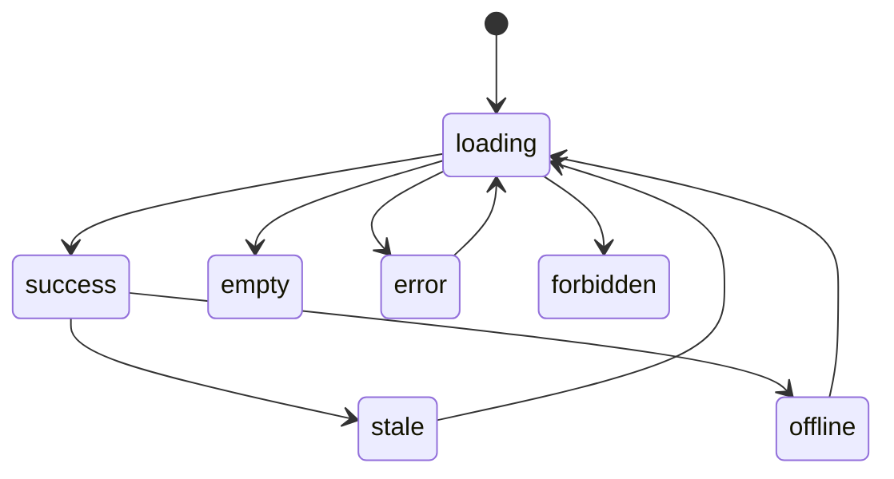

# CRM Overview Design — Sales Operating Dashboard

## 1. Resumen del módulo

Dashboard operativo para `/app/sales-crm/overview`: responde “¿cómo está el
negocio y qué debo hacer ahora?” mediante cuatro KPIs remotos (open pipeline,
open leads, open opportunities y overdue/today tasks), salud del pipeline,
resumen compacto de tareas y un único resumen de actividad de negocio.

Incluye solo lectura agregada y navegación contextual; no crea una entidad
Dashboard. Quedan fuera el workspace completo de Tasks, feeds duplicados,
Notes/Attachments por defecto, relaciones demo fijas y ruido de extracción
documental. Supuestos: organización activa es el tenant visible; workspace y
brand son filtros opcionales; Analytics y Platform adapters son reemplazables.

## 2. Benchmark de mercado

Salesforce Pipeline Inspection, Salesforce Reports/Dashboards, HubSpot Reports y
Pipedrive Insights confirman el baseline de KPIs, pipeline por etapa, actividad
y tareas. LoopDev adopta la lectura operativa y explicable, no un constructor
BI. Avanzado/Enterprise (forecasting, scoring, report builder, IA) queda fuera
del MVP.

## 3. Encaje en LoopDev

CRM consume Analytics, Tasks, Activity, Relations, Notes, Files y Document
Intelligence como Platform. Decisiones: Analytics/Tasks/Activity `REUSE`;
Timeline `REUSE` como infraestructura pero no superficie; Notes/Files/Relations
`REUSE` contextual; Document Intelligence `REUSE` fuera de esta vista. No se
extiende Platform en este gate. Cualquier extensión futura requiere aprobación.

| Módulo origen | Destino | Interacción | Trigger | Datos | Permisos |
|---|---|---|---|---|---|
| CRM | Analytics | publica cambios comerciales | create/update/stage | tenant, counts, value | CRM read |
| Tasks | Overview | consulta resumen | route/filter/refresh | task status/due/owner | task read; transition separately |
| Activity | Overview | consulta feed único | route/filter/refresh | business event/source ref | activity read |
| Overview | Contacts/Pipeline/Tasks | deep link | card/task/activity click | authorized entity id | target route rechecks access |

Rutas: `/app/sales-crm/overview` canónica; `/app/sales-crm/tasks`,
`/contacts`, `/leads`, `/pipeline`, `/opportunities` conservan sus workspaces.
Refresh/deep link/not-found/back/mobile navigation siguen AppShell; forbidden
se renderiza sin revelar registros.

## 4. Actores, casos de uso y UX

Desktop: header con rango/filtros Rivera, 4 KPI cards, pipeline health de ancho
principal y health/risks lateral, task summary compacto, activity summary único.
Mobile: una columna, filtros en Popover/Command/Calendar, cards apiladas, tablas
convertidas a filas legibles. No usar controles nativos.

Acciones: refresh, cambiar periodo/scope, abrir entidad autorizada y abrir Tasks.
Task transition inline solo si se confirma permiso; otherwise deep-link. Focus
management, keyboard order, live region para refresh/error, labels y `useT` para
locale/RTL son obligatorios.

## 5. Máquina de estados y ciclo de vida

El dashboard es read model; cada panel tiene estado independiente:

| Estado | Tipo | Entrada | Salidas | Actor | Validación | Evento |
|---|---|---|---|---|---|---|
| `loading` | transitorio | route/filter/refresh | success/empty/error/forbidden/offline | sistema | scope válido | none |
| `success` | estable | respuesta autorizada | loading/stale/offline | sistema | DTO schema | none |
| `empty` | estable | respuesta sin filas | loading | sistema | no inventar cero contextual sin semántica | none |
| `partial` | degradado | algunos queries fallan | retry/success | sistema | mantener proveniencia por panel | none |
| `stale` | degradado | cache supera SLA | refresh/success/offline | sistema | freshness metadata | none |
| `forbidden` | terminal de query | 403/RLS | retry/route away | sistema | no mostrar cached unauthorized data | audit |
| `error` | recuperable | timeout/5xx/schema | retry | sistema | error code + correlation id | telemetry |
| `offline` | recuperable | no connectivity | reconnect/stale | sistema | snapshot scope-valid | telemetry |

## 6. Modelo de datos funcional

Read models: `KpiMetric`, `PipelineHealth`, `TaskSummary`, `ActivitySummary`,
all with `scope`, `period`, `generatedAt`, `freshness`, `sourceVersion`,
`permissionSnapshot`. Entity IDs are opaque; tenant scope is mandatory.
Activity dedupes by `sourceType:sourceId`; tasks use `version` and due-date
timezone. No dashboard persistence in MVP. Remote migration maps to Analytics
metric/read-model identities; local adapter uses deterministic empty/populated
fixtures only for tests. No delete/archive operation is owned here.

## 7. Requerimientos funcionales

| ID | Capacidad | Prioridad | Dependencias | Complejidad | Criterio |
|---|---|---|---|---|---|
| OVR-01 | KPI cards remote-ready | P0 | Analytics, tenant scope | M | four canonical cards show authorized values, freshness and explicit empty |
| OVR-02 | Pipeline health | P0 | breakdown contract | M | stage distribution/health has no demo values |
| OVR-03 | Compact task summary | P0 | Tasks | M | pending/overdue/next with authorized deep link |
| OVR-04 | One activity summary | P0 | Activity | M | no duplicate Timeline/Activities surface |
| OVR-05 | State matrix | P0 | shared UI | M | loading/empty/error/forbidden/stale/offline/partial covered |
| OVR-06 | Scope and i18n | P0 | auth/i18n | M | tenant/team filters and locale/RTL labels pass |
| OVR-07 | Remove conflicts | P0 | route audit | S | no full Tasks, default Notes/Attachments, fixed relations, extraction noise |
| OVR-08 | Remote API/RLS contract | P0 | access/API | L | DTOs, errors, version/freshness and RLS cases defined |
| OVR-09 | Local-first migration | P1 | sync | L | reload/offline/stale/reconcile policy documented and testable |

## 8. API, eventos y backend

Queries: `GET /crm/overview/kpis`, `/pipeline-health`, `/task-summary`,
`/activity-summary`, each taking `organizationId`, optional workspace/brand,
period, owner/team/stage, cursor/limit. DTO envelope includes `scope`,
`generatedAt`, `freshUntil`, `items/value`, `permission`, `sourceVersion`.
The canonical KPI catalogue is `open_pipeline`, `open_leads`,
`open_opportunities`, and `overdue_today_tasks`. Target freshness is 60
seconds; data older than 5 minutes is stale and not a normal success.
Errors: `OVERVIEW_SCOPE_REQUIRED`, `FORBIDDEN`, `STALE_VERSION`,
`VALIDATION_ERROR`, `RATE_LIMITED`, `UPSTREAM_UNAVAILABLE`, `SCHEMA_MISMATCH`.
Queries are idempotent; the Overview has no mutation endpoint. All task
mutations remain in the Tasks module. Server validates scope, caps limit and
logs correlation id/metric id. Start with RLS-scoped aggregates; introduce
read models only after latency evidence.

## 9. Matriz RBAC y negocio

| Acción | Admin | Manager | Usuario | Solo lectura |
|---|---:|---:|---:|---:|
| Ver own dashboard | Sí | Sí | Sí | Sí |
| Ver team/org aggregate | Sí | Sí | según scope | según permiso |
| Cambiar filtros/refresh | Sí | Sí | Sí | Sí |
| Abrir entidades | Sí | Sí | asignadas/team | solo autorizadas |
| Transition task inline | Sí | Sí | assigned/allowed | No |
| Export | No MVP | No MVP | No MVP | No MVP |

RLS debe intersectar tenant, organization, workspace/brand, membership and
record scope. Recheck deep links, bulk/export, attachment/document access and
cached data after membership revocation. Corner cases: organization switch
while requests race; manager sees team aggregate but not sensitive records;
activity source deleted; task version conflict; offline snapshot loses scope.

## 10. Arquitectura frontend

`Overview.tsx` remains composition only. Proposed `useSalesOverview` orchestrates
typed query hooks; `SalesOverviewReadModel` and adapters live under
`src/loopdev/domains/crm` or shared Analytics ports, not components. Reuse
`StatCard`, `DataCard`, `PageHeader`, `AnalyticsEmptyState`, Rivera Select/
Popover/Calendar, Platform task/activity renderers. Remove imports/renderers for
full TaskWorkspace, Notes, Attachments, duplicate Timeline and fixed refs.
Use independent query states and no optimistic dashboard writes. Component,
adapter, RLS and route tests required.

## 11. Local-first y sincronización

MVP reads remote when configured and deterministic local adapter otherwise.
Cache last authorized read with scope hash and freshness for 60 seconds; offline
may show a stale snapshot with clear banner, never after permission scope
changes. There are no offline mutations in this module and retry is manual.
Task mutation queue belongs to Platform Tasks, not Overview. Reconcile by
`sourceVersion`; migration maps local fixtures to remote IDs only in controlled
seed/import. The new composition activates directly for all tenants after tests
pass (no feature-flag rollout); rollback restores the prior composition if
validation fails while preserving source data and shared adapters.

## 12. Plan por fases

See `implementation-plan.md`; phases are audit → design/visual approval →
contracts/domain/access/sync → local UX → remote adapter/RLS → migration →
verification/review. No phase starts before its gate and issue.

## 13. Pruebas y aceptación

Each P0 requirement has component behavior, permission/error boundary and
concrete evidence in `requirement-evidence-matrix.md`. Cover route/deep-link,
all states, tenant isolation, i18n/RTL, responsive, task conflict, activity
dedupe, no demo/extraction noise, and remote/local adapter parity.

## 14. Seguridad, cumplimiento y operación

RLS and server-side permission checks are authoritative; Activity is not audit.
Audit access/exports/task transitions, redact sensitive metric payloads, retain
only policy-approved aggregates. Monitor query latency, freshness, error rate,
forbidden rate, stale/offline frequency and duplicate activity. Roll out behind
`crm_overview_operating_dashboard`; rollback by flag to prior route composition
without reverting unrelated dirty changes.

## 15. Riesgos, decisiones y roadmap

Confirmed: KPI catalogue, 60-second target/5-minute maximum freshness,
selected-team RLS/membership visibility with no cross-team data, the activity
allowlist (calls, emails, meetings, notes, tasks, assignments, stage changes,
conversions and closures), exclusion of Document Intelligence extraction and
technical events by default, read-only Tasks summary with deep link, 60-second
read cache with stale/offline state, no offline mutations, manual retry,
direct all-tenant activation after tests, rollback on validation failure, no
export in MVP, scope, surface removals, Platform reuse and no production code
in this run. Open only: exact read-model threshold and native iOS/Android
ownership. Architecture quality is `PASS_WITH_DEBT`; remaining debt is runtime
evidence, not an unresolved product decision.

**State:** `complete` for design specification, `WAITING_DESIGN_APPROVAL` for gate.
