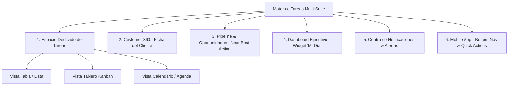

# Discovery Completo: Tareas Polimórficas Multi-Suite, Vistas & Funcionalidades Avanzadas

**Módulo:** `tasks` (Capacidad de Plataforma Multi-Suite)  
**Suite Actual:** `crm` (consumidor prioritario)  
**Suites Destino:** `crm`, `marketing`, `operations`, `support`, `document-intelligence`, `billing`  
**Run ID:** `MOD-TASKS-20260915-001`  
**Fecha:** 2026-09-15  

---

## 1. Visión y Naturaleza Multi-Suite de las Tareas

Las **Tareas (Tasks)** son una **Capacidad Central de Plataforma (Platform Capability)** transversal que da soporte operativo a todas las suites de LoopDev:

| Suite | Entidades Vinculadas | Ejemplos de Tareas |
| :--- | :--- | :--- |
| **CRM (Ventas)** | Contacto, Lead, Oportunidad | "Llamada de seguimiento", "Enviar cotización", "Cierre de póliza" |
| **Operaciones** | Póliza, Contrato, Cliente | "Revisión documental KYC", "Emisión de contrato", "Inspección técnica" |
| **Marketing** | Campaña, Segmento | "Revisión de creativos", "Validación de base de datos" |
| **Soporte** | Ticket, Reclamación | "Contactar cliente por siniestro", "Escalar a perito" |
| **Document Intelligence** | Documento, Expediente | "Aprobar extracción OCR", "Validar firma digital" |

---

## 2. Mapa de Vistas y Espacios de Trabajo (Surfaces)

### 1. Espacio Dedicado de Tareas en la Suite (`/app/sales-crm/tasks`)
* **Vista Tabla / Lista (`List/Table View`)**: Paginación, ordenación, columnas de estado, entidad vinculada con enlace directo, responsable y fecha límite con semáforo.
* **Vista Tablero Kanban (`Board View`)**: Columnas de estado (`Pendientes`, `En Progreso`, `Completadas`, `Canceladas`) con arrastre interactivo.
* **Vista Calendario / Agenda (`Calendar View`)**: Planificación mensual, semanal y diaria basada en `dueAt`.

### 2. Customer 360 (Desktop & Mobile)
* Pestaña **Tareas**: Lista de pendientes del cliente, creación rápida mediante plantillas y checkbox interactivo de completado.

### 3. Pipeline & Detalle de Oportunidad / Lead
* Widget de **"Próxima Acción" (Next Best Action)** en la cabecera del negocio.
* Sugerencia automática de tareas al cambiar de etapa en el embudo comercial.

### 4. Dashboard Ejecutivo / Overview (Widget 'Mi Día')
* Resumen matutino de tareas que vencen hoy y tareas vencidas con acción de posponer en 1 clic.

### 5. Centro de Notificaciones & Recordatorios (TopBar & Push)
* Alertas preventivas antes del vencimiento (15 min, 1 hora, 1 día).
* Notificaciones de asignación y menciones `@usuario` con botón de acción directa.

### 6. Experiencia Móvil Touch-First
* Acceso directo en navegación inferior, Botón Flotante (`FAB +`) y tarjetas optimizadas para pulgar.

---

## 3. Funcionalidades Avanzadas de Plataforma

1. **Catálogo de Plantillas por Suite (`TaskTemplateRecord`)**:
   - Catálogo preconfigurado por suite (`[📞 Llamada]`, `[📄 Cotización]`, `[📝 Firma]`, `[🔄 Renovación]`) que autocompleta título, prioridad y días de vencimiento sugeridos en 1 tap.
2. **Reprogramación Rápida (`Quick Reschedule`)**:
   - Menú contextual rápido para posponer tareas: `+1 hora`, `Mañana`, `En 3 días`, `Próxima semana`.
3. **Sub-tareas & Checklist (`Checklist`)**:
   - Pasos internos de verificación dentro de una tarea compleja (`checklist: TaskChecklistItem[]`).
4. **Buscador Global (`Cmd + K`)**:
   - Búsqueda indexada de tareas por título, contacto, lead o responsable.
5. **Filtros Guardados & Vistas Personalizadas**:
   - Guardado de filtros como *"Mis tareas urgentes de CRM"* o *"Tareas de mi equipo para hoy"*.
6. **Menciones `@usuario` y Asignaciones**:
   - Etiquetado de colaboradores con notificación automática.
7. **Emisión Automática al Timeline**:
   - Auditoría cronológica inmutable de creación, asignación y completado en `ActivityTimelinePort`.
