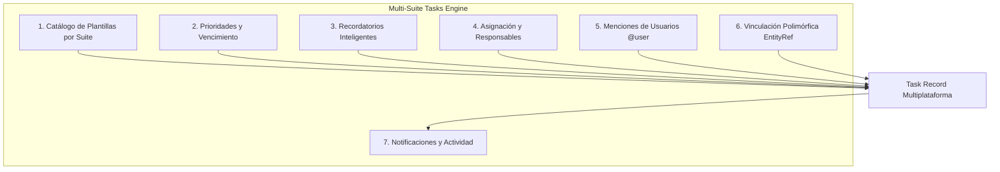

# Discovery Completo: Tareas Polimórficas Multi-Suite & Catálogo de Plantillas

**Módulo:** `tasks` (Capacidad de Plataforma Multi-Suite)  
**Suite Actual:** `crm` (consumidor prioritario)  
**Suites Destino:** `crm`, `marketing`, `operations`, `support`, `document-intelligence`  
**Run ID:** `MOD-TASKS-20260915-001`  
**Fecha:** 2026-09-15  

---

## 1. Visión y Naturaleza Multi-Suite de las Tareas

Las **Tareas (Tasks)** no son una funcionalidad aislada de CRM; son una **Capacidad Central de Plataforma (Platform Capability)** diseñada para ser consumida de manera homogénea por cualquier suite:

| Suite | Entidades Vinculadas | Ejemplos de Tareas |
| :--- | :--- | :--- |
| **CRM (Ventas)** | Contacto, Lead, Oportunidad | "Llamada de seguimiento", "Enviar cotización", "Cierre de póliza" |
| **Operaciones** | Póliza, Contrato, Cliente | "Revisión documental", "Emisión de contrato", "Inspección técnica" |
| **Marketing** | Campaña, Segmento | "Revisión de creativos", "Validación de base de datos" |
| **Soporte** | Ticket, Reclamación | "Contactar cliente por siniestro", "Escalar a perito" |
| **Document Intelligence** | Documento, Expediente | "Aprobar extracción OCR", "Validar firma digital" |

---

## 2. Inventario de Funcionalidades Cross Requeridas

Para que la capacidad sea verdaderamente potente y reutilizable en todas las suites y plataformas (Desktop y Mobile), debe contemplar:



### 1. Catálogo de Plantillas de Tareas por Suite (`TaskTemplateRecord`)
* Permite a las organizaciones definir plantillas estándar pre-configuradas por suite.
* Al crear una tarea en Desktop o Mobile, el usuario puede:
  - Escribir una tarea manual libre.
  - O seleccionar una **Plantilla del Catálogo** en 1 tap (ej. `[📞 Llamada de seguimiento]`, `[📄 Enviar cotización]`, `[📝 Firma de contrato]`), la cual pre-rellena automáticamente:
    - Título y Descripción.
    - Prioridad predeterminada (`normal`, `high`, `urgent`).
    - Días de vencimiento relativos sugeridos (`defaultDueDays: 2`).
    - Tipo de relación (`relationTypes: ["contact", "lead", "opportunity"]`).

### 2. Prioridades y Semáforos de Vencimiento
* 4 niveles de prioridad: `low`, `normal`, `high`, `urgent` con códigos visuales semánticos.
* Fechas límite con cálculo relativo:
  - 🔴 **Vencida**: `dueAt < hoy` y `status !== 'completed'`.
  - 🟡 **Vence hoy**: Alerta destacada en móvil/escritorio.
  - ⚪ **Programada**: `Vence en X días` o fecha formateada.

### 3. Recordatorios y Notificaciones (`reminders`)
* Configuración de recordatorios antes de la fecha límite (ej. 15 min, 1 hora, 1 día antes).
* Canales: Notificación In-App, Push móvil y correo electrónico.

### 4. Asignación a Otros Usuarios (`assignedUserId`)
* Asignar una tarea a uno mismo o delegarla a otro miembro de la organización.
* Filtrado de tareas: *Mis tareas*, *Tareas del equipo*, *Tareas por contacto*.

### 5. Menciones de Usuarios (`mentions`)
* Soporte para `@mención` de usuarios en la descripción o notas de la tarea.
* Disparo automático de notificación a los usuarios etiquetados.

### 6. Integración Automática con Timeline y Auditoría
* Cada cambio de estado (`created`, `assigned`, `completed`, `reopened`) registra un evento en `ActivityTimelinePort`.

---

## 3. Modelo de Contrato Multi-Suite (`packages/contracts/src/tasks.ts`)

```typescript
export type TaskStatus = "open" | "in_progress" | "completed" | "cancelled";
export type TaskPriority = "low" | "normal" | "high" | "urgent";
export type PlatformSuiteKey = "crm" | "marketing" | "operations" | "support" | "billing" | "documents";

export interface TaskEntityRef {
  entityType: "contact" | "lead" | "opportunity" | "contract" | "ticket" | "document" | string;
  entityId: string;
  label?: string;
}

export interface TaskUserMention {
  userId: string;
  displayName: string;
  email?: string;
}

export interface TaskReminder {
  remindAt: string;
  channel: "in_app" | "push" | "email";
  sent: boolean;
}

export interface TaskRecord {
  id: string;
  organizationId: string;
  workspaceId?: string | null;
  suite: PlatformSuiteKey;
  title: string;
  description?: string | null;
  status: TaskStatus;
  priority: TaskPriority;
  ownerId?: string | null;
  assignedUserId?: string | null;
  assignedUser?: { id: string; displayName: string; avatarUrl?: string | null } | null;
  dueAt?: string | null;
  completedAt?: string | null;
  relation?: TaskEntityRef | null;
  templateId?: string | null;
  mentions?: TaskUserMention[];
  reminders?: TaskReminder[];
  createdAt: string;
  updatedAt: string;
  version: number;
}

export interface TaskTemplateRecord {
  id: string;
  organizationId: string;
  suite: PlatformSuiteKey;
  key: string;
  name: string;
  description?: string | null;
  defaultPriority: TaskPriority;
  defaultDueDays?: number | null;
  relationTypes: string[];
  status: "active" | "archived";
}
```

---

## 4. Requisitos para el Primer Gate (Design)

- [x] **Arquitectura Multi-Suite**: Definida mediante `suite` y `relation: EntityRef`.
- [x] **Catálogo de Plantillas de Tareas**: Soporte de plantillas con pre-llenado rápido en 1 clic/tap.
- [x] **Prioridades, Vencimientos y Recordatorios**: Modelo de tiempo relativo y alertas.
- [x] **Asignación y Menciones**: Propiedades `assignedUserId` y `mentions` en DTOs.
- [x] **Dual-Stack & Multi-Tenant**: Supabase REST + local fallback con filtro estricto por `organization_id`.
