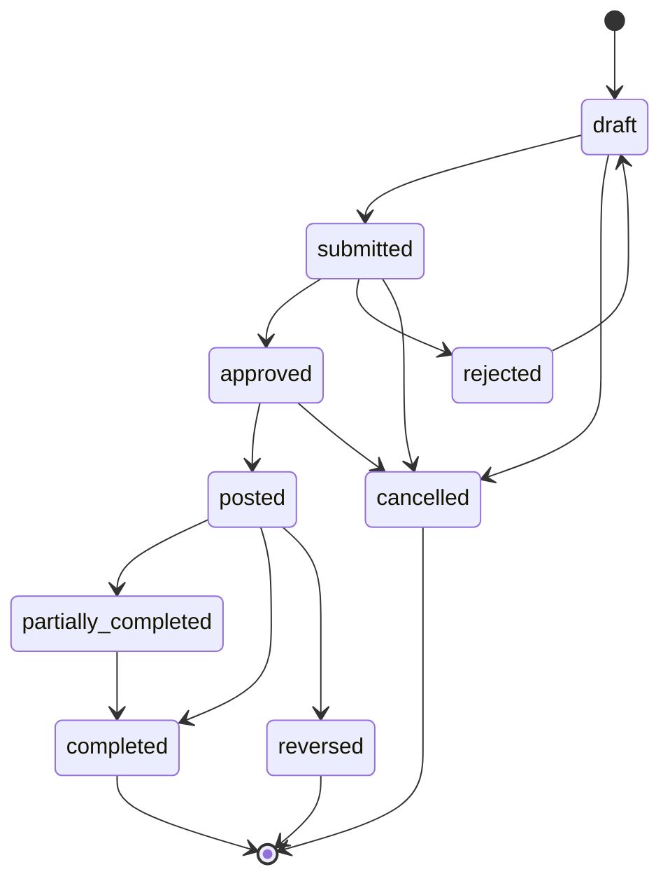

# ERP Core — Diseño funcional y de producto

## Control del documento

| Campo | Valor |
|---|---|
| Estado | `aprobado con enmiendas de módulo; gate visual conceptual aprobado; análisis de dominio en curso` |
| Suite / módulo | ERP / Core capability map |
| Run | `MOD-CORE-20261024-001` |
| Discovery | `discovery.md` (attempt 2, partial) |
| Ledger | `delivery-ledger.json` (draft) |
| Mercado confirmado | Pymes de distintos sectores |
| Prioridad de clientes | MiauCraft primero; Inhand después |

Este diseño propone una suite ERP modular y sector-neutral. No aprueba un ERP
completo ni convierte todos los módulos candidatos en el primer MVP. Las
decisiones de dominio, acceso, API y sincronización son intencionalmente
preliminares: sus contratos detallados pertenecen a las fases especializadas
posteriores al gate visual.

### 1. Resumen del módulo

- **Propósito:** dar a las pymes una fuente operativa coherente para productos
  o servicios, proveedores, ventas, compras, inventario, finanzas y reporting,
  activando únicamente los módulos que necesiten.
- **Problema de negocio:** LoopDev tiene una implementación parcial de
  productos y servicios, expuesta hoy como catálogo ERP, y casos
  comerciales distintos, pero carece de un mapa aprobado que conecte datos
  maestros, procesos y responsabilidades sin duplicar CRM o Platform.
- **Actores:** propietario/admin de organización; manager; operador de ventas;
  responsable de proveedores; compras; inventario; finanzas; lectura/auditoría;
  responsables de canales externos; cliente público de un storefront (fuera
  del ERP autenticado).
- **Incluido como dirección de producto:** mapa transversal de capacidades,
  límites entre suites, módulos opcionales y una secuencia que empieza por el
  caso Shopify de MiauCraft. Productos sustituye Catálogo como módulo visible
  y conserva su implementación actual como base técnica;
  Proveedores es un módulo independiente cuya prioridad y fecha de entrega
  siguen abiertas.
- **Fuera de alcance de este diseño:** construir ahora todas las áreas;
  reemplazar Shopify; storefront genérico; contabilidad estatutaria sin país
  definido; procesamiento de tarjetas; fabricación en el roadmap actual,
  nóminas y WMS avanzado. Fabricación requerirá discovery y aprobación futuros.
- **Supuestos:** el tenant canónico es una organización; CRM sigue siendo
  propietario de la relación e historial del cliente; algunas pymes no
  gestionan inventario físico; canales externos pueden seguir siendo sistemas
  de registro.
- **Preguntas abiertas:** módulos del primer release; prioridad y alcance
  inicial de Proveedores; países y obligaciones fiscales; ventas B2B/B2C;
  productos frente a servicios; compras y fulfillment; propiedad por entidad
  en Shopify; modelo de permisos; aplicabilidad de iOS/Android y responsable.

### 2. Benchmark de mercado

Fuentes oficiales consultadas el 2026-10-24. Se usan para contrastar patrones,
no como evidencia de implementación ni como lista automática de requisitos.

| Plataforma | Capacidades relevantes | Diferenciadores | Elementos aplicables a LoopDev |
|---|---|---|---|
| Odoo Sales / Inventory | Cotización, pedidos, entrega/factura; productos/variantes, almacenes, recepción, reserva y movimientos | Suite amplia conectada entre ventas e inventario | Separar catálogo, venta y stock; enlazar documentos sin replicar maestros |
| Microsoft Dynamics 365 Business Central | Movimientos de inventario asociados a ventas/compras, ubicaciones, ajustes, reservas y coste | Integración operacional y contable de los movimientos | Historial auditable e IDs de origen; evitar requerir libro mayor para validar el primer slice |
| SAP Business One | ERP para SMB con finanzas, ventas, compras, inventario, partners, servicio, producción y analítica | Procesos integrados de extremo a extremo | Modularidad y procesos conectados; no copiar amplitud ni complejidad enterprise |

Fuentes: [Odoo Sales](https://www.odoo.com/documentation/19.0/applications/sales/sales.html),
[Odoo Inventory](https://www.odoo.com/documentation/19.0/applications/inventory_and_mrp/inventory.html),
[Business Central Inventory](https://learn.microsoft.com/en-us/dynamics365/business-central/inventory-manage-inventory),
[SAP Business One](https://learning.sap.com/courses/managing-logistics-in-sap-business-one/introducing-sap-business-one).

- **Baseline común:** datos maestros compartidos; documentos comerciales
  trazables; ventas conectadas con entrega/facturación; compras conectadas con
  recepción; inventario derivado de operaciones auditables.
- **Avanzado:** valoración contable, reservas complejas, multi-almacén,
  fabricación, consolidación multi-compañía, forecasting y conectores
  profundos.
- **No MVP por defecto:** replicar una suite contable estatutaria, un WMS,
  fabricación, nómina, predicción o todas las integraciones de referencia.

### 3. Encaje en LoopDev

- **Suite propietaria:** ERP. Productos es el módulo propietario de los
  productos y servicios maestros;
  Proveedores, Ventas, Compras, Inventario, Finanzas y Reporting son bounded
  contexts separados. La separación de Proveedores está confirmada; su
  prioridad y fecha de entrega siguen abiertas. Los storefronts son canales
  públicos consumidores de contratos, no páginas administrativas ERP.
- **Módulos afectados:** CRM (referencias de clientes y contexto comercial),
  Platform (organización, permisos, UI y colaboración), Communications
  (notificaciones futuras), ERP y los canales Shopify/Inhand.
- **Estado de rutas:** existen `/app/erp/overview` y la ruta legacy
  `/app/erp/product-catalog`. La ruta canónica propuesta para el módulo es
  `/app/erp/products`; todavía no está implementada. Los enlaces legacy deberán
  conservarse mediante redirección compatible durante la migración. Rutas como
  `/app/erp/suppliers`, `/app/erp/sales`, `/app/erp/procurement`,
  `/app/erp/inventory`, `/app/erp/finance`, `/app/erp/reports` e
  `/app/erp/integrations` son propuestas, no runtime existente.

| Capacidad o módulo | Decisión | Contrato existente | Integración | ¿Se extiende? | ¿Se prohíbe duplicar? |
|---|---|---|---|---:|---:|
| Organization scope / tenant | `REUSE` | `organization_id`; tenancy/RLS references de Platform | Todas las entidades ERP se acotan a organización; verificar enforcement fuente/runtime | No, salvo gap probado | Sí: membership y tenant local |
| CRM Contacts / Customer 360 | `REUSE` | CRM contacts/customer context | ERP guarda referencias estables; sincronización de identidades por resolver | Solo si contrato compartido insuficiente | Sí: cliente e historial relacional |
| Notes | `REUSE` | `PlatformNotesPanel`, `NoteEditorDrawer`, dominio Platform | Relación con registros ERP usando `EntityRef` | No | Sí: editor o persistencia de notas |
| Files | `REUSE` | `FilePicker`, `FilesDropzone`, `FilePreview`, `RelatedFilesPanel`, dominio Files | Adjuntos de documentos ERP mediante referencia compartida | No | Sí: uploader, preview y cola |
| Tasks / Activity / Timeline | `REUSE` | Workspace de Tasks y componentes Platform | Asignaciones/actividad enlazadas a entidad ERP | No | Sí: timeline, task widget o auditoría paralela |
| Relations | `REUSE` | Relaciones y `EntityRef` Platform | Navegación entre orden, contacto, producto y organización | No | Sí: grafo de relaciones local |
| Document Intelligence Core | `REUSE` | Contrato Core aprobado; composición cross-suite existente como intención | Extracción/revisión de facturas o documentos solo si se aprueba el caso de uso | No en ERP; posible extensión Core vía aprobación | Sí: extractor, lifecycle o historial documental |
| Rivera UI / navegación | `REUSE` | `PageContainer`, `PageHeader`, `DataTable`, common states, Shell y sidebar | Renderers desktop/mobile consumen significado compartido | Extender Platform solo con gap cross-suite aprobado | Sí: design system, shell o selector nativo |
| ERP Products | `REUSE` con reconciliación | `CatalogAdapter`, tipos, ruta y migración legacy existentes (paridad parcial) | ERP posee identidad de producto/servicio; CRM/canales referencian IDs | Contrato/capacidad pendiente de auditoría | Sí: duplicar maestros por canal |
| ERP Suppliers | `MODULE_SPECIFIC`; módulo independiente confirmado, prioridad y fecha abiertas | No hay contrato funcional aprobado | ERP posee la ficha/rol de proveedor; Compras referencia su ID estable; relaciones con CRM por resolver | No antes de identificar gap transversal | Sí: duplicar el maestro de proveedor dentro de Compras |
| Ventas, compras, inventario, finanzas, reporting | `MODULE_SPECIFIC` como dominios; alcance `BLOCKED` para primer release | No hay contratos funcionales aprobados | Contextos separados conectados por referencias y eventos versionados | No antes de identificar gap transversal | Sí: reglas en páginas o adapter de otro módulo |
| Conexión Shopify | `MODULE_SPECIFIC` sobre boundary de integración compartido | No existe conector verificado | Adapter por proveedor y política por entidad | Contrato compartido solo si aplica a otros proveedores | Sí: clonar el dominio ERP para Shopify |
| Storefront Inhand | `MODULE_SPECIFIC` canal público independiente | No existe backend de pedidos/storefront verificado | API pública restringida a catálogo publicado y comandos de checkout | Platform/API pública requiere diseño de seguridad propio | Sí: reglas de stock/precio/pedido en el renderer |

| Módulo origen | Módulo destino | Interacción | Trigger | Datos compartidos | Permisos |
|---|---|---|---|---|---|
| ERP Products | CRM | Referenciar producto/oferta desde contexto comercial | Selección en una oportunidad | IDs/versiones de producto | Lectura de producto + permiso CRM |
| ERP Sales | CRM | Asociar comprador a contacto existente | Creación/importación de documento | `contact_id`, referencia externa | Permiso ERP + permiso de enlace CRM |
| ERP Suppliers | ERP Procurement | Compras selecciona un proveedor existente; el módulo proveedor conserva su perfil | Creación/edición de orden de compra | `supplier_id`, organización, versión y referencias de contacto si aplican | Lectura de proveedor + permiso de compras |
| ERP Sales | ERP Inventory | Solicitar disponibilidad/reserva cuando se apruebe | Confirmación de pedido | SKU/variant, location, cantidad, versión | Ventas + inventario |
| ERP Procurement | ERP Inventory | Recibir compras como movimientos | Recepción aprobada | Purchase order, item, location, cantidad | Compras + recepción |
| ERP Finance | ERP Sales / Procurement | Referenciar facturas y pagos; no reescribir el documento de origen | Emisión/reconciliación | IDs, totales/currency snapshots, referencias externas | Finanzas explícito; segregación de datos sensibles |
| Shopify adapter | ERP Products / Sales | Importar o reconciliar datos autorizados | Webhook, pull programado o acción (mecanismo abierto) | Provider ID, external ID, versión, sync result | Integración manage + scope organización |
| ERP Commerce API | Storefront Inhand | Leer productos publicados y enviar compra | Navegación/checkout público | Campos públicos, carrito/pedido, resultado proveedor | Políticas públicas antiabuso; nunca permisos admin |

### 4. Actores, casos de uso y UX

Vistas candidatas, no wireframes aprobados:

- **Overview:** actividad y métricas autorizadas, alertas de integración y
  enlaces a módulos habilitados; sin asumir que todos los datos tienen una
  fuente LoopDev.
- **Productos:** lista unificada como entrada directa del módulo; distingue
  productos terminados, materias primas/componentes y servicios, con filtros
  por clase y categoría. El árbol de categorías también se administra dentro
  de Productos. Cada producto tiene una categoría principal en una jerarquía.
  Su clase no determina si se compra, vende o controla en inventario:
  esos usos se combinan de forma independiente. El producto define si se
  abastece comprándolo, fabricándolo o por ambos medios; sus variantes heredan
  esa regla. No se muestra un índice separado de catálogos. La agrupación
  técnica existente puede conservarse internamente hasta resolver su destino.
  Los semielaborados quedan fuera hasta descubrir Fabricación.
- **Proveedores:** espacio separado para consultar y gestionar proveedores;
  alcance de ficha, contactos, estados y acciones por definir antes del diseño
  de sus vistas.
- **Ventas:** bandeja de cotizaciones/pedidos si el alcance se aprueba; detalle
  con cliente, líneas versionadas, historial y acciones autorizadas.
- **Compras:** órdenes y recepción enlazada a proveedor; políticas y roles por
  definir.
- **Inventario:** saldos por ubicación, movimientos y reservas; no presentar
  disponibilidad como stock físico si solo proviene del canal.
- **Finanzas:** facturas/reconciliación únicamente tras definir país, proveedor
  y frontera con contabilidad.
- **Integraciones:** conexión, permisos, salud, estado por entidad, reintento
  seguro y reconciliación; secretos solo en backend.
- **Reporting:** filtros, periodos, exportación permitida y trazabilidad de
  origen.

Flujos de creación, aprobación, bulk actions, exportación y cierre dependen de
la aprobación de cada módulo. Las vistas deben cubrir loading, empty, error,
forbidden, conflict, offline, pending y success. En móvil web, las operaciones
se adaptan al mismo contrato; navegación directa, refresh, back y focus deben
conservar el significado. Desktop/mobile requeridos; iOS/Android quedan
planificados, sin alegar paridad. Visuales, density y composición quedan para
`01-visual-design`.

### 5. Máquina de estados y ciclo de vida

Máquina de referencia para documentos transaccionales; es una propuesta para
comparar contextos, no un lifecycle común que todas las entidades deban
implementar. `02-domain` debe definir estados y transiciones por agregado.

| Estado | Tipo | Entrada permitida | Salidas | Actor | Validaciones | Evento |
|---|---|---|---|---|---|---|
| `draft` | Inicial | Crear o editar documento sin efectos externos | `submitted`, `cancelled` | Operador autorizado | Scope, líneas, moneda y campos requeridos | `erp.document.drafted` (propuesto) |
| `submitted` | Intermedio | Enviar para aprobación/confirmación | `approved`, `rejected`, `cancelled` | Operador/manager | Versión actual; límites de aprobación | `erp.document.submitted` |
| `approved` | Intermedio | Aprobar explícitamente | `posted`, `cancelled` | Aprobador independiente cuando aplique | Permiso, segregación de funciones, invariantes | `erp.document.approved` |
| `posted` | Intermedio irreversible por defecto | Registrar operación externa/contable/stock | `partially_completed`, `completed`, `reversed` | Servicio o actor autorizado | Idempotencia, periodo y versión | `erp.document.posted` |
| `partially_completed` | Intermedio | Recepciones, entregas o pagos parciales | `completed`, `reversed` | Operador de módulo | Cantidades/totales no exceden saldo | `erp.document.progressed` |
| `completed` | Terminal (reapertura solo por regla explícita) | Cumplimiento total del documento | `reopened` solo por regla explícita | Sistema/manager | Evidencia de cierre; permisos de reapertura | `erp.document.completed` |
| `rejected` | Intermedio | Rechazo con motivo | `draft` (revisión) o `cancelled` | Aprobador/creador | Motivo y auditoría | `erp.document.rejected` |
| `cancelled` | Terminal | Cancelación antes de posting o compensación explícita | Ninguna; nuevo documento para corregir | Manager autorizado | No borrar efectos publicados; motivo obligatorio | `erp.document.cancelled` |
| `reversed` | Terminal contable | Compensar operación publicada | Ninguna; documento compensatorio | Finanzas/admin autorizado | Referencia a original y periodo abierto | `erp.document.reversed` |

Los eventos son nombres de diseño, no eventos implementados. Entrega,
facturación y reserva de stock requieren reglas de dominio separadas.

### 6. Modelo de datos funcional

Esquema conceptual que será refinado por `02-domain`; no es una migración
aprobada.

| Entidad | Owner propuesto | Relaciones/invariantes |
|---|---|---|
| `Organization` | Platform | Organización canónica; la UI no decide el tenant |
| `CatalogItem` (modelo técnico actual; maestro conceptual de producto), `ProductCategory` (propuesta), `Variant`, `Offer`, `PriceBook` | ERP Products | El maestro tiene una clase (terminado, materia prima/componente o servicio), usos independientes (comprable, vendible, inventariable), una categoría principal jerárquica y una regla de abastecimiento. Una variante se gestiona/vende por separado y tiene SKU propio; hereda la regla de abastecimiento. Atributos descriptivos por sí solos no crean variantes. `OrganizationCatalog` es legado de migración, no una relación del modelo objetivo; la moneda comercial pertenece a cada `PriceBook`; los owners de locale y canales siguen abiertos. |
| `PartyRef` | CRM para clientes/contactos; ERP Suppliers para el rol de proveedor | Referencias por ID; no duplica el historial de relación ni identidad de cliente de CRM |
| `Supplier` | ERP Suppliers | Perfil de proveedor independiente; scope, campos, lifecycle y relación con contactos CRM quedan para discovery de dominio |
| `SalesDocument` / `SalesLine` | ERP Sales o canal externo según ownership | Cabecera 1:N líneas; líneas referencian ID/version de item y snapshot de cantidad/precio/impuestos |
| `PurchaseOrder` / `PurchaseLine` | ERP Procurement | 1:N; `supplier_id` referencia ERP Suppliers; recepciones parciales se aplican sin exceder lo permitido |
| `StockLocation`, `StockMovement`, `StockReservation` | ERP Inventory | Movimiento append-only; saldo derivado; reserva no produce stock disponible negativo bajo política aprobada |
| `Invoice` / `PaymentReference` | ERP Finance o proveedor externo según jurisdicción | No almacenar PAN/CVV; conservar external refs y snapshots; reversión auditable |
| `ChannelConnection`, `ExternalMapping`, `SyncRun` | Integration boundary por definir | External ID único por organización/proveedor/recurso; no guardar secretos en cliente |
| `AuditEvent` | Platform audit capability si aplica; de otro modo propuesta compartida | Actor, organización, acción, timestamp, entity ref y cambios redactados |

Toda entidad de negocio debe tener ID estable, `organization_id`, timestamps,
versión optimistic-concurrency y owner explícito. Las relaciones usan IDs, no
copias de datos vivos; snapshots transaccionales preservan valores históricos.
No hard-delete documentos posteados: archivar o emitir compensación según
política. La persistencia local actual puede usar adapters existentes; la
representación remota y constraints/RLS se especificarán tras el gate visual.

### 7. Requerimientos funcionales

Complejidad `S/M/L/XL` es relativa a un módulo local-first y no equivale a una
estimación de calendario. Los IDs `CAP-*` se conservan del ledger.

#### Nivel 1 — Core Operativo / MVP candidato

Este nivel es una recomendación para definir slices, no una aprobación de que
todos deban entregarse simultáneamente.

| ID | Capacidad | Prioridad | Dependencias | Complejidad | Criterio de aceptación |
|---|---|---|---|---|---|
| `CAP-ERP-CATALOG` | Módulo Productos: maestro unificado de terminados, materias primas/componentes y servicios; categoría jerárquica, usos independientes, abastecimiento y variantes con SKU (ID histórico conservado) | P0 foundation | Permisos/tenant; auditoría de adapter remoto; resolver agrupación por catálogo; análisis de dominio tras el gate visual | M | Un maestro permite combinar clase, compra/venta/control de inventario y abastecimiento; cada producto tiene una categoría principal; variantes separadas tienen SKU y heredan abastecimiento; la lista de Productos es la entrada directa |
| `CAP-ERP-PRODUCT-CATEGORIES` | Administrar dentro de Productos el árbol jerárquico de categorías y asignar una categoría principal por producto | P0 foundation | Productos; permisos y tenancy; lifecycle de categorías pendiente de `02-domain` | M | Operadores autorizados pueden consultar y administrar el árbol desde Productos; cada producto mantiene una categoría principal; clase y abastecimiento no se derivan de la categoría |
| `CAP-MIAUCRAFT-SHOPIFY` | Primer slice cliente: conectar Shopify sin reemplazarlo | P1 first client slice; follow-up, no baseline genérico | Mapeo por entidad, credenciales backend, idempotencia | L/XL | Propiedad/operaciones aprobadas por MiauCraft; sync inicial segura, observable y recuperable |
| `CAP-ERP-SALES` | Documentos de venta y ciclo de pedido | P1 candidate | Productos, CRM identity, reglas fiscales | L | Cotización/pedido trazable con snapshots; transiciones y permisos validados |
| `CAP-ERP-INVENTORY` | Inventario opcional para bienes físicos | P1 candidate | Productos, ventas y recepción | L | Movimientos auditables; disponibilidad y reserva concurrente nunca sobre-venden |
| `CAP-ERP-PROCUREMENT` | Compras y recepciones | P2 candidate | Proveedores, Productos, inventario | L | Orden aprobada y recibo parcial actualizan referencias y cantidades de manera idempotente |
| `CAP-ERP-FINANCE` | Facturación y conciliación de pagos, no ledger completo | P2 / jurisdiction blocker | Ventas/compras, país, proveedor | XL | No se emite ni reconcilia sin reglas fiscales y ownership aprobados |
| `CAP-ERP-REPORTING` | Consultas operativas autorizadas | P2 candidate | Read models, tenant/RBAC, paginación | M | Filtros/exportaciones muestran solo datos permitidos y registran export |

#### Módulo independiente con prioridad abierta

| ID | Capacidad | Prioridad | Dependencias | Complejidad | Criterio de aceptación |
|---|---|---|---|---|---|
| `CAP-ERP-SUPPLIERS` | Gestión independiente de proveedores | Separación confirmada; nivel, prioridad y fecha abiertos | Organization scope; límites CRM; Compras cuando se habilite | TBD | Proveedor tiene identidad ERP propia; Compras lo referencia sin duplicar su perfil; alcance funcional queda aprobado antes de implementación |

#### Nivel 2 — Automatización y colaboración

| ID | Capacidad | Prioridad | Dependencias | Complejidad | Criterio de aceptación |
|---|---|---|---|---|---|
| `CAP-MIAUCRAFT-SHOPIFY` | Webhooks, automatización de sync y reconciliación avanzada | P2 follow-up | Contrato inicial aprobado, outbox/inbox, auditoría | XL | Replay y recuperación seguros; eventos duplicados o tardíos no revierten estado |
| `CAP-ERP-SALES` | Reglas de aprobación y notificaciones | P2 | Lifecycle, permissions y Platform activity/tasks | L | Regla versionada; ejecución duplicada no repite efecto |
| `CAP-ERP-PROCUREMENT` | Recordatorios de recepción/aprobación | P3 | Compras, tareas/notificaciones Platform | M | Recordatorio respeta permisos, zona horaria y estado terminal |
| ERP collaboration | Notes, Tasks, Files y Activity sobre entidades ERP | P2 | Contratos Platform existentes | S/M | Componentes compartidos funcionan; no hay editor/uploader/timeline local |

#### Nivel 3 — Enterprise, analítica e IA

| ID | Capacidad | Prioridad | Dependencias | Complejidad | Criterio de aceptación |
|---|---|---|---|---|---|
| `CAP-ERP-FINANCE` | Multi-moneda, consolidación y ledger | Future / enterprise | País, accounting policy, auditoría | XL | Cálculos reproducibles; cierres y reversos probados por jurisdicción |
| `CAP-ERP-REPORTING` | Forecasting, dashboards y métricas avanzadas | Future | Datos suficientes, privacidad, modelo analítico | XL | Métricas tienen definiciones, lineage y acceso evaluado |
| ERP integrations | Automatización multi-provider y API partners | Future | Shared integration contract | XL | Cada provider cumple contrato, límites y pruebas de fallos |
| Document Intelligence | Captura/extracción documental | Future | Caso aprobado; Document Intelligence Core | L/XL | Reusa Core y expone resultados versionados; no crea lifecycle paralelo |
| ERP administration | Multi-company, delegación profunda y políticas avanzadas | Future | Entitlements y modelo organization/brand aprobado | XL | Acceso evaluado por organization y entidad; export/audit verificables |

### 8. API, eventos y backend

Propuesta de límites, pendiente de `04-api`; no son endpoints existentes ni
contratos aprobados.

- **Servicios/casos de uso:** `ProductsService` (propuesto; el adapter técnico
  actual sigue llamándose `CatalogAdapter`), `SalesDocumentService`,
  `SupplierService`, `ProcurementService`, `InventoryService`, `FinanceService`,
  `ChannelSyncService`, `ReportingQueryService`; separarlos por ownership,
  evitar un ERP mega-service.
- **Comandos/queries candidatos:** conservar `catalog.list/manage` como IDs de
  compatibilidad actuales hasta que `04-api`/`03-access` aprueben su mapeo al
  módulo Productos;
  `sales.document.list/create`, `sales.order.transition`,
  `supplier.list/manage`,
  `procurement.purchase_order.create`, `procurement.receipt.record`,
  `inventory.movement.record`, `inventory.reservation.manage`,
  `finance.invoice.issue`, `finance.payment.reconcile`,
  `channel.connect/sync/reconcile`, `erp.report.view/export`.
- **DTOs:** comandos con `organizationId` resuelto/validado en servidor,
  `actorId`, `expectedVersion`, idempotency key y campos de negocio; no confiar
  en tenant del cliente ni aceptar totales derivados sin verificación.
- **Transacciones/constraints:** unicidad por organización y external ID;
  compare-and-swap por versión; recepción/reserva/invoice posting transaccional;
  ledger de inventario inmutable si se aprueba.
- **Eventos candidatos:** `erp.sales.document.created`,
  `erp.inventory.movement.posted`, `erp.procurement.receipt.recorded`,
  `erp.finance.invoice.issued`, `erp.channel.sync.completed`. Payload mínimo:
  ID, organization, versión, actor/sistema, timestamp y referencias; sin PII
  innecesaria.
- **Idempotencia/retry:** clave por operación/proveedor, outbox/inbox si se
  aprueba backend; retries con backoff y dead-letter visible; no repetir
  posting por reintento.
- **Transporte:** API remota futura detrás de ports/adapters; paginación
  cursor-based para transacciones; límites por tenant; cache de lectura
  invalidada por versión. No ejecutar trabajos de sincronización dentro del
  renderer.
- **Observabilidad:** correlation ID, métricas de duración/errores/retries,
  logs redactados y auditoría de mutaciones. No exponer secretos ni cuerpos
  completos de proveedores.

### 9. Matriz RBAC y reglas de negocio

Roles son perfiles propuestos; autorización real debe ser por permisos,
organization scope, asignación y server enforcement, no por nombre de rol.

| Acción | Admin | Manager | Usuario | Solo lectura |
|---|---:|---:|---:|---:|
| Ver datos permitidos | Sí | Sí | Asignados/equipo | Sí |
| Crear documentos | Sí | Sí | Según módulo | No |
| Editar borradores | Sí | Sí | Propios/asignados | No |
| Asignar usuarios | Sí | Según equipo | No | No |
| Aprobar/postear | Sí, con segregation policy | Según límite | No por defecto | No |
| Exportar | Sí, auditado | Permiso explícito | No por defecto | No |
| Archivar/cancelar | Sí, motivo/audit | Según estado | No por defecto | No |
| Reabrir/revertir | Permiso especial | Permiso especial | No | No |
| Administrar integraciones/automatizaciones | Sí | Delegable explícito | No | No |
| Ver pagos, datos fiscales o documentos sensibles | Permiso granular | Permiso granular | Need-to-know | No |

- **Visibilidad:** organization obligatoria; equipos/asignaciones son filtros de
  autorización posteriores, no sustitutos de aislamiento. Cache local debe
  invalidarse al perder membresía/permisos.
- **Asignación:** no asignar fuera de organization/equipo permitido; asignado
  puede ejecutar solo operaciones concedidas.
- **Corner cases:** dos operadores reservan la última unidad; evento Shopify
  llega duplicado o fuera de orden; usuario pierde permiso con cambios offline
  pendientes; documento ya posteado se cancela por pedido duplicado; contacto
  externo coincide con varios CRM records. En cada caso bloquear el efecto
  irreversible y ofrecer reconciliación/auditoría.

### 10. Arquitectura frontend

- **Rutas actuales:** `/app/erp/overview` y la ruta legacy
  `/app/erp/product-catalog`. La ruta canónica propuesta es
  `/app/erp/products`; el build deberá migrar la navegación y conservar una
  redirección compatible de deep links. La ruta de Proveedores y las de ventas, compras, inventario, finanzas,
  reporting e integraciones son propuestas hasta aprobar scopes.
- **Composición:** LoopDev AppShell + rutas definidas en
  `src/routes/LoopdevRoutes.tsx`; `PageContainer`, `PageHeader`, `PageTabs`,
  `DataTable`, `EmptyState`, `LoadingState`, `DetailDrawer`, `ConfirmDialog`
  y primitivas `src/components/ui/*` como reuse candidates verificados en la
  referencia Platform.
- **Dominios/hook/adapter:** página → hook/caso de uso → contrato de dominio →
  port → adapter local o remoto. Los componentes no contienen reglas, SQL,
  política de canal ni lógica de permisos. Interfaces propuestas: `Erp*`,
  `Sales*`, `Supplier*`, `Inventory*`, `Procurement*`; naming final en design
  review.
- **TypeScript:** IDs nominales, `OrganizationId`, `EntityRef`,
  `expectedVersion`, `Money` con currency explícita, cantidades decimales con
  unidad, `Result<T, DomainError>`; no representar dinero con float binario.
- **Mutaciones:** pessimistic para aprobación, posting, reserva y sync;
  optimistic solo para borradores no financieros con rollback visible. Conflicto
  conserva cambios locales y solicita reload/rebase explícito.
- **Plataformas:** desktop y mobile web comparten acciones/validaciones;
  mobile adapta navegación, densidad y touch sin cambiar semántica. Native
  permanece planificado hasta decisión y owner.
- **Pruebas:** dominio y adapter por contrato; componente para acciones/estados;
  navegación y deep links; responsive/accessibility; visuales solo tras aprobar
  `visual-design.md`. Ninguna ruta candidata cuenta como implementada.

### 11. Arquitectura local-first y sincronización

El módulo Products usa actualmente adapters local y Supabase con nombres
legacy de catálogo, pero la paridad remota/deployment no está probada. No se
extrapola esa situación a futuros módulos.

- Persistir borradores y lecturas cacheadas mediante adapter; no almacenar
  tokens de proveedor ni datos de tarjeta.
- Para escrituras offline, diferenciar `pending`, `synced`, `conflict`,
  `rejected` y `retryable`; solo permitirlas donde las invariantes toleren
  retraso. No permitir postear pagos, emitir facturas o reservar stock offline
  hasta aprobar política.
- Cada comando lleva operation ID/idempotency key, organization, actor,
  expected version y origen; adapter server vuelve a validar scope/permisos.
- `05-sync` define orden, reintento, conflicto y compensación. Prioridad
  propuesta: merge de campos independientes; conflicto explícito si cambia
  precio, cantidad, estado, stock o propiedad de canal.
- Migración: versión local schema; export/backup; dry-run de mapping; carga
  idempotente; comparación de conteos/IDs; mantener fallback de lectura;
  desactivar escritura local cuando remoto se active; rollback por feature
  flag, sin borrar datos sin aprobación.
- Feedback visible: pendiente vs confirmado; fecha de última sync; error
  accionable con correlation ID; reintento seguro; no reportar éxito antes de
  confirmación remota cuando la operación es irreversible.

### 12. Plan de implementación por fases

Secuencia de referencia; no es el plan aprobado y no autoriza build.

| Fase | Objetivo | Frontend | Backend | Datos/Sync | Validación |
|---|---|---|---|---|---|
| 1. Discovery/decisiones/contratos | Cerrar primer slice, clientes, jurisdictions y ownership | Flujos y roles objetivos | Elegir local-only vs remote slice | Identidad, source-of-truth, idempotencia | Discovery aprobado; matriz CAP y decisiones con owner |
| 2. UX/frontend local-first | Validar una experiencia completa sobre shell Rivera | Vistas/estados desktop y mobile | Sin requisito de backend real | Fixtures/adapters existentes, no mocks Rivera | Visual approval; tests de acciones/estados y a11y |
| 3. Adapter local/persistencia/eventos | Probar reglas y recuperación en local | Feedback pending/conflict | Use cases/ports y storage local | Persistencia, versión, events local | Unit/integration, reload y migration tests |
| 4. Backend/API/auth/RLS | Exponer contratos remotos aprobados | API adapter | Auth, commands, constraints, audit | RLS negativa entre organizations | Contract, RLS/isolation, idempotencia |
| 5. Sync/migración | Operar local + remote sin pérdida | Estado/recovery UI | Worker/outbox y reconciliation | Dual-read/safe cutover | Duplicate/out-of-order/offline/recovery tests |
| 6. Automatizaciones/integraciones | MiauCraft Shopify, luego otras | Admin de conexión/sync | Provider adapter, secrets, webhooks/jobs | Mapping por entidad y replay | Sandbox/provider contract, fault injection |
| 7. Enterprise/analítica/IA | Añadir capacidades por demanda | Dashboards y admin avanzados | Warehouse/analytics/AI providers | Retención, lineage, multi-company | Privacy, accuracy, usage/cost, rollback |

Cada fase necesita issues con propietario, dependencias reales, criterios de
aceptación y comandos de validación antes de `module-plan`.

### 13. Estrategia de pruebas y criterios de aceptación

No se afirma cobertura funcional de módulos candidatos. Los tipos de prueba
son gates futuros:

- **Dominio/backend:** invariantes, transiciones inválidas, constraints,
  idempotencia, concurrencia, eventos, reintentos, API errors y RLS entre dos
  organizaciones.
- **Frontend:** rutas, creación/edición/asignación/transición, permisos, drawers,
  responsive, teclado, focus restoration, screen reader e i18n/RTL.
- **Local-first:** persistencia tras reload, mutaciones pending, pérdida de
  autorización, conflicto de versión, error remoto, reintento y migración.
- **Visual/regresión:** overview, listas, detalle y estados desktop/mobile;
  comparación contra fuente visual aprobada después de implementación.
- **Integración:** payload duplicado/fuera de orden, timeout, rate limit,
  proveedor sin autorización, sync parcial y conciliación.

| ID | Requisito/capacidad | Tipo de test | Caso de éxito | Caso de fallo | Evidencia |
|---|---|---|---|---|---|
| `CAP-ERP-CATALOG` | Módulo Productos (contrato técnico legacy `catalog.*`) | Adapter + component + permission | CRUD permitido respeta scope/versión | permiso revocado o remote mismatch bloquea y explica | Test adapter actual existe; remote parity pendiente |
| `CAP-ERP-SALES` | Venta/pedido | Domain + RLS + component | Documento válido transiciona y conserva snapshot | versión stale/permiso ausente no modifica | A definir en 02/03/04 |
| `CAP-ERP-PROCUREMENT` | Compra/recepción | Domain + integration | Recepción parcial se aplica una vez | evento duplicado no duplica cantidades | A definir |
| `CAP-ERP-INVENTORY` | Stock/reserva | Concurrency + RLS | Reserva dentro de disponible | dos reservas simultáneas no sobre-venden | A definir |
| `CAP-ERP-FINANCE` | Factura/pago | Contract + jurisdiction + security | Resultado external ref reconciliado una vez | provider error no marca factura pagada | Bloqueado por país/ownership |
| `CAP-ERP-REPORTING` | Reporte/export | Query + permission + component | Solo datos autorizados, export auditado | acceso no permitido no filtra existencia | A definir |
| `CAP-MIAUCRAFT-SHOPIFY` | Canal Shopify | Provider contract + integration | Sync aprobado es idempotente y recuperable | payload viejo no sobrescribe versión nueva | Bloqueado por mapeo cliente |
| `CAP-INHAND-COMMERCE` | Commerce nativo | Journey + concurrency + payment contract | checkout coordina pedido/stock/proveedor | pago rechazado libera/gestiona reserva según regla | Futuro tras MiauCraft |

| Superficie | Loading | Empty | Error | Forbidden | Conflict | Offline | Pending | Success |
|---|---:|---:|---:|---:|---:|---:|---:|---:|
| ERP overview | Sí | Sí | Sí | Sí | Sí | Sí | Sí | Sí |
| Productos/lista | Sí | Sí | Sí | Sí | Sí | Sí | Sí | Sí |
| Documento/detalle | Sí | Sí | Sí | Sí | Sí | Sí | Sí | Sí |
| Integración/sync | Sí | Sí | Sí | Sí | Sí | Sí | Sí | Sí |
| Storefront público Inhand (otro scope) | Sí | Sí | Sí | N/A admin | Sí | Sí | Sí | Sí |

`Sí` significa estado requerido por diseño, no evidencia implementada. No se
identificó una UX legacy que este diseño autorice a reemplazar; no habrá dos
caminos activos sin una decisión de migración.

### 14. Seguridad, cumplimiento y operación

- Cada entidad de negocio usa `organization_id` resuelto server-side; RLS y
  tests negativos son obligatorios antes de declarar aislamiento. Los
  documentos de política no sustituyen evidencia de código/runtime.
- RBAC por acción, scope, equipo/asignación y sensibilidad. Revalidar permisos
  al ejecutar comandos, exportar y reintentar offline.
- Auditar cambios irreversibles, overrides, exportaciones, integración,
  aprobación y reconciliación; registrar valores redactados y actor.
- Minimizar PII; pagos por proveedor externo, sin datos de tarjeta en LoopDev;
  región, retención, facturación y obligaciones legales quedan bloqueadas por
  jurisdicción.
- Métricas: tiempos de ciclo, errores de dominio, sync lag, retry/DLQ, stock
  discrepancy y export counts. Logs con correlation ID y sin secrets/PII.
- Rollout por capability/tenant flag; feature kill switch para escrituras y
  jobs; rollback a lectura/canal propietario; migraciones con estrategia
  reversible o forward-recovery documentada.
- Support runbook debe incluir replay seguro, reconciliación, restauración de
  permisos, bloqueo de integración y escalado por provider error.

### 15. Riesgos, decisiones y roadmap

**Decisiones confirmadas**

- ERP se dirige a pymes de distintos sectores; modularidad y sector-neutralidad
  son objetivos de producto.
- MiauCraft conserva Shopify y es el primer caso cliente; Inhand será posterior
  con backend LoopDev, bienes físicos, un almacén y proveedor de pago externo.
- `ERP-DEC-005` / `CR-ERP-PRODUCT-MASTER-MODEL`: Productos mantiene un maestro
  único con clases de producto terminado, materia prima/componente y servicio;
  los semielaborados esperan a Fabricación. Clase y usos (comprable, vendible,
  controlado en inventario) son dimensiones independientes. Cada producto tiene
  una categoría principal jerárquica; la regla de abastecimiento se define en
  el producto y se hereda por variantes. Solo se crea una variante cuando se
  gestiona o vende por separado, con SKU propio; los demás atributos son
  descriptivos.
- Proveedores será un módulo independiente de Compras; su prioridad y fecha de
  entrega permanecen abiertas. Fabricación se deja fuera del roadmap actual y
  requerirá una decisión/discovery futura.
- El módulo se denomina **Productos** y la lista de productos/servicios es su
  entrada principal; se conserva `CAP-ERP-CATALOG` y el contrato técnico
  `catalog.*` para no romper trazabilidad ni compatibilidad.
- No duplicar CRM, Platform o reglas de negocio en canales públicos.

**Supuestos y decisiones abiertas**

- El primer release puede empezar con Productos + ventas/órdenes, pero el alcance
  debe validarse; compras, inventario, finanzas y reporting son candidatos,
  no compromiso de MVP.
- Proveedores es un bounded context independiente, pero su alcance funcional
  y entrada en el roadmap de MiauCraft no están aprobados.
- `OrganizationCatalog` queda como legado de migración, no como entidad de
  negocio. Su moneda se migra a los `PriceBook` aplicables; faltan owners para
  locale y canales. Las entradas de precio heredan la moneda del `PriceBook`,
  y `Offer` no tiene moneda independiente; retirar/migrar el campo legacy de
  `Offer`. Preservar los datos hasta resolver esas fronteras en
  `02-domain`/`04-api`.
- `ERP-DEC-006`: el producto base tiene una categoría general y cada variante/SKU
  tiene una categoría propia, que puede diferir de la del producto base y de
  otras variantes; la categoría no se hereda. Los borradores pueden no tener
  categoría, pero es obligatoria antes de activar. El sourcing sí se hereda,
  excepto que los servicios no tienen sourcing. Los productos terminados
  permiten buy/make/both; materias primas/componentes, solo buy por ahora.
- `ERP-DEC-007`: el SKU es único en toda la organización; queda por definir la
  normalización de SKU y las reglas de claves de productos/categorías.
- País, impuestos, facturas legales, moneda, B2B/B2C y fuente de pago están
  abiertos.
- MiauCraft debe definir entidades Shopify visibles, fuente por campo,
  direccionalidad y operaciones de escritura; default seguro: lectura hasta
  aprobación.
- Inhand requiere después especificar fulfillment, envío, devolución, reserva,
  reembolso y políticas de publicación.
- Native iOS/Android: owner y applicability pendientes.

**Riesgos y dependencias**

- Los documentos del catálogo técnico contradicen adapter/migración;
  `catalog.write` vs
  `catalog.manage`; remoto no probado. Resolver antes de ampliar permisos o
  conectores.
- Una arquitectura "para todos los sectores" puede convertirse en ERP sin
  límites; cada módulo necesita validación y release separado.
- Duplicar clientes, notas, tareas, documentos o reglas en ERP genera
  inconsistent systems; usar contracts Platform/CRM.
- Importar operaciones Shopify como transacciones propias sin source-of-truth
  explícito causa sobreescrituras, pedidos duplicados y errores de stock.
- Finanzas y datos fiscales requieren país, asesoría y provider; un payment
  status no es contabilidad.
- iOS/Android, extensiones Platform, entitlements y operación remota tienen
  owner/dependencias sin confirmar.

**Roadmap propuesto:** reconciliar el modelo técnico de catálogo con el módulo
Productos y sus capability permissions; asegurar que los formularios permitan
categoría propia por SKU; migrar `OrganizationCatalog` solo como fuente legada
y asignar destino a sus campos; aprobar
un primer slice cross-sector basado en entrevistas; diseñar UX/gate visual;
realizar análisis domain/access/API/sync; planificar MiauCraft connector; pilotar
y medir antes de Inhand; abrir módulos enterprise solo con evidencia de demanda.

**Gate actual:** diseño aprobado con las enmiendas `CR-ERP-PRODUCTS-MODULE` y
`CR-ERP-PRODUCT-MASTER-MODEL`. El Product Owner aprobó explícitamente el gate
visual conceptual el 2026-10-24; la comparación visual de runtime queda para
después de la implementación. El análisis especializado está activo en
`02-domain`; no iniciar `module-plan` hasta completar dominio, acceso, API y
sync. Estado del análisis de dominio: `partial`.
