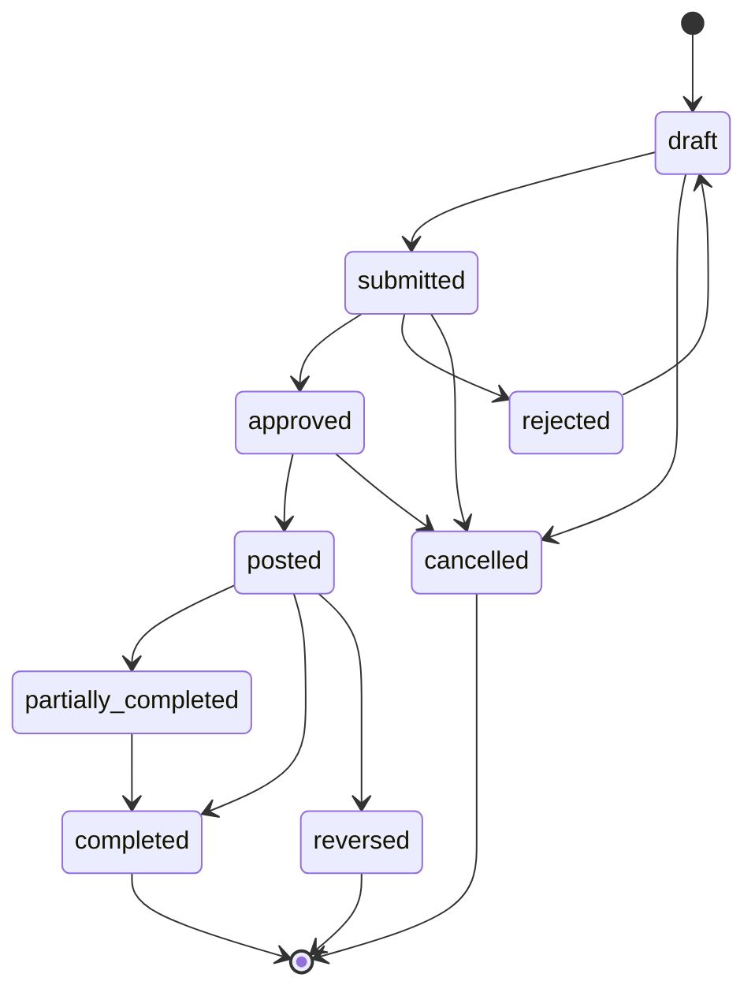

# ERP Core — Diseño funcional y de producto

## Control del documento

| Campo | Valor |
|---|---|
| Estado | `scope de Products aprobado; gate visual conceptual aprobado; plan de implementación pendiente de aprobación` |
| Suite / módulo | ERP / Core capability map |
| Run | `MOD-CORE-20261024-001` |
| Discovery | `discovery.md` (attempt 2, partial) |
| Ledger | `delivery-ledger.json` (draft) |
| Mercado confirmado | Pymes de distintos sectores |
| Primer release | Products, categorías y coste de compra unitario de referencia; clientes e integraciones quedan para follow-up |

Este diseño propone una suite ERP modular y sector-neutral. No aprueba un ERP
completo ni convierte todos los módulos candidatos en el primer release.
Discovery y los análisis de dominio, acceso, API y sincronización registran
las decisiones aprobadas y sus gaps de evidencia; la implementación queda
condicionada a un plan completo y explícitamente aprobado.

### 1. Resumen del módulo

- **Propósito:** establecer una base operativa modular para pymes de distintos
  sectores; el primer release se limita a Products y categorías.
- **Problema de negocio:** LoopDev tiene una implementación parcial de
  productos y servicios, expuesta hoy como catálogo ERP, y casos
  comerciales distintos, pero carece de un mapa aprobado que conecte datos
  maestros, procesos y responsabilidades sin duplicar CRM o Platform. La
  primera entrega validada será el maestro Products y su taxonomía.
- **Actores:** owner/admin y operadores con `catalog.read` o `catalog.write`;
  otros roles y usuarios de ventas, proveedores, compras, inventario, finanzas
  y canales externos pertenecen a follow-up. El cliente público de storefront
  queda fuera del ERP autenticado.
- **Incluido en el primer release:** Products y categorías, variantes/SKUs,
  ofertas, listas y entradas de precio, coste de compra unitario de referencia
  por producto/SKU y atributos físicos estructurados para artículos físicos,
  en web escritorio y móvil. La ficha completa de producto/SKU usa páginas;
  los drawers quedan para altas/ediciones rápidas de datos auxiliares. Productos
  sustituye Catálogo como módulo visible y conserva la implementación actual
  como compatibilidad técnica.
- **Fuera de alcance de este release:** Shopify, storefront/pedidos Inhand,
  Proveedores, Ventas, Compras, Inventario, Finanzas, Reporting, iOS/Android,
  caché/cola offline remota, exportación, valoración contable/de inventario,
  coste de fabricación, cálculo de márgenes y borrado permanente. El coste
  aprobado es solo una referencia unitaria de compra, no un dato contable.
  Fabricación, nóminas y WMS avanzado requieren discovery y aprobación futuros.
- **Supuestos:** el tenant canónico es una organización; CRM sigue siendo
  propietario de la relación e historial del cliente; algunas pymes no
  gestionan inventario físico; canales externos pueden seguir siendo sistemas
  de registro.
- **Dependencias abiertas:** inventario autorizado de datos legados y
  aprobación del contrato de auditoría por Platform. País, impuestos, Shopify,
  Inhand y otros módulos se resolverán en follow-up.

### 2. Benchmark de mercado

Fuentes oficiales consultadas el 2026-10-24. Se usan para contrastar patrones,
no como evidencia de implementación ni como lista automática de requisitos.

| Plataforma | Capacidades relevantes | Diferenciadores | Elementos aplicables a LoopDev |
|---|---|---|---|
| Odoo Sales / Inventory | Cotización, pedidos, entrega/factura; productos/variantes, almacenes, recepción, reserva y movimientos | Suite amplia conectada entre ventas e inventario | Separar catálogo, venta y stock; enlazar documentos sin replicar maestros |
| Microsoft Dynamics 365 Business Central | Movimientos de inventario asociados a ventas/compras, ubicaciones, ajustes, reservas y coste | Integración operacional y contable de los movimientos | Historial auditable e IDs de origen; evitar requerir libro mayor para validar el primer slice |
| SAP Business One | ERP para SMB con finanzas, ventas, compras, inventario, partners, servicio, producción y analítica | Procesos integrados de extremo a extremo | Modularidad y procesos conectados; no copiar amplitud ni complejidad enterprise |

Fuentes: [Odoo Sales](https://www.odoo.com/documentation/19.0/applications/sales/sales.html),
[Odoo Inventory](https://www.odoo.com/documentation/19.0/applications/inventory_and_mrp/inventory.html),
[Business Central Inventory](https://learn.microsoft.com/en-us/dynamics365/business-central/inventory-manage-inventory),
[SAP Business One](https://learning.sap.com/courses/managing-logistics-in-sap-business-one/introducing-sap-business-one).

- **Baseline común:** datos maestros compartidos; documentos comerciales
  trazables; ventas conectadas con entrega/facturación; compras conectadas con
  recepción; inventario derivado de operaciones auditables.
- **Avanzado:** valoración contable, reservas complejas, multi-almacén,
  fabricación, consolidación multi-compañía, forecasting y conectores
  profundos.
- **No MVP por defecto:** replicar una suite contable estatutaria, un WMS,
  fabricación, nómina, predicción o todas las integraciones de referencia.

### 3. Encaje en LoopDev

- **Suite propietaria:** ERP. Productos es el módulo propietario de los
  productos y servicios maestros;
  Proveedores, Ventas, Compras, Inventario, Finanzas y Reporting son bounded
  contexts separados. La separación de Proveedores está confirmada; su
  prioridad y fecha de entrega siguen abiertas. Los storefronts son canales
  públicos consumidores de contratos, no páginas administrativas ERP.
- **Módulos afectados:** CRM (referencias de clientes y contexto comercial),
  Platform (organización, permisos, UI y colaboración), Communications
  (notificaciones futuras), ERP y los canales Shopify/Inhand.
- **Estado de rutas:** existen `/app/erp/overview` y la ruta legacy
  `/app/erp/product-catalog`. La ruta canónica propuesta para el módulo es
  `/app/erp/products`; todavía no está implementada. Los enlaces legacy deberán
  conservarse mediante redirección compatible durante la migración. Rutas como
  `/app/erp/suppliers`, `/app/erp/sales`, `/app/erp/procurement`,
  `/app/erp/inventory`, `/app/erp/finance`, `/app/erp/reports` e
  `/app/erp/integrations` son propuestas, no runtime existente.

| Capacidad o módulo | Decisión | Contrato existente | Integración | ¿Se extiende? | ¿Se prohíbe duplicar? |
|---|---|---|---|---:|---:|
| Organization scope / tenant | `REUSE` | `organization_id`; tenancy/RLS references de Platform | Todas las entidades ERP se acotan a organización; verificar enforcement fuente/runtime | No, salvo gap probado | Sí: membership y tenant local |
| CRM Contacts / Customer 360 | `REUSE` | CRM contacts/customer context | ERP guarda referencias estables; sincronización de identidades por resolver | Solo si contrato compartido insuficiente | Sí: cliente e historial relacional |
| Notes | `REUSE` | `PlatformNotesPanel`, `NoteEditorDrawer`, dominio Platform | Relación con registros ERP usando `EntityRef` | No | Sí: editor o persistencia de notas |
| Files | `REUSE` | `FilePicker`, `FilesDropzone`, `FilePreview`, `RelatedFilesPanel`, dominio Files | Adjuntos de documentos ERP mediante referencia compartida | No | Sí: uploader, preview y cola |
| Tasks / Activity / Timeline | `REUSE` | Workspace de Tasks y componentes Platform | Asignaciones/actividad enlazadas a entidad ERP | No | Sí: timeline, task widget o auditoría paralela |
| Relations | `REUSE` | Relaciones y `EntityRef` Platform | Navegación entre orden, contacto, producto y organización | No | Sí: grafo de relaciones local |
| Document Intelligence Core | `REUSE` | Contrato Core aprobado; composición cross-suite existente como intención | Extracción/revisión de facturas o documentos solo si se aprueba el caso de uso | No en ERP; posible extensión Core vía aprobación | Sí: extractor, lifecycle o historial documental |
| Rivera UI / navegación | `REUSE` | `PageContainer`, `PageHeader`, `DataTable`, common states, Shell y sidebar | Renderers desktop/mobile consumen significado compartido | Extender Platform solo con gap cross-suite aprobado | Sí: design system, shell o selector nativo |
| ERP Products | `REUSE` con reconciliación | `CatalogAdapter`, tipos, ruta y migración legacy existentes (paridad parcial) | ERP posee identidad de producto/servicio; CRM/canales referencian IDs | Contrato/capacidad pendiente de auditoría | Sí: duplicar maestros por canal |
| ERP Suppliers | `MODULE_SPECIFIC`; módulo independiente confirmado y diferido | No hay contrato funcional aprobado | Futuro: ERP posee la ficha; Compras referencia su ID estable; relaciones con CRM por resolver | No antes de identificar gap transversal | Sí: duplicar el maestro de proveedor dentro de Compras |
| Ventas, compras, inventario, finanzas, reporting | `MODULE_SPECIFIC` como dominios; alcance `BLOCKED` para primer release | No hay contratos funcionales aprobados | Contextos separados conectados por referencias y eventos versionados | No antes de identificar gap transversal | Sí: reglas en páginas o adapter de otro módulo |
| Conexión Shopify | `MODULE_SPECIFIC` follow-up sobre boundary compartido | No existe conector verificado | Futuro: adapter por proveedor y política por entidad | Contrato compartido solo si aplica a otros proveedores | Sí: clonar el dominio ERP para Shopify |
| Storefront Inhand | `MODULE_SPECIFIC` follow-up de canal público independiente | No existe backend de pedidos/storefront verificado | Futuro: API pública restringida a catálogo publicado y comandos de checkout | Platform/API pública requiere diseño de seguridad propio | Sí: reglas de stock/precio/pedido en el renderer |

| Módulo origen | Módulo destino | Interacción | Trigger | Datos compartidos | Permisos |
|---|---|---|---|---|---|
| ERP Products | CRM | Referenciar producto/oferta desde contexto comercial | Selección en una oportunidad | IDs/versiones de producto | Lectura de producto + permiso CRM |
| ERP Sales | CRM | Asociar comprador a contacto existente | Creación/importación de documento | `contact_id`, referencia externa | Permiso ERP + permiso de enlace CRM |
| ERP Suppliers | ERP Procurement | Compras selecciona un proveedor existente; el módulo proveedor conserva su perfil | Creación/edición de orden de compra | `supplier_id`, organización, versión y referencias de contacto si aplican | Lectura de proveedor + permiso de compras |
| ERP Sales | ERP Inventory | Solicitar disponibilidad/reserva cuando se apruebe | Confirmación de pedido | SKU/variant, location, cantidad, versión | Ventas + inventario |
| ERP Procurement | ERP Inventory | Recibir compras como movimientos | Recepción aprobada | Purchase order, item, location, cantidad | Compras + recepción |
| ERP Finance | ERP Sales / Procurement | Referenciar facturas y pagos; no reescribir el documento de origen | Emisión/reconciliación | IDs, totales/currency snapshots, referencias externas | Finanzas explícito; segregación de datos sensibles |
| Shopify adapter | ERP Products / Sales | Importar o reconciliar datos autorizados | Webhook, pull programado o acción (mecanismo abierto) | Provider ID, external ID, versión, sync result | Integración manage + scope organización |
| ERP Commerce API | Storefront Inhand | Leer productos publicados y enviar compra | Navegación/checkout público | Campos públicos, carrito/pedido, resultado proveedor | Políticas públicas antiabuso; nunca permisos admin |

### 4. Actores, casos de uso y UX

Vistas candidatas, no wireframes aprobados:

- **Overview:** existe como superficie actual, pero su rediseño no forma parte
  del primer release salvo que una dependencia de navegación lo requiera.
- **Productos:** lista unificada como entrada directa del módulo; distingue
  productos terminados, materias primas/componentes y servicios, con filtros
  por clase y categoría. El árbol de categorías también se administra dentro
  de Productos. Cada producto tiene una categoría principal en una jerarquía.
  Su clase no determina si se compra, vende o controla en inventario:
  esos usos se combinan de forma independiente. El producto define si se
  abastece comprándolo, fabricándolo o por ambos medios; sus variantes heredan
  esa regla. No se muestra un índice separado de catálogos. La agrupación
  técnica existente puede conservarse internamente hasta resolver su destino.
  Cada variante/SKU tiene su propia categoría; el producto base conserva una
  categoría general. El detalle y la creación/edición de productos y SKUs usan
  páginas completas con secciones para identidad, clasificación, coste de
  compra de referencia y atributos físicos. Un producto sin SKUs administra
  su coste de referencia; cuando hay SKUs, cada SKU puede mostrar su propio
  coste. Categoría y marca admiten alta rápida en drawer sin perder el draft;
  la gestión jerárquica completa de categorías permanece en una vista dedicada.
  Las reglas de herencia de coste/atributos, la administración completa de
  marcas/etiquetas y sus permisos requieren análisis antes de implementar.
  Los semielaborados quedan fuera hasta descubrir Fabricación.
- **Proveedores (follow-up):** espacio separado para consultar y gestionar proveedores;
  alcance de ficha, contactos, estados y acciones por definir antes del diseño
  de sus vistas.
- **Ventas (follow-up):** bandeja de cotizaciones/pedidos si el alcance se aprueba; detalle
  con cliente, líneas versionadas, historial y acciones autorizadas.
- **Compras (follow-up):** órdenes y recepción enlazada a proveedor; políticas y roles por
  definir.
- **Inventario (follow-up):** saldos por ubicación, movimientos y reservas; no presentar
  disponibilidad como stock físico si solo proviene del canal.
- **Finanzas (follow-up):** facturas/reconciliación únicamente tras definir país, proveedor
  y frontera con contabilidad.
- **Integraciones (follow-up):** conexión, permisos, salud, estado por entidad, reintento
  seguro y reconciliación; secretos solo en backend.
- **Reporting (follow-up):** filtros, periodos, exportación permitida y trazabilidad de
  origen.

Flujos de creación, aprobación, bulk actions, exportación y cierre dependen de
la aprobación de cada módulo. Products requiere loading, empty, error,
forbidden, conflict, offline, pending y success; en remoto, offline significa
servicio no disponible y no lectura cacheada. Desktop y mobile web consumen el
mismo catálogo de operaciones; navegación directa, refresh, back, touch y focus
deben conservar el significado. iOS/Android quedan diferidos. El gate visual
conceptual ya está aprobado; runtime evidence queda para verificación.

### 5. Máquina de estados y ciclo de vida

Máquina de referencia para documentos transaccionales; es una propuesta para
comparar contextos, no un lifecycle común que todas las entidades deban
implementar. `02-domain` debe definir estados y transiciones por agregado.

| Estado | Tipo | Entrada permitida | Salidas | Actor | Validaciones | Evento |
|---|---|---|---|---|---|---|
| `draft` | Inicial | Crear o editar documento sin efectos externos | `submitted`, `cancelled` | Operador autorizado | Scope, líneas, moneda y campos requeridos | `erp.document.drafted` (propuesto) |
| `submitted` | Intermedio | Enviar para aprobación/confirmación | `approved`, `rejected`, `cancelled` | Operador/manager | Versión actual; límites de aprobación | `erp.document.submitted` |
| `approved` | Intermedio | Aprobar explícitamente | `posted`, `cancelled` | Aprobador independiente cuando aplique | Permiso, segregación de funciones, invariantes | `erp.document.approved` |
| `posted` | Intermedio irreversible por defecto | Registrar operación externa/contable/stock | `partially_completed`, `completed`, `reversed` | Servicio o actor autorizado | Idempotencia, periodo y versión | `erp.document.posted` |
| `partially_completed` | Intermedio | Recepciones, entregas o pagos parciales | `completed`, `reversed` | Operador de módulo | Cantidades/totales no exceden saldo | `erp.document.progressed` |
| `completed` | Terminal (reapertura solo por regla explícita) | Cumplimiento total del documento | `reopened` solo por regla explícita | Sistema/manager | Evidencia de cierre; permisos de reapertura | `erp.document.completed` |
| `rejected` | Intermedio | Rechazo con motivo | `draft` (revisión) o `cancelled` | Aprobador/creador | Motivo y auditoría | `erp.document.rejected` |
| `cancelled` | Terminal | Cancelación antes de posting o compensación explícita | Ninguna; nuevo documento para corregir | Manager autorizado | No borrar efectos publicados; motivo obligatorio | `erp.document.cancelled` |
| `reversed` | Terminal contable | Compensar operación publicada | Ninguna; documento compensatorio | Finanzas/admin autorizado | Referencia a original y periodo abierto | `erp.document.reversed` |

Los eventos son nombres de diseño, no eventos implementados. Entrega,
facturación y reserva de stock requieren reglas de dominio separadas.

### 6. Modelo de datos funcional

Esquema conceptual que será refinado por `02-domain`; no es una migración
aprobada.

| Entidad | Owner propuesto | Relaciones/invariantes |
|---|---|---|
| `Organization` | Platform | Organización canónica; la UI no decide el tenant |
| `CatalogItem` (modelo técnico actual; maestro conceptual de producto), `ProductCategory` (propuesta), `Variant`, `Offer`, `PriceBook` | ERP Products | El maestro tiene una clase (terminado, materia prima/componente o servicio), usos independientes (comprable, vendible, inventariable), una categoría general y una regla de abastecimiento. Cada SKU variante tiene categoría propia; hereda el abastecimiento. `OrganizationCatalog` es solo origen de migración; moneda pertenece a `PriceBook`; locale/canales se preservan como provenance y quedan diferidos. |
| `PartyRef` | CRM para clientes/contactos; ERP Suppliers para el rol de proveedor | Referencias por ID; no duplica el historial de relación ni identidad de cliente de CRM |
| `Supplier` | ERP Suppliers | Perfil de proveedor independiente; scope, campos, lifecycle y relación con contactos CRM quedan para discovery de dominio |
| `SalesDocument` / `SalesLine` | ERP Sales o canal externo según ownership | Cabecera 1:N líneas; líneas referencian ID/version de item y snapshot de cantidad/precio/impuestos |
| `PurchaseOrder` / `PurchaseLine` | ERP Procurement | 1:N; `supplier_id` referencia ERP Suppliers; recepciones parciales se aplican sin exceder lo permitido |
| `StockLocation`, `StockMovement`, `StockReservation` | ERP Inventory | Movimiento append-only; saldo derivado; reserva no produce stock disponible negativo bajo política aprobada |
| `Invoice` / `PaymentReference` | ERP Finance o proveedor externo según jurisdicción | No almacenar PAN/CVV; conservar external refs y snapshots; reversión auditable |
| `ChannelConnection`, `ExternalMapping`, `SyncRun` | Integration boundary por definir | External ID único por organización/proveedor/recurso; no guardar secretos en cliente |
| `AuditEvent` | Platform audit capability si aplica; de otro modo propuesta compartida | Actor, organización, acción, timestamp, entity ref y cambios redactados |

Toda entidad de negocio debe tener ID estable, `organization_id`, timestamps,
versión optimistic-concurrency y owner explícito. Las relaciones usan IDs, no
copias de datos vivos; snapshots transaccionales preservan valores históricos.
No hard-delete documentos posteados: archivar o emitir compensación según
política. La persistencia local actual puede usar adapters existentes; la
representación remota y constraints/RLS se especificarán tras el gate visual.

### 7. Requerimientos funcionales

Complejidad `S/M/L/XL` es relativa a un módulo local-first y no equivale a una
estimación de calendario. Los IDs `CAP-*` se conservan del ledger.

#### Nivel 1 — Core Operativo / MVP aprobado

Solo Products y categorías están aprobados para este release. Las demás filas
son capacidades de follow-up preservadas en el ledger; no forman parte del
alcance de implementación actual.

| ID | Capacidad | Prioridad | Dependencias | Complejidad | Criterio de aceptación |
|---|---|---|---|---|---|
| `CAP-ERP-CATALOG` | Products: maestro de items, variantes/SKUs, ofertas, libros/precios, coste unitario de compra de referencia y atributos físicos; categorías vinculadas | P0 approved | Permisos/tenant; permiso sensible de coste; Platform audit; RLS/adapter; migration dry-run | M/L | Acciones aprobadas operan sobre un único organization-scoped master, con generated keys, clases/usos/sourcing, coste no contable explícitamente autorizado, atributos físicos y archivo/restauración |
| `CAP-ERP-PRODUCT-CATEGORIES` | Árbol jerárquico dentro de Products; categoría general en producto y asignación independiente por SKU | P0 approved | Products contract; permissions; category persistence and migration | M | Usuarios autorizados listan, crean, mueven, archivan y restauran categorías sin ciclos ni borrado permanente; mobile y desktop comparten operaciones |
| `CAP-MIAUCRAFT-SHOPIFY` | Conectar Shopify sin reemplazarlo | Follow-up; not in this release | Descubrimiento de cliente, mapeo por entidad, credenciales backend, idempotencia | L/XL | Propiedad/operaciones aprobadas por MiauCraft; sync segura, observable y recuperable |
| `CAP-ERP-SALES` | Documentos de venta y ciclo de pedido | Follow-up | Productos, CRM identity, reglas fiscales | L | Cotización/pedido trazable con snapshots; transiciones y permisos validados |
| `CAP-ERP-INVENTORY` | Inventario opcional para bienes físicos | Follow-up | Productos, ventas y recepción | L | Movimientos auditables; disponibilidad y reserva concurrente nunca sobre-venden |
| `CAP-ERP-PROCUREMENT` | Compras y recepciones | Follow-up | Proveedores, Productos, inventario | L | Orden aprobada y recibo parcial actualizan referencias y cantidades de manera idempotente |
| `CAP-ERP-FINANCE` | Facturación y conciliación de pagos, no ledger completo | Follow-up; jurisdiction blocker | Ventas/compras, país, proveedor | XL | No se emite ni reconcilia sin reglas fiscales y ownership aprobados |
| `CAP-ERP-REPORTING` | Consultas operativas autorizadas | Follow-up | Read models, tenant/RBAC, paginación | M | Filtros/exportaciones muestran solo datos permitidos y registran export |

#### Módulo independiente con prioridad abierta

| ID | Capacidad | Prioridad | Dependencias | Complejidad | Criterio de aceptación |
|---|---|---|---|---|---|
| `CAP-ERP-SUPPLIERS` | Gestión independiente de proveedores | Separación confirmada; diferido | Organization scope; límites CRM; Compras cuando se habilite | TBD | Proveedor tiene identidad ERP propia; Compras lo referencia sin duplicar su perfil; alcance funcional queda aprobado antes de implementación |

#### Nivel 2 — Automatización y colaboración

| ID | Capacidad | Prioridad | Dependencias | Complejidad | Criterio de aceptación |
|---|---|---|---|---|---|
| `CAP-MIAUCRAFT-SHOPIFY` | Webhooks, automatización de sync y reconciliación avanzada | P2 follow-up | Contrato inicial aprobado, outbox/inbox, auditoría | XL | Replay y recuperación seguros; eventos duplicados o tardíos no revierten estado |
| `CAP-ERP-SALES` | Reglas de aprobación y notificaciones | P2 | Lifecycle, permissions y Platform activity/tasks | L | Regla versionada; ejecución duplicada no repite efecto |
| `CAP-ERP-PROCUREMENT` | Recordatorios de recepción/aprobación | P3 | Compras, tareas/notificaciones Platform | M | Recordatorio respeta permisos, zona horaria y estado terminal |
| ERP collaboration | Notes, Tasks, Files y Activity sobre entidades ERP | P2 | Contratos Platform existentes | S/M | Componentes compartidos funcionan; no hay editor/uploader/timeline local |

#### Nivel 3 — Enterprise, analítica e IA

| ID | Capacidad | Prioridad | Dependencias | Complejidad | Criterio de aceptación |
|---|---|---|---|---|---|
| `CAP-ERP-FINANCE` | Multi-moneda, consolidación y ledger | Future / enterprise | País, accounting policy, auditoría | XL | Cálculos reproducibles; cierres y reversos probados por jurisdicción |
| `CAP-ERP-REPORTING` | Forecasting, dashboards y métricas avanzadas | Future | Datos suficientes, privacidad, modelo analítico | XL | Métricas tienen definiciones, lineage y acceso evaluado |
| ERP integrations | Automatización multi-provider y API partners | Future | Shared integration contract | XL | Cada provider cumple contrato, límites y pruebas de fallos |
| Document Intelligence | Captura/extracción documental | Future | Caso aprobado; Document Intelligence Core | L/XL | Reusa Core y expone resultados versionados; no crea lifecycle paralelo |
| ERP administration | Multi-company, delegación profunda y políticas avanzadas | Future | Entitlements y modelo organization/brand aprobado | XL | Acceso evaluado por organization y entidad; export/audit verificables |

### 8. API, eventos y backend

`api-contracts.md` es el contrato lógico aprobado para planificar Products;
no representa rutas HTTP ni implementación. Las operaciones de ventas,
proveedores, compras, inventario, finanzas, canales y reporting son solo
referencias de follow-up, no contratos del primer release.

- **Servicios/casos de uso:** `ProductsService` (propuesto; el adapter técnico
  actual sigue llamándose `CatalogAdapter`), `SalesDocumentService`,
  `SupplierService`, `ProcurementService`, `InventoryService`, `FinanceService`,
  `ChannelSyncService`, `ReportingQueryService`; separarlos por ownership,
  evitar un ERP mega-service.
- **Comandos/queries Products:** conservar `catalog.list/manage` como IDs de
  compatibilidad y usar `catalog.write` como permiso canónico para mutaciones;
  los contratos detallados están en `api-contracts.md`;
  `sales.document.list/create`, `sales.order.transition`,
  `supplier.list/manage`,
  `procurement.purchase_order.create`, `procurement.receipt.record`,
  `inventory.movement.record`, `inventory.reservation.manage`,
  `finance.invoice.issue`, `finance.payment.reconcile`,
  `channel.connect/sync/reconcile`, `erp.report.view/export`.
- **DTOs:** comandos con `organizationId` resuelto/validado en servidor,
  `actorId`, `expectedVersion`, idempotency key y campos de negocio; no confiar
  en tenant del cliente ni aceptar totales derivados sin verificación.
- **Transacciones/constraints:** unicidad por organización y external ID;
  compare-and-swap por versión; recepción/reserva/invoice posting transaccional;
  ledger de inventario inmutable si se aprueba.
- **Eventos candidatos:** `erp.sales.document.created`,
  `erp.inventory.movement.posted`, `erp.procurement.receipt.recorded`,
  `erp.finance.invoice.issued`, `erp.channel.sync.completed`. Payload mínimo:
  ID, organization, versión, actor/sistema, timestamp y referencias; sin PII
  innecesaria.
- **Idempotencia/retry:** clave por operación/proveedor, outbox/inbox si se
  aprueba backend; retries con backoff y dead-letter visible; no repetir
  posting por reintento.
- **Transporte:** mantener Supabase detrás del adapter existente; paginación
  cursor-based; límites por organización; no cachear datos remotos para uso
  offline. No ejecutar trabajos de sincronización dentro del renderer.
- **Observabilidad:** correlation ID, métricas de duración/errores/retries,
  logs redactados y auditoría de mutaciones. No exponer secretos ni cuerpos
  completos de proveedores.

### 9. Matriz RBAC y reglas de negocio

La tabla describe perfiles futuros y no sustituye el contrato de permisos
actual. Para este release aplican las decisiones y acciones de
`access-model.md`: `catalog.read` ve productos/precios; `catalog.write`
gestiona y archiva/restaura; delete/export, valoración contable y márgenes no
están disponibles. El coste de compra de referencia requiere autorización
explícita separada antes de mostrarse; `catalog.read` no lo concede por defecto.

| Acción | Admin | Manager | Usuario | Solo lectura |
|---|---:|---:|---:|---:|
| Ver datos permitidos | Sí | Sí | Asignados/equipo | Sí |
| Crear documentos | Sí | Sí | Según módulo | No |
| Editar borradores | Sí | Sí | Propios/asignados | No |
| Asignar usuarios | Sí | Según equipo | No | No |
| Aprobar/postear | Sí, con segregation policy | Según límite | No por defecto | No |
| Exportar | Sí, auditado | Permiso explícito | No por defecto | No |
| Archivar/cancelar | Sí, motivo/audit | Según estado | No por defecto | No |
| Reabrir/revertir | Permiso especial | Permiso especial | No | No |
| Administrar integraciones/automatizaciones | Sí | Delegable explícito | No | No |
| Ver pagos, datos fiscales o documentos sensibles | Permiso granular | Permiso granular | Need-to-know | No |

- **Visibilidad:** organization obligatoria; equipos/asignaciones son filtros de
  autorización posteriores, no sustitutos de aislamiento. Cache local debe
  invalidarse al perder membresía/permisos.
- **Asignación:** no asignar fuera de organization/equipo permitido; asignado
  puede ejecutar solo operaciones concedidas.
- **Corner cases:** dos operadores reservan la última unidad; evento Shopify
  llega duplicado o fuera de orden; usuario pierde permiso con cambios offline
  pendientes; documento ya posteado se cancela por pedido duplicado; contacto
  externo coincide con varios CRM records. En cada caso bloquear el efecto
  irreversible y ofrecer reconciliación/auditoría.

### 10. Arquitectura frontend

- **Rutas actuales:** `/app/erp/overview` y la ruta legacy
  `/app/erp/product-catalog`. La ruta canónica propuesta es
  `/app/erp/products`; el build deberá migrar la navegación y conservar una
  redirección compatible de deep links. La ruta de Proveedores y las de ventas, compras, inventario, finanzas,
  reporting e integraciones son propuestas hasta aprobar scopes.
- **Composición:** LoopDev AppShell + rutas definidas en
  `src/routes/LoopdevRoutes.tsx`; `PageContainer`, `PageHeader`, `PageTabs`,
  `DataTable`, `EmptyState`, `LoadingState`, `FormSection`, `FormSectionNav`,
  `ConfirmDialog` y primitivas `src/components/ui/*` como reuse candidates
  verificados en la referencia Platform. Producto/SKU se muestran y editan en
  páginas completas; `AppDrawer` se reserva para altas/ediciones rápidas de
  datos auxiliares y preview breve, no para sustituir la ficha.
- **Dominios/hook/adapter:** página → hook/caso de uso → contrato de dominio →
  port → adapter local o remoto. Los componentes no contienen reglas, SQL,
  política de canal ni lógica de permisos. Interfaces propuestas: `Erp*`,
  `Sales*`, `Supplier*`, `Inventory*`, `Procurement*`; naming final en design
  review.
- **TypeScript:** IDs nominales, `OrganizationId`, `EntityRef`,
  `expectedVersion`, `Money` con currency explícita, cantidades decimales con
  unidad, `Result<T, DomainError>`; no representar dinero con float binario.
- **Mutaciones:** pessimistic para aprobación, posting, reserva y sync;
  optimistic solo para borradores no financieros con rollback visible. Conflicto
  conserva cambios locales y solicita reload/rebase explícito.
- **Plataformas:** desktop y mobile web comparten acciones/validaciones;
  mobile adapta navegación, densidad y touch sin cambiar semántica. Native
  permanece planificado hasta decisión y owner.
- **Pruebas:** dominio y adapter por contrato; componente para acciones/estados;
  navegación y deep links; responsive/accessibility; visuales solo tras aprobar
  `visual-design.md`. Ninguna ruta candidata cuenta como implementada.

### 11. Persistence and synchronization

Products has two explicit, non-fallback modes:

- `local_demo`: seeded local-only data for demo use; storage read/write errors
  must be visible and cannot be reported as successful saves.
- `supabase`: organization-scoped remote source of truth; reads and mutations
  require an online server response. No remote read cache, offline mutation
  queue or fallback to demo fixtures is permitted in this release.

Adapter selection must come from explicit runtime configuration and fail
closed when missing or invalid; organization ID shape is not a mode selector.
Remote mutations require server authorization, `expectedVersion`, idempotency
for creates, operation-specific RLS and an append-only shared Platform audit
record in the same transaction. A failed audit write fails the mutation.
Storage/deployment parity, version fields, category persistence and the
forward migration must be verified before remote writes are enabled.

The migration process is dry-run first: obtain an authorized source inventory,
preserve legacy IDs/values as provenance, report duplicate keys/SKUs,
workspace visibility expansion, category mapping gaps and currency
mismatches, then require review before any cutover. No automatic class/category
mapping, workspace-wide data rewrite or destructive migration is permitted.
The UI distinguishes online/unavailable from business status and never labels
local demo data as remotely saved.

### 12. Implementation sequence

This is the proposed sequence for the approved Products/categories release.
It does not authorize build; `implementation-plan.md` and the ledger must be
approved first.

| Fase | Objetivo | Frontend | Backend | Datos/Sync | Validación |
|---|---|---|---|---|---|
| 1. Pre-build audits and shared contracts | Complete environment, Platform reuse, architecture, responsibility, legacy, route, state, operation, accessibility and security audits | No renderer implementation | Confirm audit owner and API/persistence boundaries | Explicit mode, online-only, archive-only, migration dry-run contract | Audits and shared Product/category contract accepted |
| 2. Platform audit capability | Implement the approved append-only audit contract before consumer writes | No Products mutation UI enabled | Shared audit adapter/schema and atomic persistence | Forward migration and rollback plan | Platform contract approval, tests, transaction failure rollback |
| 3. Products persistence and security | Explicit adapter mode, surfaced demo storage failures, version/idempotency, operation-specific RLS and `catalog.write` | Existing flows remain disabled from remote mutation until gates pass | Supabase mapping and permission parity | Forward-only migration, no DELETE, shared audit | RLS, adapter-contract, idempotency and cross-tenant tests |
| 4. Product/category domain | Implement approved classes, SKU/key/category/sourcing/currency/archive rules | Shared action contract, forms/list/detail and category view | Domain/use cases and category data access | Dry-run legacy mapping; no guessed class/category assignment | Domain and migration tests; mapped records reviewed |
| 5. Desktop and mobile web | Complete parity for every approved operation using same semantic contract | Rivera-based desktop/mobile interactions, routes and states | No renderer-owned domain behavior | No offline remote cache/queue | Focused component tests, a11y/i18n/responsive tests and route evidence |
| 6. Verification and rollout | Verify remote state, runtime, rollback and acceptance evidence | Direct-route/runtime screenshots after implementation | Tenant isolation and audit evidence | Authorized migration preflight; no deployment without approval | Requirement matrix, desktop/mobile verdicts, release decision |

Cada fase necesita issues con propietario, dependencias reales, criterios de
aceptación y comandos de validación antes de `module-plan`.

### 13. Test strategy and acceptance criteria

No se afirma cobertura funcional de módulos candidatos. Los tipos de prueba
son gates futuros:

- **Dominio/backend:** invariantes, transiciones inválidas, constraints,
  idempotencia, concurrencia, eventos, reintentos, API errors y RLS entre dos
  organizaciones.
- **Frontend:** rutas, creación/edición/asignación/transición, permisos, drawers,
  responsive, teclado, focus restoration, screen reader e i18n/RTL.
- **Local-first:** persistencia tras reload, mutaciones pending, pérdida de
  autorización, conflicto de versión, error remoto, reintento y migración.
- **Visual/regresión:** overview, listas, detalle y estados desktop/mobile;
  comparación contra fuente visual aprobada después de implementación.
- **Integración:** payload duplicado/fuera de orden, timeout, rate limit,
  proveedor sin autorización, sync parcial y conciliación.

| ID | Requisito/capacidad | Tipo de test | Caso de éxito | Caso de fallo | Evidencia |
|---|---|---|---|---|---|
| `CAP-ERP-CATALOG` | Módulo Productos (contrato técnico legacy `catalog.*`) | Adapter + component + permission | CRUD permitido respeta scope/versión | permiso revocado o remote mismatch bloquea y explica | Test adapter actual existe; remote parity pendiente |
| `CAP-ERP-SALES` | Venta/pedido | Domain + RLS + component | Documento válido transiciona y conserva snapshot | versión stale/permiso ausente no modifica | A definir en 02/03/04 |
| `CAP-ERP-PROCUREMENT` | Compra/recepción | Domain + integration | Recepción parcial se aplica una vez | evento duplicado no duplica cantidades | A definir |
| `CAP-ERP-INVENTORY` | Stock/reserva | Concurrency + RLS | Reserva dentro de disponible | dos reservas simultáneas no sobre-venden | A definir |
| `CAP-ERP-FINANCE` | Factura/pago | Contract + jurisdiction + security | Resultado external ref reconciliado una vez | provider error no marca factura pagada | Bloqueado por país/ownership |
| `CAP-ERP-REPORTING` | Reporte/export | Query + permission + component | Solo datos autorizados, export auditado | acceso no permitido no filtra existencia | A definir |
| `CAP-MIAUCRAFT-SHOPIFY` | Canal Shopify | Provider contract + integration | Sync aprobado es idempotente y recuperable | payload viejo no sobrescribe versión nueva | Bloqueado por mapeo cliente |
| `CAP-INHAND-COMMERCE` | Commerce nativo | Journey + concurrency + payment contract | checkout coordina pedido/stock/proveedor | pago rechazado libera/gestiona reserva según regla | Futuro tras MiauCraft |

| Superficie | Loading | Empty | Error | Forbidden | Conflict | Offline | Pending | Success |
|---|---:|---:|---:|---:|---:|---:|---:|---:|
| ERP overview | Sí | Sí | Sí | Sí | Sí | Sí | Sí | Sí |
| Productos/lista | Sí | Sí | Sí | Sí | Sí | Sí | Sí | Sí |
| Documento/detalle | Sí | Sí | Sí | Sí | Sí | Sí | Sí | Sí |
| Integración/sync | Sí | Sí | Sí | Sí | Sí | Sí | Sí | Sí |
| Storefront público Inhand (otro scope) | Sí | Sí | Sí | N/A admin | Sí | Sí | Sí | Sí |

`Sí` significa estado requerido por diseño, no evidencia implementada. No se
identificó una UX legacy que este diseño autorice a reemplazar; no habrá dos
caminos activos sin una decisión de migración.

### 14. Seguridad, cumplimiento y operación

- Cada entidad de negocio usa `organization_id` resuelto server-side; RLS y
  tests negativos son obligatorios antes de declarar aislamiento. Los
  documentos de política no sustituyen evidencia de código/runtime.
- RBAC por acción, scope, equipo/asignación y sensibilidad. Revalidar permisos
  al ejecutar comandos, exportar y reintentar offline.
- Auditar cambios irreversibles, overrides, exportaciones, integración,
  aprobación y reconciliación; registrar valores redactados y actor.
- Minimizar PII; pagos por proveedor externo, sin datos de tarjeta en LoopDev;
  región, retención, facturación y obligaciones legales quedan bloqueadas por
  jurisdicción.
- El coste de compra de referencia no hereda automáticamente
  `catalog.read`; definir permiso, visibilidad y auditoría específicos antes
  de implementar o habilitar escrituras remotas.
- Métricas: tiempos de ciclo, errores de dominio, sync lag, retry/DLQ, stock
  discrepancy y export counts. Logs con correlation ID y sin secrets/PII.
- Rollout por capability/tenant flag; feature kill switch para escrituras y
  jobs; rollback a lectura/canal propietario; migraciones con estrategia
  reversible o forward-recovery documentada.
- Support runbook debe incluir replay seguro, reconciliación, restauración de
  permisos, bloqueo de integración y escalado por provider error.

### 15. Riesgos, decisiones y roadmap

**Decisiones confirmadas**

- ERP se dirige a pymes de distintos sectores; modularidad y sector-neutralidad
  son objetivos de producto.
- El primer release es Products y categorías en escritorio/móvil web, con coste
  de compra unitario de referencia y atributos físicos estructurados. Shopify,
  Inhand, Proveedores y los demás módulos quedan diferidos.
- Datos remotos Products son online-only: no hay cache offline ni cola de
  mutaciones; `local_demo` es un modo explícito y separado, no un fallback.
- Products y categorías son organization-wide y archive/restore-only. Los
  precios/ofertas siguen la decisión vigente de `catalog.read`; el coste de
  compra de referencia no es valoración contable ni margen y requiere una
  decisión de permiso separado antes de hacerse visible.
- Las mutaciones remotas no se habilitan hasta contar con autorización RLS
  correcta, `catalog.write`, versionado e idempotencia y auditoría Platform
  append-only atómica.
- `ERP-DEC-005` / `CR-ERP-PRODUCT-MASTER-MODEL`: Productos mantiene un maestro
  único con clases de producto terminado, materia prima/componente y servicio;
  los semielaborados esperan a Fabricación. Clase y usos (comprable, vendible,
  controlado en inventario) son dimensiones independientes. Cada producto tiene
  una categoría principal jerárquica; la regla de abastecimiento se define en
  el producto y se hereda por variantes. Solo se crea una variante cuando se
  gestiona o vende por separado, con SKU propio; los demás atributos son
  descriptivos.
- Proveedores será un módulo independiente de Compras, diferido de este
  release. Fabricación se deja fuera del roadmap actual y requerirá una
  decisión/discovery futura.
- El módulo se denomina **Productos** y la lista de productos/servicios es su
  entrada principal; se conserva `CAP-ERP-CATALOG` y el contrato técnico
  `catalog.*` para no romper trazabilidad ni compatibilidad.
- `CR-ERP-PRODUCT-EDITOR-COST-REFERENCE` (aprobada por @loopdev-io el
  2026-10-24): producto y SKU usan páginas completas; los drawers sirven para
  alta/edición rápida de referencias auxiliares. Se incluye coste unitario de
  compra de referencia por producto/SKU, no contable, sin valoración de
  inventario ni cálculo de margen.
- No duplicar CRM, Platform o reglas de negocio en canales públicos.

**Supuestos y decisiones abiertas**

- La aprobación del contrato de auditoría compartida pertenece al owner de
  Platform; remote writes siguen bloqueadas hasta implementación y verificación.
- La información remota real no está disponible en este checkout; requiere
  inventario autorizado y dry-run antes de mapear categoría, workspace o moneda.
- `OrganizationCatalog` queda como legado de migración; preservar locale/canal
  como provenance y diferir sus owners. La moneda se migra a `PriceBook`;
  `PriceEntry` la hereda y `Offer` no tiene moneda independiente.
- `ERP-DEC-006`: el producto base tiene una categoría general y cada variante/SKU
  tiene una categoría propia, que puede diferir de la del producto base y de
  otras variantes; la categoría no se hereda. Los borradores pueden no tener
  categoría, pero es obligatoria antes de activar. El sourcing sí se hereda,
  excepto que los servicios no tienen sourcing. Los productos terminados
  permiten buy/make/both; materias primas/componentes, solo buy por ahora.
- `ERP-DEC-007`: el SKU es único en toda la organización tras recortar
  espacios externos y comparar sin distinción de mayúsculas; conserva el caso
  ingresado. Las claves internas de productos, variantes y categorías son
  generadas, inmutables y únicas por organización.
- País, impuestos, facturas legales, moneda, B2B/B2C y fuente de pago están
  abiertos.
- La visibilidad del coste, su moneda/default, si el coste del producto base
  actúa como valor inicial de SKUs y el tratamiento de su historial/fuente
  siguen abiertos. El dato no se expondrá a `catalog.read` por defecto.
- La ubicación/herencia de peso y dimensiones entre producto base y SKU sigue
  abierta; los campos deben ser estructurados y limitados a artículos físicos,
  no texto libre ni atributos contables/de almacén.
- La administración de marcas y etiquetas como referencias controladas frente
  a texto libre, y si requiere una vista completa además de drawers rápidos,
  sigue abierta.
- MiauCraft debe definir entidades Shopify visibles, fuente por campo,
  direccionalidad y operaciones de escritura; default seguro: lectura hasta
  aprobación.
- Inhand requiere después especificar fulfillment, envío, devolución, reserva,
  reembolso y políticas de publicación.
- Al restaurar un producto o SKU archivado, siempre vuelve a `draft`; para
  volver a `active` debe superar de nuevo las validaciones de activación.

**Riesgos y dependencias**

- El runtime técnico sigue usando `catalog.manage` en RLS aunque la decisión
  canónica es `catalog.write`; requiere migración forward y verificación.
- El adapter sigue seleccionando local/remoto por forma del ID, y el storage
  local suprime fallos; ambos comportamientos deben corregirse antes de confiar
  en modo demo o escritura remota.
- Una arquitectura "para todos los sectores" puede convertirse en ERP sin
  límites; cada módulo necesita validación y release separado.
- Duplicar clientes, notas, tareas, documentos o reglas en ERP genera
  inconsistent systems; usar contracts Platform/CRM.
- Importar operaciones Shopify como transacciones propias sin source-of-truth
  explícito causa sobreescrituras, pedidos duplicados y errores de stock.
- Finanzas y datos fiscales requieren país, asesoría y provider; un payment
  status no es contabilidad.
- La extensión de auditoría Platform y el inventario de datos remoto son
  dependencias de aprobación/acceso; no se resuelven por inferencia.

**Roadmap aprobado para este run:** cerrar los audits y contrato compartido;
aprobar e implementar Platform Audit; implementar RLS/adapter/modelo de
Products y categorías; completar desktop y mobile web; ejecutar dry-run y
verificación. Shopify, Inhand y otros módulos requieren nuevos runs.

**Gate actual:** el diseño anterior recibió un cambio aprobado
`CR-ERP-PRODUCT-EDITOR-COST-REFERENCE`; su revisión visual está en curso y el
gate visual de esta revisión aún requiere aprobación explícita. Las decisiones
de interfaz y coste están registradas, pero domain/access/API/sync deben
reconciliarse con el nuevo coste sensible y las reglas abiertas de atributos.
El plan y su ledger necesitan actualizarse y aprobarse antes de iniciar
`07-build`; runtime comparison queda después de implementar el diseño aprobado.
