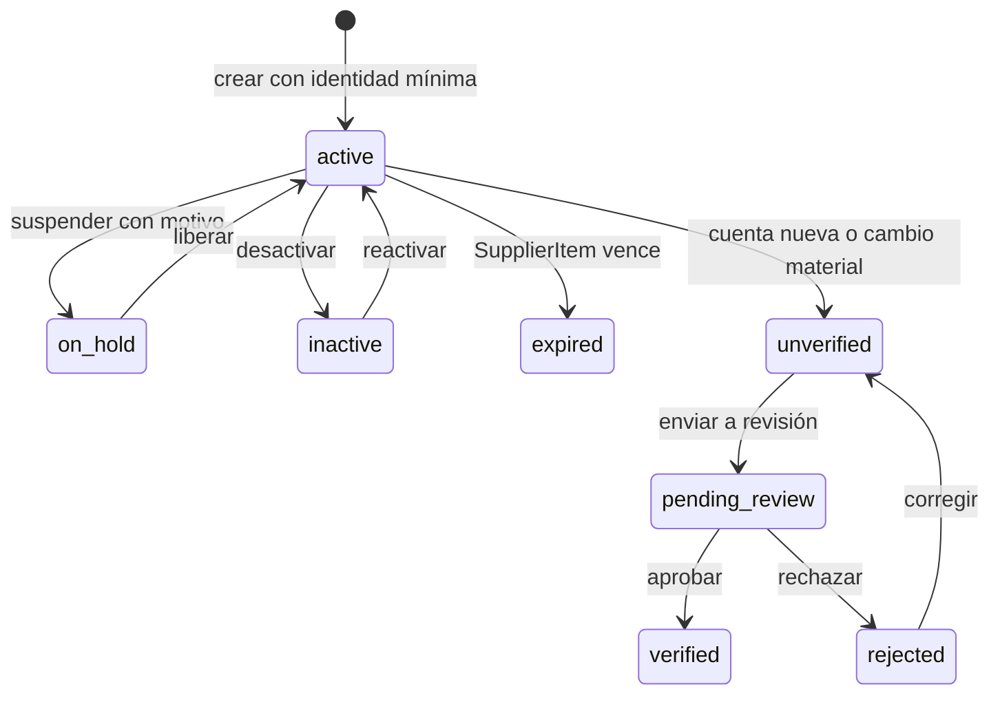

# Diseño del módulo ERP Proveedores

## Control del documento

| Campo | Valor |
|---|---|
| Módulo | ERP / Proveedores |
| Definición de producto | `discovery.md`; `docs/implementation/erp/core/discovery.md`; `docs/06-product/products/PRODUCT_CATALOG_GLOBAL_TRACK.md` |
| Run | `MOD-PROVEEDORES-20261025-001`, intento 6 |
| Fase | `01-design` |
| Estado | `draft`; propuesta para revisión, no autoriza implementación |
| Plataformas | Desktop web y mobile web responsive; iOS y Android nativos excluidos |
| Ledger | `delivery-ledger.json` (`draft`, sin tareas) |

**Baseline operativo (2026-10-25):** repositorio `minoveaz/loopdev-v2`; checkout tipo branch, rama `feature/erp-proveedores`, HEAD `ffd9bd16d01438f8dc3efd25be4b646861988476`; working tree modificado. No existe ruta Supplier. El preview anterior referenciaba `http://127.0.0.1:8080/pages/login`, pero una comprobación actual de `127.0.0.1:8080` no encontró listener; no hay proceso servidor confirmado ni evidencia runtime del módulo.

## 1. Resumen del módulo

- **Propósito:** mantener la contraparte comercial ERP a la que la organización compra productos, materias primas y servicios, con datos maestros suficientes para preparar compras, recepción y pagos posteriores.
- **Problema:** hoy no existe un Supplier independiente; el rol `supplier` de `ProductPartyRole` está ligado a un producto y no ofrece identidad, lifecycle, datos P2P ni un vínculo muchos-a-muchos reutilizable.
- **Actores:** operador de compras/catálogo; administración de la organización; perfiles de Products; Finanzas/AP como consumidor posterior de datos fiscales y de pago.
- **Incluido en la propuesta MVP:** directorio y detalle; identidad de empresa o persona; direcciones y contactos por función; defaults de compra; datos fiscales por jurisdicción; referencias contables; instrucciones de pago; ofertas SupplierItem vinculadas al catálogo canónico; entrada manual.
- **Fuera del módulo:** CRM como maestro o listado de proveedores; órdenes de compra, recepciones/movimientos, facturas, cuentas por pagar y ejecución/reconciliación de pagos; apps nativas; automatización fiscal o bancaria.
- **Confirmado por producto:** proveedor ERP; mismo producto puede tener varios proveedores; entrada manual y CSV diferido; Supplier readers ven tax/bank mediante permiso específico sin ampliar Products `catalog.read`; gestión replica los escritores de Products; solo owner/admin verifica y debe ser distinto del editor; web responsive; ciclo `active/on_hold/inactive` sin borrado físico; SupplierItem admite draft sin vínculo, pero para compra enlaza a Product o variante de la misma organización con conversión positiva; jurisdicciones España, Estados Unidos y Colombia.
- **Reglas para planificar:** scope por organización; valores reales tax/bank en almacenamiento protegido server-authoritative, no en caché clara ni offline; cuenta no elegible para pago hasta verificarse; cambio material invalida verificación; duplicado fiscal exacto bloquea y similitud de nombre advierte.
- **Pendiente:** Finance/Legal validará campos fiscales por país; Platform/Access acordará claves, RLS y auditoría; confirmar ruta/sidebar y revisar compatibilidad/migración legacy de `ProductPartyRole`. Estos puntos bloquean solo sus tareas dependientes.

## 2. Benchmark de mercado

El benchmark es referencia de dominio, no aprobación de paridad ni evidencia de LoopDev implementado.

| Plataforma | Capacidades relevantes | Diferenciadores | Elementos aplicables a LoopDev |
|---|---|---|---|
| ERPNext — Supplier | Identidad, grupos/tipo, direcciones/contactos, defaults de compra y datos de cuentas/impuestos. Fuente: [Supplier](https://docs.frappe.io/erpnext/supplier), consultada 2026-10-25. | Integra el maestro con compras y contabilidad configurable. | Agrupar datos maestros por propósito y guardar referencias financieras; evitar imponer un esquema fiscal único. |
| Odoo — proveedor/precios | Relación proveedor-producto con referencia del proveedor, precio, cantidad mínima, plazo y vigencia. Fuente: [Import vendor pricelist](https://www.odoo.com/documentation/19.0/applications/inventory_and_mrp/purchase/products/pricelist.html), consultada 2026-10-25. | Ofertas específicas y comparables por producto y proveedor. | SupplierItem separado de Product, con unidad/conversión y términos seleccionados copiados a una futura orden. |
| Microsoft Dynamics 365 Business Central — Vendor | Ficha de proveedor, varias cuentas bancarias, cuenta preferida y controles para cambios de información bancaria. Fuentes: [Vendor card](https://learn.microsoft.com/en-us/dynamics365/business-central/purchasing-how-record-purchases) y [vendor bank accounts](https://learn.microsoft.com/en-us/dynamics365/business-central/finance-how-to-set-up-vendor-bank-accounts), consultadas 2026-10-25. | Cuenta bancaria preferida y flujo de aprobación/seguimiento de cambios. | Separar visibilidad del dato de su verificación; diseñar estados/auditoría antes de permitir pagos. |

**Baseline común:** entidad ERP durable; varios contactos y direcciones tipadas; defaults de compra; ofertas proveedor-artículo; documentos de compra/recepción/factura/pago separados.

**Capacidades avanzadas:** aprobación dual de cambios bancarios, reglas fiscales automáticas, múltiples entidades legales compradoras, conciliación y analítica de proveedores. Son candidatas futuras, no alcance aprobado.

**No incluir en MVP:** CRM, pagos bancarios ejecutables, KYC/validación automática de identidad, scoring, portales de proveedor, sincronización EDI, forecasting ni IA.

## 3. Encaje en LoopDev

- **Propietario:** ERP / bounded context `suppliers`; Products mantiene el producto/SKU interno canónico.
- **Consumidores:** Procurement consume proveedor y oferta al crear órdenes; Inventory consume producto/unidad y registra la recepción real; Finance/AP consume identidad fiscal, términos y beneficiario. Estos módulos conservan sus propias transacciones y permisos.
- **CRM:** fuera de alcance. No crear `Contact` de CRM ni mostrar proveedores en Customer 360 por defecto.
- **Compatibilidad existente:** `ProductPartyRole` es una etiqueta local ligada al producto, no un Supplier master; el adapter Supabase actual devuelve una lista vacía. Mantenerlo separado y no migrarlo automáticamente. Definir posterior lectura/migración con revisión de duplicados.
- **Rutas candidatas:** `/app/erp/suppliers`, `/app/erp/suppliers/new`, `/app/erp/suppliers/:supplierId` y `/app/erp/suppliers/:supplierId/edit`. Son propuestas; no existen aún ni se afirma que el prefijo coincida con una ruta registrada. La navegación debe integrarse en el shell ERP actual y los deep links deben validar permiso y organización.
- **Componentes:** reutilizar Rivera, shell, formularios, tablas/listas, filtros, selects, calendario, feedback y primitivas existentes en `src/components/ui`, `src/components/common` y `src/components/layout`. No crear componentes paralelos de notas, archivos, actividad, tareas o permisos.
- **Contrato semántico:** los IDs de operación del ledger son la fuente compartida entre desktop/mobile. Móvil cambia la composición/densidad, no el catálogo de acciones, reglas o lifecycle. El wireframe normativo y la matriz de estados se preparan en `01-visual-design`.

| Capacidad o módulo | Decisión | Contrato existente | Integración | ¿Se extiende? | ¿Se prohíbe duplicar? |
|---|---|---|---:|---:|---:|
| Rivera, shell, navegación y UI | `REUSE` | `PLATFORM_V2_UI_REFERENCE.md`; `PLATFORM_V2_SHELL_REFERENCE.md`; componentes actuales | Entrada ERP, rutas, formularios y vistas responsive | No, salvo evidencia concreta de carencia | Sí |
| Organización y permisos | `REUSE` con reconciliación | Platform membership; Products `catalog.read`/`catalog.write`; `erp/core/access-model.md` | Scope organizacional y mismos perfiles; dato fiscal/bancario visible a todo lector por decisión confirmada | Sí, contrato de acceso debe aceptar el nuevo dato y la política de auditoría | Sí; no hay ACL local |
| Auditoría inmutable | `EXTEND_PLATFORM` | No se encontró contrato genérico compartido; Activity no lo sustituye | Registrar actor, organización, operación, campos modificados, timestamp y versión; redactar valores bancarios/fiscales en logs | Sí, aprobación Platform requerida antes de escrituras remotas | Sí; no crear una bitácora propia |
| Notes, Tasks, Activity y Files | `REUSE`, solo cuando exista caso aprobado | Contratos y componentes Platform | En MVP no son requisito; futuro enlace al Supplier con permisos heredados | No | Sí |
| Relations / Customer 360 | `BLOCKED` para CRM; `REUSE` para futuras relaciones ERP aprobadas | Contrato compartido, alcance ERP por confirmar | No enlazar a CRM ni ampliar acceso por una relación | Requiere decisión si se presenta una relación ERP compartida | Sí |
| Document Intelligence | `REUSE` futura | Contrato de la capacidad y permisos del documento fuente | No OCR ni extracción fiscal en MVP | No en este slice | Sí |
| ERP Products/Catalog | `REUSE` | `CatalogAdapter`, `CatalogItem`, producto/variante | SupplierItem referencia el ID canónico y delega creación al flujo Products | No | Sí; no duplicar Product/SKU |
| Supplier y SupplierItem | `MODULE_SPECIFIC` | Contrato nuevo propuesto en `packages/contracts/src/suppliers.ts` | Identidad, términos de compra y vínculos con Products | Contrato de dominio propio; sujeto a aprobación | Sí; una sola fuente de verdad |
| Procurement, Inventory, Finance | `BLOCKED` fuera del slice | Contratos de transacción aún no definidos para esta integración | Referencias y snapshots en módulos propietarios | Diseño separado | Sí; no guardar transacciones en Supplier |

| Módulo origen | Módulo destino | Interacción | Trigger | Datos compartidos | Permisos |
|---|---|---|---|---|---|
| Products | Suppliers | Seleccionar producto/variante existente o iniciar creación en Products | Alta/vinculación de SupplierItem | ID, SKU/nombre de catálogo, unidad de inventario | Grants de Products para escritura; Supplier permission para el vínculo; validar misma organización |
| Suppliers | Procurement | Seleccionar proveedor/oferta y copiar defaults al borrador de PO | Creación/edición de orden futura | Supplier ID, SupplierItem ID, snapshot comercial, direcciones elegidas | Procurement autoriza la orden; Supplier ofrece solo datos maestros |
| Suppliers | Inventory | Proveer la conversión de unidad y referencia del producto | Recepción futura basada en PO | Producto, unidad/conversión y vínculo de origen | Inventory autoriza recepción y stock; Supplier no contabiliza movimientos |
| Suppliers | Finance/AP | Leer identidad fiscal/beneficiario y seleccionar cuenta verificada | Factura o pago futuro | Supplier ID, tax profile, payment instruction elegida | Finance autoriza factura/pago; datos visibles a lectores de Supplier según decisión, sujeto a contrato de acceso |
| Suppliers | CRM | Ninguna en MVP | Ninguno | Ninguno | No crear relación implícita ni ampliar permisos |

**Impacto arquitectónico propuesto:** dominio bajo `src/loopdev/domains/suppliers/` con tipos/servicios/puertos y adapters local/remoto separados; hooks y páginas consumen la API de dominio. Contrato de operaciones compartido en `packages/contracts/src/` antes de renderers. No modificar Products para almacenar datos Supplier. No se propone refactor de producción ni migración en esta fase.

## 4. Actores, casos de uso y UX

| Vista | Operaciones principales | Desktop | Mobile web |
|---|---|---|---|
| Directorio | Listar, buscar, filtrar, ordenar, abrir, crear | Tabla compacta con búsqueda y filtros persistentes | Lista/cards apiladas; filtros accesibles sin scroll horizontal |
| Crear/editar proveedor | Identidad, estado, datos fiscales, contactos/direcciones, compras, finanzas y pagos | Página de formulario en secciones; validación por grupo y resumen de errores | Página de una columna, secciones plegables, acciones al alcance del pulgar |
| Detalle | Ver estado y datos, entrar a editar, revisar ofertas vinculadas | Página con resumen y navegación por secciones/pestañas | Secciones apiladas con navegación compacta |
| Catálogo del proveedor | Listar, añadir, vincular, editar, desactivar ofertas; iniciar Product create | Tabla de ofertas con filtros y acciones por fila | Lista/cards con acciones por ítem |
| Importación CSV opcional | Subir, previsualizar, mapear, resolver filas, confirmar | Wizard de escritorio con vista previa y errores por fila | Solo si se aprueba; flujo usable en viewport móvil, no se cambia semántica |

No se requiere kanban, calendario, dashboard ni exportación para el MVP. Búsqueda sugerida: nombre legal/comercial, código interno, identificador fiscal (sujeto a contrato de búsqueda) y referencia SupplierItem. Filtros sugeridos: estado, país, categoría y estado de verificación del beneficiario. No mostrar secretos en telemetría o logs.

**Flujo mínimo:** abrir directorio → crear proveedor → validar identidad mínima y duplicados → completar grupos P2P gradualmente → crear/vincular ofertas → revisar detalle → editar/inactivar con confirmación y motivo. Un Supplier puede estar activo para compras aunque todavía no tenga una cuenta de pago verificada; el pago futuro debe impedir seleccionar una cuenta no verificada.

**Accesibilidad y calidad UX:** teclado y foco visible; orden de tabulación semántico; errores asociados al campo y resumen enfocable; etiquetas y copy keys compartidas; diálogo de confirmación con foco gestionado; tablas con encabezados accesibles; estados anunciados a screen readers; RTL y formatos de fecha/moneda/localización; touch targets y reflow mobile sin overflow. Las diferencias permitidas son layout/densidad, no acciones.

**Matriz de superficies/estados**

| Superficie | Loading | Empty | Error | Forbidden | Conflict | Offline | Pending | Success |
|---|---:|---:|---:|---:|---:|---:|---:|---:|
| Directorio (desktop/mobile) | Sí | Sí, CTA según permiso | Sí, retry | Sí, sin datos | N/A | Sí, indicar frescura y límites | Sí | Sí |
| Detalle | Sí | N/A | Sí | Sí, acceso directo no revela existencia | Sí, recargar o comparar | Sí; datos financieros no cacheados en claro | Sí | Sí |
| Formulario de proveedor | Sí | N/A | Sí, conservar borrador no sensible | Sí | Sí, resolver versión | Sí, guardar borrador no sensible; mutación en cola solo donde se apruebe | Sí | Sí |
| Tax y pagos | Sí | Sí | Sí | Sí según permiso de gestión; lectura responde a decisión de visibilidad | Sí, nunca sobreescribir silenciosamente | Sin valores reales offline hasta aprobar almacenamiento protegido | Sí | Sí |
| SupplierItem | Sí | Sí | Sí | Sí | Sí | Sí, regla común de conflictos | Sí | Sí |
| Importación CSV | Sí | Sí | Sí con errores por fila | Sí | Sí, revisión antes de confirmar | No confirmar offline | Sí | Sí |

**Navegación/legacy:** no existe flujo legacy de Supplier que sustituir. El rol Supplier de Catalog permanece solo como dato preexistente; no se exponen dos directorios. Refresh/back deben preservar la ruta, filtros no sensibles y deep link; not-found/forbidden no filtran existencia cross-tenant.

## 5. Máquina de estados y ciclo de vida

Los estados Supplier/SupplierItem reflejan dirección aprobada; los campos fiscales por jurisdicción y la implementación de permisos/auditoría siguen sujetos a sus dueños. Mantener las transiciones como comandos compartidos, no lógica de renderer.

| Estado | Tipo | Entrada permitida | Salidas | Actor | Validaciones | Evento |
|---|---|---|---|---|---|---|
| `active` | Supplier | Crear con identidad mínima o reactivar | `on_hold`, `inactive` | `catalog.write` | País/tipo/nombre; duplicado fiscal exacto bloquea; similitud solo alerta | `supplier.created` / `supplier.reactivated` |
| `on_hold` | Supplier | Suspender con motivo | `active`, `inactive` | Supplier management grant | Motivo obligatorio; no seleccionar para órdenes nuevas; no reescribir transacciones existentes | `supplier.held` |
| `inactive` | Supplier | Desactivar | `active` | Supplier management grant | No borrar si hay referencias; conservar hechos históricos; módulos dueños controlan transacciones abiertas | `supplier.deactivated` / `supplier.reactivated` |
| `active` | SupplierItem | Crear o activar oferta | `inactive`, `expired` | `catalog.write` | Referencia Supplier única; producto requerido para uso en PO; conversión positiva; moneda/cantidad válidas | `supplier_item.created` / `supplier_item.activated` |
| `inactive` | SupplierItem | Desactivar oferta | `active` si la vigencia aún aplica | `catalog.write` | Conservar snapshots existentes; no eliminar órdenes históricas | `supplier_item.deactivated` |
| `expired` | SupplierItem | Vencimiento por fecha | `active` al extender vigencia | Sistema o `catalog.write` | Rango de fechas válido; no reescribir snapshots de PO | `supplier_item.expired` |
| `unverified` | PaymentInstruction | Crear o modificar cuenta | `pending_review`, `rejected`, `inactive` | Supplier management grant | Cambio invalida verificación anterior; no elegible para pago | `payee_instruction.changed` |
| `pending_review` | PaymentInstruction | Enviar para verificación | `verified`, `rejected` | Owner/admin distinto del editor | Registrar decisión/motivo y actor | `payee_instruction.reviewed` |
| `verified` | PaymentInstruction | Verificar instrucción | `unverified`, `inactive` | Owner/admin distinto del editor | Cuenta activa; cambio material revoca verificación | `payee_instruction.verified` |
| `rejected` | PaymentInstruction | Rechazar y corregir | `unverified`, `inactive` | Owner/admin | Motivo requerido; no elegible para pago | `payee_instruction.rejected` |

La política aprobada es `inactive`/archive únicamente; no hay hard delete. Las referencias financieras, tax IDs, contactos y cuentas deben respetar retención y privacidad por jurisdicción. Los estados no reescriben hechos existentes; cada módulo transaccional decide el tratamiento de documentos abiertos.

## 6. Modelo de datos funcional

| Entidad | Atributos funcionales | Relaciones |
|---|---|---|
| `Supplier` | `id` estable; `organizationId`; `kind` empresa/persona; legal/trading name; país; estado; categoría; default purchase currency/payment terms/delivery terms/lead time; referencias a configuración de Finance; `createdAt`, `updatedAt`, `createdBy`, `updatedBy`, `version` | 1:N contactos, direcciones, perfiles fiscales, instrucciones de pago y SupplierItems; 1:N futuras referencias desde PO/AP |
| `SupplierAddress` | `id`, tipo (legal, billing, order, ship-from, remit-to, returns), líneas, ciudad/región/postal/country, default por propósito, estado | N:1 Supplier; varios destinos por propósito |
| `SupplierContact` | `id`, función (purchasing, receiving, AP/invoices, remittance), nombre, email/teléfono, preferencia, estado | N:1 Supplier; contacto puede cubrir más de una función mediante relaciones tipadas |
| `SupplierTaxProfile` | jurisdicción, clase/categoría, IDs fiscales tipados, withholding/reporting refs cuando aplique, estado de validación | N:1 Supplier; varios registros si la jurisdicción/entidad compradora lo exige |
| `SupplierPaymentInstruction` | beneficiario, método, país/banco, identificador de cuenta o IBAN, routing/branch/SWIFT según jurisdicción, moneda, preferida, estado/verificación, timestamps y versión | N:1 Supplier; múltiple por proveedor; no representa pagos realizados |
| `SupplierItem` | `id`, `organizationId`, `supplierId`, referencia/nombre/barcode del proveedor, `catalogItemId` o `variantId`, compra UOM, conversión positiva a stock UOM, moneda/precio, mínimo/escalas, lead time, fechas de vigencia, estado, `version` | N:1 Supplier; N:1 Product o variante; múltiples proveedores por producto |
| `SupplierAuditReference` | referencia al evento inmutable Platform, actor, scope, acción, campos cambiados y versión; sin copia de secretos en Activity | 1:N por entidad mutada, dueño Platform |

**Identidad y scope:** UUID no enumerable; organización deriva de membership autenticada y no del input cliente. Supplier y todas sus hijas deben tener la misma organización; no hay ACL por workspace ni por asignado en este slice.

**Reglas acordadas para el slice:** identidad mínima es tipo + legal name + país; duplicado fiscal exacto dentro de organización/jurisdicción bloquea y similitud de nombre advierte; Finance/Legal debe validar las reglas exactas para España, Estados Unidos y Colombia. Currency ISO-4217; conversión > 0; vigencia inicio ≤ fin; un default activo por propósito; Product/variante es canónico y no se modifica desde Supplier; términos seleccionados se copian como snapshot en la futura PO.

**Versionado/auditoría:** entero `version` para concurrencia optimista; mutaciones incluyen `expectedVersion`; toda escritura remota y cambio de datos fiscales/pago debe emitir evento append-only en la misma transacción. Registrar actor, organización, IDs, timestamp, versión y nombres de campos; redactar valores de cuenta/tax en actividad, logs y telemetría.

**Borrado:** ninguna eliminación física desde UI/adapters; Supplier y SupplierItem se desactivan. Conservar identidad referenciada por documentos históricos según política de retención; legal erasure requiere revisión de Finance/Legal y no se infiere en esta fase.

**Representación local/remota:** la experiencia local usa fixtures sintéticas. Valores reales de tax/bank requieren almacenamiento protegido server-authoritative; no se guardan en `localStorage`, caché clara ni `metadata`, y no se leen/editan/encolan offline. Remoto futuro normaliza tablas con FK compuesta/tenant, constraints y RLS. Datos de transacción no viven en estas entidades.

## 7. Requerimientos funcionales

Las clasificaciones y los IDs existentes del ledger se preservan. CSV queda fuera de `supplier-directory`; los consumidores P2P siguen como follow-up, fuera de este slice.

### Nivel 1 — Core Operativo / MVP propuesto

| ID | Capacidad | Prioridad | Dependencias | Complejidad | Criterio de aceptación |
|---|---|---|---|---|---|
| `CAP-ERP-SUPPLIER-DIRECTORY` | Directorio, búsqueda, detalle y mantenimiento del maestro | Alta | Permiso Products, scope organización, identidad y lifecycle | M | Se crea/consulta/edita/inactiva empresa o persona; evita duplicado fiscal exacto; acceso directo respeta scope; desktop y mobile ejecutan las mismas operaciones. |
| `CAP-ERP-SUPPLIER-P2P-SETUP` | Contactos, direcciones, tax profile, defaults de compra, Finance refs e instrucciones de pago | Alta | Reglas jurisdiccionales; acceso/auditoría; estado de cuenta | L | Formulario valida campos condicionados por tipo/jurisdicción; un lector Supplier puede ver los campos según decisión; no se permite usar cuenta no verificada para pagos futuros; cambios quedan auditados. |
| `CAP-ERP-SUPPLIER-ASSORTMENT` | SupplierItem manual y link a Product/variante | Alta | Catalog read/write, UOM/conversión, currency y versión | L | Varios proveedores enlazan al mismo producto; SupplierItem no modifica Product; conversiones inválidas se rechazan; una oferta seleccionada puede ser snapshot de futura orden. |

### Nivel 2 — Automatización y colaboración

| ID | Capacidad | Prioridad | Dependencias | Complejidad | Criterio de aceptación |
|---|---|---|---|---|---|
| `CAP-ERP-SUPPLIER-CATALOG-IMPORT` | Importación CSV revisada | Diferida de este slice | Alcance y aprobación separados, columnas y matching | L | Si se reabre, ninguna fila se aplica antes del preview; conflictos visibles por fila; nunca sobrescribir Product canónico ni datos de pago. |
| Platform Notes/Tasks/Activity/Files | Colaboración enlazada, solo si hay caso de uso aprobado | Baja | Contratos Platform, herencia de permisos | M | Usa primitives existentes y no crea editor, upload, timeline ni persistencia duplicados. |

### Nivel 3 — Enterprise / IA

| Capacidad | Estado | Dependencias / criterio futuro |
|---|---|---|
| Portal, EDI, scoring/forecasting, IA documental y verificación automática fiscal/bancaria | Fuera del MVP; no aprobada | Aprobación de producto, contratos backend, privacidad, integración y evidencia de valor |
| Órdenes, recepciones, facturas y pagos | Follow-up por módulos propietarios, no capacidad Supplier | Diseños y ledgers separados de Procurement, Inventory y Finance |
| Multi-entidad compradora y mapping contable | Campos de referencia contemplados; alcance por confirmar | Definir entidades legales, chart of accounts, país y RLS con Finance |

## 8. API, eventos y backend

No existe API Supplier implementada. Nombres y formas aquí son propuesta conceptual; los DTOs ejecutables pertenecen a la posterior definición de contratos/API.

| Operación compartida | Comando/consulta conceptual | Resultado |
|---|---|---|
| Directorio | `listSuppliers(query, filters, cursor)` / `getSupplier(id)` | Página de resúmenes o detalle autorizados |
| Maestro | `createSupplier(input)` / `updateSupplier(id, expectedVersion, patch)` | Supplier y versión nueva; errores de validación/conflicto explícitos |
| Lifecycle | `deactivateSupplier(id, expectedVersion, reason)` / `reactivateSupplier(...)` | Estado y evento; sin hard delete |
| P2P setup | `upsertSupplierContact`, `upsertSupplierAddress`, `upsertTaxProfile`, `upsertPaymentInstruction` | Registro hijo, versión y resultado de auditoría |
| Verificación | `submitPayeeForReview` / `verifyPayee` / `rejectPayee` | Estado y actor revisor; `verifyPayee` sujeto a policy approval |
| SupplierItem | `listSupplierItems`, `createSupplierItem`, `linkSupplierItem`, `updateSupplierItemTerms`, `deactivateSupplierItem` | Oferta y referencia a Product, sin mutación implícita del catálogo |
| CSV opcional | `previewSupplierCatalog`, `confirmSupplierCatalogImport(batchId, idempotencyKey)` | Preview no mutante; confirmación explícita y resumen por fila |

**Validación server-side:** membership activa, permiso por acción, tenant derivado; campos requeridos por tipo/país; unicidad de ID fiscal por jurisdicción/organización; UOM y conversión; currency; fechas y cantidades; versión esperada; referencias en misma organización; estado del proveedor/oferta. No confiar en validación de formulario.

**Transacciones/índices:** FK compuesta `(organization_id, supplier_id)` en hijas; índice de búsqueda por organización y nombre normalizado; unique parcial de fiscal ID según tipo/jurisdicción; clave idempotente por import batch; no definir DDL hasta aprobación de contratos y política de datos.

**Eventos propuestos:** `supplier.created`, `supplier.updated`, `supplier.deactivated`, `supplier.reactivated`, `supplier_item.created/updated/deactivated`, `supplier_tax_profile.changed`, `supplier_payment_instruction.changed`, `supplier_payment_instruction.verified/rejected`. Payload mínimo: IDs, organization, actor, versión, timestamp, campos cambiados y correlation/idempotency key; excluir valores completos de cuenta/tax. Entrega al menos una vez, consumidores idempotentes por event ID; reintento con backoff y DLQ futura.

**API transversal:** cursor pagination; límites por página y archivo; no cachear permisos; invalidar queries al revocar membership; errores tipados `FORBIDDEN`, `NOT_FOUND`, `VALIDATION`, `CONFLICT`, `OFFLINE`, `DUPLICATE`, `SERVER_ERROR`. Observabilidad con request/correlation ID, latencia/resultado y contadores sin PII.

## 9. Matriz RBAC y reglas de negocio

Esta propuesta conserva la población de Products: owner, admin, agent y viewer. No crea roles ERP nuevos. La regla de lectura fiscal/bancaria reproduce la decisión explícita del usuario, pero contradice el contrato core actual; no afirmar política remota aprobada.

| Acción | Admin | Manager (mapeo propuesto: `agent`) | Usuario (no rol Products actual) | Solo lectura (`viewer`) |
|---|---:|---:|---:|---:|
| Listar/ver Supplier y tax/bank | Sí (`catalog.read`) | Sí (`catalog.read`) | No aplica; no inventar rol | Sí (`catalog.read`) |
| Crear/editar maestro, contactos, direcciones y SupplierItem | Sí (`catalog.write`) | Sí (`catalog.write`) | No aplica | No |
| Inactivar/reactivar | Sí (`catalog.write`) | Sí (`catalog.write`) | No aplica | No |
| Editar tax/payment instructions | Sí (`catalog.write`) | Sí (`catalog.write`) | No aplica | No |
| Verificar/rechazar cuenta | Owner/admin, distinto del editor | Owner/admin, distinto del editor | No aplica | No |
| Exportar/bulk edit/hard delete | No en MVP | No en MVP | No aplica | No |
| Ejecutar PO/recepción/factura/pago | Permiso del módulo propietario | Permiso del módulo propietario | Según ese módulo | No por herencia automática |

- **Scope:** organización activa, sin workspace ni assignment ACL; no se deriva acceso por ser dueño del Supplier.
- **Acceso directo:** servidor vuelve a validar cada request; denied/not-found no expone existencia cross-tenant; se invalida cache al perder permisos.
- **Cambios sensibles:** todo lector autorizado puede ver el dato en pantalla según decisión; edición requiere grant de gestión, y la cuenta requiere verificación previa al uso. Separar la aprobación del editor es recomendado, pendiente.
- **Conflicto formal:** `ACC-ERP-008` excluye supplier terms de Products `catalog.read`. La dirección aprobada es un grant Supplier específico para sus lectores; el contrato de acceso, RLS y pruebas deben implementarlo sin ampliar el permiso de Products.
- **Corner cases:** ID fiscal cambia de jurisdicción; Supplier duplicado por variación de nombre; actualización concurrente de cuenta bancaria; proveedor inactivado con PO abierto; conversión de compra que cambia después de emitir PO; permiso revocado mientras existe borrador offline.

## 10. Arquitectura frontend

**Rutas/páginas propuestas:** directorio, alta, detalle y edición bajo `/app/erp/suppliers`; confirmar convención exacta al implementar contra router/navegación existente. No existe ruta Supplier en `LoopdevRoutes.tsx` ni entrada Supplier en `navigation.ts`.

**Responsabilidades por capa**

| Capa | Responsabilidad | Área propuesta | Dependencias permitidas | Prohibido |
|---|---|---|---|---|
| Presentación | Páginas/formularios/listas responsive, navegación y estados | `src/loopdev/pages/erp/suppliers/`, componentes de módulo solo si Rivera no cubre el patrón | Hooks, componentes UI compartidos | Reglas de dominio, acceso o persistencia |
| Aplicación | Casos de uso, query orchestration, manejo de mutación y errores | `src/loopdev/domains/suppliers/hooks/` o patrón vigente equivalente | Puertos y contratos | Imports directos de Supabase/localStorage desde página |
| Dominio | Tipos, estados, validaciones puras, invariantes y comandos | `src/loopdev/domains/suppliers/` | Contratos compartidos | React, UI, transporte |
| Ports/contracts | Operaciones y DTOs semánticos compartidos | `packages/contracts/src/suppliers.ts` (propuesta) | Tipos de dominio/Platform | Catálogo de acciones exclusivo de un renderer |
| Adapters | Persistencia local/remota, mapeo de errores, versionado | `src/loopdev/domains/suppliers/adapter/` | Puertos y Platform | Autorizar solo por ocultar botones; filtrar tenants solo en cliente |

La dirección lógica es `Presentation → Application → Domain/Ports ← Adapters`; la excepción práctica de importar contratos desde capas superiores debe respetar dependencias de paquetes existentes. Evitar un único formulario/servicio que mezcle maestro, ofertas, CSV y pago. No se requiere refactor preexistente.

**Primitivas y pruebas:** reutilizar `DataTable`/listas y formularios actuales de Rivera, Select, Command/Popover, Calendar, feedback y shell tras confirmar los componentes concretos en el inventario UI. Unit tests de reglas; pruebas de adapter local/remote; pruebas de componente por operación y estado desktop/mobile; visual tests solo para vistas/estados críticos. Las pruebas E4 de transacción corresponden a módulos downstream.

## 11. Arquitectura local-first y sincronización

- **Primera experiencia:** adapter local permite validar CRUD/UX y reglas puras sin backend real, con fixture sintética; no convierte el prototipo en almacenamiento listo para datos reales.
- **Persistencia sensible:** el `localStorage` actual no es almacenamiento seguro para números bancarios/IDs fiscales completos. No persistir valores reales en claro ni colocarlos en cache, logs, eventos o dumps; la estrategia de cifrado/almacenamiento protegido requiere diseño de seguridad y aprobación antes de habilitar uso con datos reales. No restringe el acceso por rol: es una limitación del almacenamiento local.
- **Offline:** perfil general no sensible puede conservar borrador; cambios de tax/payment quedan online-only y se bloquean/offline con mensaje claro hasta disponer de almacenamiento protegido. No encolar una mutación sensible como si fuera segura. CSV no se confirma offline.
- **Remoto futuro:** Supabase/API adapter separado; server deriva organización, revalida membership/grant, ejecuta constraints/RLS y escribe auditoría atómica. Sin fallback local ante denegación remota.
- **Concurrencia:** cada entidad usa versión; stale version retorna `CONFLICT` con opción de recargar/comparar; no last-write-wins para datos financieros.
- **Migración:** importar solo campos no sensibles o fixtures; mapping explícito de `ProductPartyRole` revisado manualmente; dry-run de duplicates; no mover valores reales desde localStorage. Cutover por organización/feature flag, reconciliación y rollback a lectura/export de copia segura según política aprobada.
- **Feedback:** badges de estado local/guardado/pendiente; errores y conflictos preservan borradores no sensibles; indicar cuándo ciertos campos requieren conexión. Reautorización en replay obligatoria.

**Conflictos pendientes:** política de merge por grupo de campos, retención/limpieza del outbox, cifrado y recuperación de clave, y UX offline de campos financieros; estas decisiones impiden autorizar sincronización de datos reales.

## 12. Plan de implementación por fases

Este es el orden de trabajo recomendado; no crea tareas ni autoriza build. El plan ejecutable y sus IDs pertenecen a `module-plan` tras aprobación visual/producto.

| Fase | Objetivo | Frontend | Backend | Datos/Sync | Validación |
|---|---|---|---|---|---|
| 1. Descubrimiento, decisiones y contratos | Resolver open decisions y aprobar alcance/capability contract | Aprobar UX y operaciones | Alinear permisos/auditoría con Platform | Cerrar campos, lifecycle, tenancy y storage | Validators de delivery/contracts; checklist de decisiones firmado |
| 2. UX y frontend local-first | Directorio, formulario, detalle y catálogo responsive | Reusar Rivera; cubrir todas las acciones web | Ninguno requerido | Fixture sintética; sin datos bancarios reales | Tests de dominio/componentes desktop/mobile; accesibilidad |
| 3. Adapter local, persistencia y eventos | Persistencia segura del slice demo y eventos locales | Estados de carga/conflicto/offline | Ninguno | Decidir cifrado/datos permitidos; versionado e idempotencia | Reload, conflictos, permisos y tests de contrato |
| 4. Backend, API, autenticación y RLS | API remota organizacional | Adapter remoto y errores | API/constraints/RLS + auditoría atómica | Migración forward y fixtures de prueba | RLS entre tenants/roles y auditoría en transacción |
| 5. Sync y migración | Operación multi-device confiable | Indicadores/recovery | Revalidación de permisos | Outbox, conflictos, migración y rollback | Tests de replay/revocación/duplicados y cutover dry-run |
| 6. Automatizaciones e integraciones | CSV aprobado e integraciones de Products/P2P | Wizard de importación si aprobado | Import batch idempotente/eventos | Reglas de retry y matching | Preview sin side effects, reintentos y pruebas consumidoras |
| 7. Enterprise, analítica e IA | Capacidades separadas con aprobación | UX específica | Jobs/webhooks/integraciones | Retención/telemetría gobernada | Seguridad, calidad de datos y métricas de adopción |

## 13. Estrategia de pruebas y criterios de aceptación

No se ejecutaron pruebas de producto Supplier porque no existe implementación. Las pruebas `test:delivery` de discovery no prueban el comportamiento de este módulo.

| ID | Requisito | Tipo de test futuro | Éxito | Fallo/límite | Evidencia exigida |
|---|---|---|---|---|---|
| `CAP-ERP-SUPPLIER-DIRECTORY` | Directorio/maestro | Dominio + componentes desktop/mobile | CRUD permitido, búsqueda y estado coherentes | No miembro, viewer intentando editar, ID fiscal duplicado, error de red | Tests + evidencia de ruta y estados |
| `CAP-ERP-SUPPLIER-P2P-SETUP` | Datos P2P, visibles a todos los lectores | Dominio + permisos + componentes | Todos los perfiles con acceso Supplier ven tax/bank en contexto autorizado; gestor cambia y queda auditado | Usuario sin scope, versión obsoleta, cuenta no verificada, falta de jurisdicción | Tests RLS/API y audit; no usar dato real en fixtures |
| `CAP-ERP-SUPPLIER-ASSORTMENT` | Oferta y vínculo Products | Dominio + Catalog adapter + componentes | Múltiples SupplierItems refieren mismo Product; términos no mutan catálogo | Conversión no positiva, tenant distinto, producto inactivo, conflicto | Tests de invariantes y navegación Products |
| `CAP-ERP-SUPPLIER-CATALOG-IMPORT` | CSV opcional | Componente + integración | Preview, errores por fila y confirmación idempotente | Archivo inválido, duplicado, cancelación, retry | Solo tras aprobar disponibilidad y contrato |
| `CAP-ERP-SUPPLIER-P2P-CONSUMERS` | Consumidores futuros | Journey E4 de módulos propietarios | Snapshot y transacciones conservan hechos propios | Cambiar Supplier no reescribe PO/receipt/invoice/payment | Evidencia en cada módulo propietario |

**Cobertura requerida:** estado loading/empty/error/forbidden/conflict/offline/pending/success; refresh/deep link/back; keyboard, screen reader, responsive y touch; cross-organization denial; permisos revocados; persistencia reload; simultaneidad y auditoría. Ningún estado `PASS` sin test observable; `missing` queda en el ledger hasta implementación.

## 14. Seguridad, cumplimiento y operación

- **Tenant:** derivar organización del usuario autenticado; validar membership activa y pertenencia padre-hija en servidor, adapter remoto y constraints/RLS. IDs o `organizationId` enviados por cliente no son autoridad.
- **RBAC:** reutilizar grant y población de Products; acceso a tax/bank por todos los Supplier readers sigue decisión confirmada, pero backend no está aprobado hasta reconciliar `ACC-ERP-008`. UI oculta acciones, servidor siempre aplica reglas.
- **PII/finanzas:** minimizar campos por jurisdicción; cifrado at-rest/in-transit del proveedor remoto; acceso al campo completo en pantalla para lectores autorizados; redacción en logs/telemetría/Activity; jamás fixture con datos personales reales. La política exacta de retención/mascarado permanece pendiente.
- **Auditoría:** append-only Platform audit antes de escrituras remotas; falla auditoría → falla mutación. Activity es interfaz de colaboración y no reemplaza el audit log.
- **Adjuntos/documentos:** consumir Files y permiso del registro padre si se aprueba; no añadir upload de factura/estado bancario al módulo base; Document Intelligence solo futuro y hereda el permiso del documento fuente.
- **Bulk/export:** fuera de MVP; una futura operación requiere scope, permisos, logging, rate limit y protección contra cache stale.
- **Rollout/rollback:** feature flag por organización; migration forward con dry-run y rollback documentado; lectura segura si se deshabilitan escrituras; parar jobs/retries al revertir; conservar datos transaccionales y no usar hard-delete cascades.
- **Operación:** métricas agregadas de CRUD, conflictos, errores por tipo y latencia; no registrar valores PII; alertar fallos de auditoría/sync; límites de búsqueda, páginas, importación y reintentos definidos en API design.

## 15. Riesgos, decisiones y roadmap

**Confirmadas:** ERP-owned; no CRM; empresa o persona; relación N:M SupplierItem↔Product; SupplierItem puede ser borrador sin vínculo, pero una oferta comprable debe enlazar el Product canónico o una variante suya y tener conversión válida; maestro preparado para P2P; lectores Supplier ven tax/bank mediante permiso Supplier propio asignado a los mismos perfiles lectores de Products; gestión para la población escritora de Products; verificación de pagos owner/admin y distinta del editor; jurisdicciones iniciales España, Estados Unidos y Colombia; duplicado exacto fiscal bloquea y similitud de nombre advierte; ciclo `active/on_hold/inactive`, sin borrado físico; valores fiscales/bancarios reales solo en almacenamiento protegido server-authoritative y sin uso offline; entrada manual en el slice y CSV diferido; transacciones son de Procurement/Inventory/Finance.

**Supuestos para planificación:** organización como único scope; grants específicos de Supplier sin ampliar `catalog.read` de Products; `supplier.manage` alineado con la población `catalog.write`; verificación se invalida al cambiar datos materiales de la cuenta; versionado optimista; evento de auditoría transaccional; campos fiscales específicos pendientes de validación Finance/Legal.

**Decisiones pendientes con tarea/owner (no bloquean tareas no dependientes):**

| ID | Decisión | Propuesta | Owner / impacto |
|---|---|---|---|
| `PLAN-SUP-001` | Campos y validaciones fiscales exactos para cada país | Validación España, Estados Unidos y Colombia usando fuentes oficiales; no universalizar tax ID | Finance/Legal; bloquea solo el contrato/operación de tax profile |
| `PLAN-SUP-002` | Claves, RLS y auditoría del permiso Supplier específico | Mapear el mismo grupo lector/escritor de Products sin ampliar `catalog.read`; enforcement server-side | Platform/Access; bloquea escrituras con datos reales |
| `PLAN-SUP-003` | Ruta y ubicación en navegación ERP | Evaluar `/app/erp/suppliers` contra router/navigation actuales | ERP + Platform; bloquea navegación final |
| `PLAN-SUP-004` | Compatibilidad con `ProductPartyRole` legacy | No promoción automática; definir coexistencia o migración explícita | Products + ERP; bloquea migración, no los datos nuevos |

**Riesgos:** implementar grants/RLS de forma que expongan Supplier a usuarios incorrectos; guardar datos financieros en claro; doble maestro por `ProductPartyRole`; duplicados cross-jurisdiction; términos cambiantes que alteren órdenes emitidas; datos fiscales incompletos; paridad móvil solo visual. Mitigaciones: tareas bloqueadas por dueño, server-authoritative storage, revisión legacy y tests de tenant/role.

**Deuda y dependencia:** concretar el contrato de acceso Supplier y el audit append-only con Platform; comprobar role grants/RLS antes de escrituras remotas; validar campos fiscales con Finance/Legal. No se afirma implementación ni runtime de Supplier.

**Roadmap:** visual y defaults prebuild aprobados; cerrar el plan ejecutable con tareas bloqueadas por Finance/Legal o Platform, sin iniciar build hasta aprobar el ledger; mantener CSV y consumidores transaccionales fuera de este slice.
