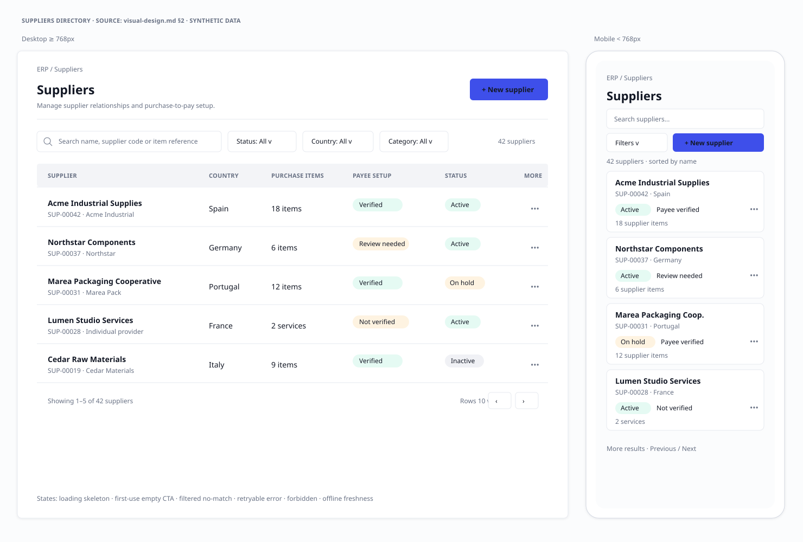
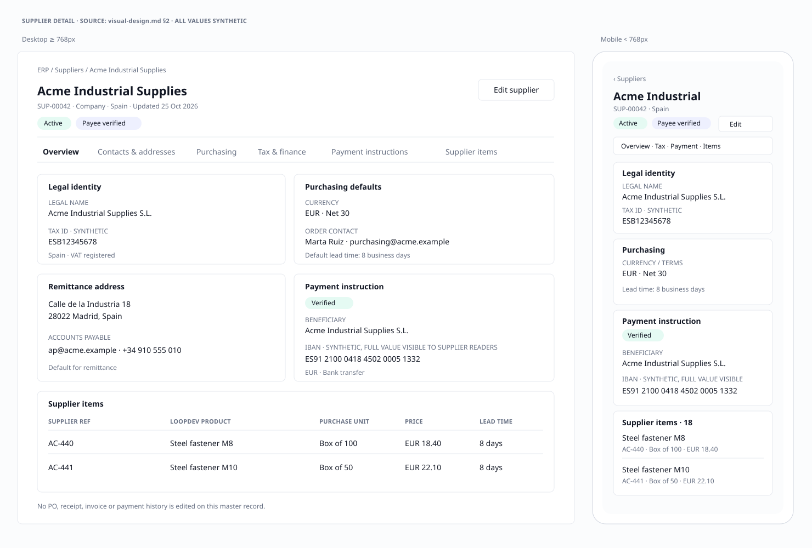
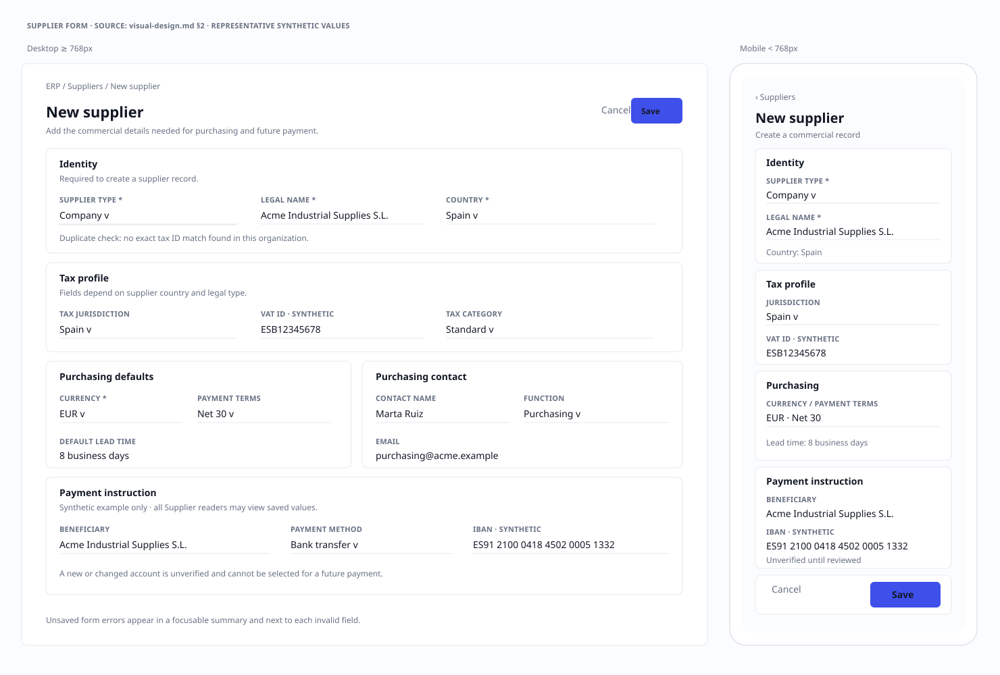

# Proveedores — Visual design baseline

| Field | Value |
|---|---|
| Run / slice | `MOD-PROVEEDORES-20261025-001` / `supplier-directory` |
| Version | `1.1` |
| Status | `user_approved` |
| Normative source | This Markdown; SVGs are review evidence only |
| Product/design source | `discovery.md`; `architecture-design.md` |
| Platform scope | Desktop web + responsive mobile web; native iOS/Android excluded |

This is the approved conceptual visual direction, not a production route or
implementation. Wireframes use synthetic supplier data and demonstrate the
confirmed rule that all Supplier readers can see tax/payment fields. No real
personal, tax or bank data is included.

## 1. Rivera / LoopDev baseline inventory

| Concern | Observed baseline | Evidence |
|---|---|---|
| Semantic colors | Light surfaces: background `220 30% 98.8%`, card white, foreground `222 32% 11%`, primary indigo `234 80% 58%`, muted text `222 12% 46%`, border `220 22% 92%`; success, warning, destructive and info have separate semantic tokens. Dark theme uses token overrides. | `src/index.css` (`:root`, `.dark`) |
| Typography | Geist/system sans; body 15px / 1.55 / 400; headings use Geist with responsive sizing and tight tracking; numbers may use tabular numerals. | `src/index.css` |
| Radius and borders | `--radius: 0.5rem`, `--radius-sm: 0.375rem`; semantic `border`/`border-strong`; current utility bindings map rounded sizes to these values. | `src/index.css` |
| Elevation and focus | One restrained shadow recipe (`--shadow-modern`), semantic focus ring (`--shadow-focus`), no decorative elevation system. | `src/index.css` |
| Spacing / density | Use the existing Tailwind spacing scale (`gap-2/3/4/6`, `p-3/4`, `px-4`, `py-2.5`) rather than new tokens. CRM uses compact table cells, 12px metadata and explicit pagination. | `src/loopdev/pages/crm/Contacts.tsx`; `src/loopdev/pages/crm/Opportunities.tsx`; `src/components/common/DataTable.tsx` |
| Shell and breakpoints | Authenticated `/app/*` routes render inside `LoopdevShell`; below `md` (768px) the sidebar becomes a focus-managed mobile drawer; `nav` (1200px) controls desktop sidebar density. | `PLATFORM_V2_SHELL_REFERENCE.md`; `src/components/layout/AppShell.tsx`; `src/components/layout/Sidebar.tsx` |
| Page composition | `PageContainer`, `PageHeader`, breadcrumbs, `PageTabs`, `FormSection`, `FormSectionNav`, common feedback and card/table surfaces. | `PLATFORM_V2_UI_REFERENCE.md`; `src/components/common/` |
| List composition | `DataCard`, compact `DataTable`, `SearchInput`, `FilterDropdown`, `StatusBadge`, table skeleton/pagination and empty/error states. | `src/components/common/DataTable.tsx`; `Contacts.tsx`; `Opportunities.tsx` |
| Mobile precedent | CRM Contacts switches from a table to `ContactMobileCard` below `md`; this is a layout precedent only, not a supplier component to copy. | `src/loopdev/pages/crm/Contacts.tsx`; `src/loopdev/components/crm/contacts/ContactMobileCard.tsx` |
| Primitive constraints | Use shared `Select`, `Command`, `Popover`, `Calendar`, `Dialog` and `AppDrawer` as appropriate; never use a native `<select>` for product UI. Notes must use `NoteEditorDrawer`; files and other platform capabilities stay with their owning shared modules. | `PLATFORM_V2_UI_REFERENCE.md`; component inventory at `docs/03-platform/governance/MULTIPLATFORM_COMPONENT_INVENTORY.md` |

No new palette, typography, radius, shadow, spacing scale, shell or generic
table/card component is proposed. The mobile Supplier card is a module-specific
composition of shared primitives and one semantic operation contract; it is
not a new `MobileDataList` Platform API.

## 2. Styled wireframes

All illustrations are low-fidelity review evidence. Their light/dark surfaces
and status meaning follow semantic tokens; every status also includes text, so
color is never the only signal. Labels and values are representative, synthetic
examples.

### Directory — desktop and mobile

Source view: `architecture-design.md`, section 4. Desktop preserves CRM's
compact scan density; mobile replaces the table layout with stacked records
without removing actions.

### Supplier detail — desktop and mobile

Source view: `architecture-design.md`, sections 4 and 6. The tax ID and IBAN
are intentionally fully visible in the synthetic example to reflect the
confirmed Supplier-reader visibility decision; real values must not be used
in design artifacts or local fixtures.

### Supplier form — desktop and mobile

Source view: `architecture-design.md`, sections 4, 6 and 9. The form is a
full-page flow, not a drawer: it groups identity, tax, contacts/addresses,
purchasing defaults, finance references and payment instructions. Save/cancel
actions remain available on narrow screens.

CSV is intentionally not wireframed because the user deferred it from this
slice. Any later import needs separate scope approval and a reviewed
preview/confirm flow, not a silent import.

## 3. Zone reuse matrix

| Meaningful zone | Classification | Primitive / contract | Owner | Rationale | Evidence |
|---|---|---|---|---|---|
| Authenticated shell, sidebar and mobile navigation | `shared` | `AppShell`, `LoopdevShell`, `LoopdevSidebar`, `Sidebar` | Platform | Existing route shell and responsive drawer; no supplier-specific shell | `PLATFORM_V2_SHELL_REFERENCE.md` |
| Page header, breadcrumb and title actions | `shared` | `PageContainer`, `PageHeader`, `AppBreadcrumbs` | Platform | Consistent shell hierarchy, responsive header | `PLATFORM_V2_UI_REFERENCE.md`; CRM Contacts |
| Search and directory filters | `shared` | `SearchInput`, `FilterDropdown`, shared `Select`/`Command` | Platform | Existing controls preserve keyboard and interaction conventions | `src/components/common/`; `src/components/ui/` |
| Desktop supplier directory rows | `shared` | `DataCard`, compact `DataTable`, `StatusBadge`, pagination | Platform | Existing sortable, paginated list and empty/loading surfaces | `DataTable.tsx`; CRM Contacts/Opportunities |
| Mobile supplier directory cards | `MODULE_SPECIFIC` | `ClickableSurfaceCard`/`SurfaceCard`, `StatusBadge`, shared action menu | ERP / Suppliers | Supplier-specific summary fields; same operation IDs as desktop; no new generalized table API | `MULTIPLATFORM_COMPONENT_INVENTORY.md`; CRM `ContactMobileCard` as precedent only |
| Supplier status and verification labels | `shared` | `StatusBadge` plus explicit text/status semantics | Platform | Token-backed state presentation, not color-only | `src/components/common/StatusBadge.tsx` |
| Detail section navigation | `shared` | `PageTabs` or `FormSectionNav` | Platform | Shared tab/section semantics; horizontal overflow handled by existing pattern | `PLATFORM_V2_UI_REFERENCE.md` |
| Supplier identity, tax and purchase sections | `shared` + `MODULE_SPECIFIC` | `FormSection`, `FormSectionHeader`, `Input`, `Select`, `Calendar` | Platform primitives; ERP owns fields/rules | Layout primitives are reusable; field grouping and validation are domain-specific | `FormSection.tsx`; discovery field inventory |
| Payment instruction panel | `MODULE_SPECIFIC` | Shared form/card primitives; Supplier payment contract | ERP / Suppliers + Finance | Distinct verification state; do not invent a shared bank-account component before contract approval | `architecture-design.md`, sections 6 and 9 |
| Save/cancel confirmation and unsaved changes | `shared` | `Button`, `ConfirmDialog` / `Dialog`, form lifecycle patterns | Platform | Preserve established focus and dirty-form behavior | CRM Opportunities; common primitives |
| Loading, empty, error, forbidden and conflict feedback | `shared` | `LoadingState`, `EmptyState`, `DataCard`, semantic alert/status roles | Platform | Reuse shared feedback primitives; retain operation semantics on both viewports | `PLATFORM_V2_UI_REFERENCE.md` |
| Notes, Tasks, Activity, Files, Relations, Document Intelligence | `shared` (deferred) | Existing Platform panels/domains | Platform | Not needed for MVP; add only with an approved supplier use case and inherited access | UI reference; Platform domain |
| CRM contact/customer views | Not used | None | CRM | Supplier is ERP-owned and must not be presented as a CRM contact | User decision in `discovery.md` |
| Generic cross-module mobile table API | Not used | None | Platform | A module-specific card composition is sufficient; do not extend Platform solely for this screen | Component inventory |

## 4. Two-level validation

### Conceptual approval — approved

The user approved the **scope and visual direction together** on 2026-10-25:
directory/detail/full-page form hierarchy; desktop table and mobile cards;
status labels and all-reader tax/bank visibility; states and recovery; Rivera
primitive reuse; accessibility, focus and responsive behavior. The user also
approved the associated prebuild defaults: Supplier-specific access grants,
owner/admin-only independent payee verification, protected server-authoritative
storage with no offline access to real tax/bank values, active/on-hold/inactive
lifecycle, Product-or-variant SupplierItem links, Spain/United States/Colombia
as initial jurisdictions, and CSV deferred from this slice.

The approval is recorded in the pilot run against this version's actual
`visual-design.md` SHA-256, the `supplier-directory` slice and its semantic
scope fingerprint. It does not authorize implementation. The ERP route and
sidebar placement, exact country-specific tax field requirements and legacy
`ProductPartyRole` migration remain planning decisions.

### Post-implementation runtime comparison — not run

After an approved implementation exists, compare actual desktop and mobile
screenshots against these wireframes at minimum 1440×900 and 390×844. Verify
directory, detail and form; loading/empty/error/forbidden/conflict/offline/
pending/success treatments; shell navigation; keyboard/focus; screen-reader
labels; no horizontal overflow; and no live writes in any prototype route.
Record route, viewport, commit, runtime URL/port, serving process, screenshot
paths and visual deviations in `08-verify`. This evidence cannot be
backfilled by conceptual approval.

## Visual decisions and remaining open decisions

| ID | State | Owner | Impact | Approved direction / remaining action |
|---|---|---|---|---|
| `VIS-SUP-001` | Approved | Product owner | Directory scan density and mobile affordances | Compact table at ≥768px; stacked supplier cards below 768px |
| `VIS-SUP-002` | Approved | Product owner | Supplier details and long form hierarchy | Full-page detail and form with section navigation; no drawer for the full P2P record |
| `VIS-SUP-003` | Approved direction; implementation contract pending | Product + Platform access owner | User-visible tax/bank data conflicts with `ACC-ERP-008` | All Supplier readers see the values using Supplier-specific grants; do not broaden Products `catalog.read`; implement protected server-side enforcement and audit |
| `VIS-SUP-004` | Approved deferral | Product owner | Optional bulk intake alters MVP size | No CSV screen or entry point in `supplier-directory`; any later import needs separate scope approval |
| `VIS-SUP-005` | Open | ERP + Platform | No Supplier navigation route exists | Confirm `/app/erp/suppliers` and sidebar placement during planning |
| `VIS-SUP-006` | Jurisdictions approved; tax rule details open | Product + Finance/Legal | Country-specific required fields and identifiers | Initial scope is Spain, United States and Colombia; validate exact fields against authoritative sources before implementation |
