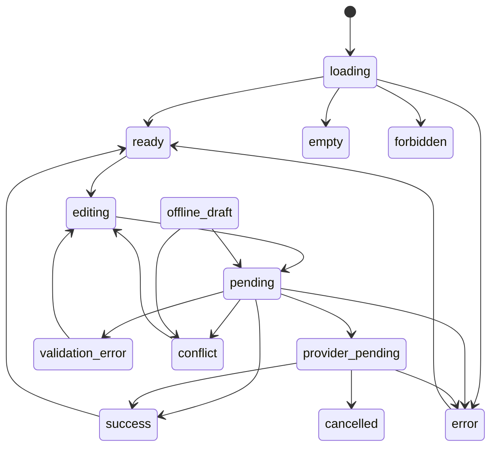

# Platform Account design

## Document control

| Field | Value |
|---|---|
| Module | Platform Account surfaces |
| Run ID | `MOD-ACCOUNT-20261010-001` |
| Phase | `01-design`, attempt 3 |
| Branch / HEAD | `feature/platform-account-pages` / `af5e511506339ef1f96e85e9248fe0feee427516` |
| Product authority | User-approved discovery decisions in `discovery.md` §10 and §14; no approved Account product document exists |
| Design status | `partial`; design proposal complete, approval and listed decisions remain open |
| Platform scope | Desktop web, mobile web, iOS and Android |

This is a design proposal, not an implementation claim. It preserves the
approved scope and capability IDs from `delivery-ledger.json`. The mandatory
visual-design subgate must produce and receive approval for its normative
wireframes before domain, access, API, sync or implementation planning begins.

## 1. Resumen del módulo

- **Propósito:** sustituir los cuatro destinos mock de Rivera por superficies
  nativas de LoopDev con semántica compartida y datos autoritativos.
- **Problema:** hoy la presencia de formularios, switches y acciones de cuenta
  da apariencia de funcionalidad aunque parte del comportamiento escribe
  estado local de ejemplo; las filas nativas tampoco navegan a esos destinos.
- **Actores:** usuario autenticado; Owner/Admin de la organización activa;
  Platform Auth/Delivery y responsable de Billing/Finance.
- **Incluido en MVP aprobado:** perfil global (nombre visible y avatar);
  preferencias personales (idioma, zona horaria, apariencia y notificaciones);
  seguridad de identidad (contraseña/email, MFA, revisión/revocación de
  sesiones); billing de la organización activa (plan, facturas, método de
  pago, upgrade/downgrade/cancelación). Desktop web, mobile web, iOS y Android
  mantienen las mismas operaciones con adaptación de interfaz.
- **Fuera de alcance:** eliminar la cuenta; administración de organización y
  miembros en Account Settings; precios, facturas o tarjetas de ejemplo;
  SSO/passkeys no aprobados; elegir proveedor sin verificar la jurisdicción
  de LoopDev, responsabilidades fiscales y modelo Merchant of Record (MoR);
  afirmar que mobile ya tiene auth nativo seguro.
- **Supuestos:** reutilizar AuthPort, Tenant Context, shell, primitivos y
  capacidades Platform existentes. Perfil/preferencias requieren un contrato
  Platform compartido; billing requiere autoridad de organización en servidor.
- **Preguntas abiertas:** proveedor y acuerdo comercial de Billing, incluida
  la comparación entre procesador de pagos y oferta MoR, domicilio legal
  preciso y obligaciones fiscales/de facturación; mecanismo soportado para
  listar y revocar sesiones individuales; aprobación de extensiones
  compartidas para Profile/Preferences y Auth. LoopDev ya está confirmado como
  vendedor. Propietarios: Product/Finance, Platform y Platform Auth.

## 2. Benchmark de mercado

Fuentes oficiales consultadas el 2026-10-10. Los mercados compradores inicialmente considerados son España, Estados
Unidos y Colombia (`DEC-ACCOUNT-012`); la lista no implica que sean los únicos
países de clientes. LoopDev es la entidad legal propietaria del SaaS y la
entidad vendedora, y operará inicialmente desde España (`DEC-ACCOUNT-014`).
Las obligaciones fiscales concretas y la elegibilidad comercial deben
validarse con Finance.

**Merchant of Record (MoR), en sencillo:** si se usa este modelo, el proveedor
actúa como vendedor ante el cliente para cada transacción y, según el
contrato, gestiona cobro, facturas e impuestos indirectos. Con un procesador
de pagos tradicional, LoopDev suele seguir siendo el vendedor y el procesador
solo tramita el pago. Esto afecta comisiones, facturación, impuestos y la
relación contractual con los clientes. Es una opción técnica/comercial para
que Finance evalúe; no se requiere que el usuario la elija ahora.
Son referencias de mercado, no selección de proveedor ni alcance adicional
para LoopDev.

| Plataforma | Capacidades relevantes | Diferenciadores | Elementos aplicables a LoopDev |
|---|---|---|---|
| Stripe Billing / Customer Portal | Gestiona facturación, métodos de pago, suscripciones y facturas; cancelar ahora o al fin del periodo, sujeto a configuración y limitaciones. | Gateway + billing management; portal configurado por el negocio, no MoR. | Stripe exige entidad en país admitido. España y EE.UU. aparecen entre países/regiones disponibles; Colombia no aparece como país de alta local en la lista consultada. Esto limita a una entidad vendedora colombiana, no necesariamente las ventas a compradores colombianos desde una entidad admitida. Validar condiciones vigentes con Stripe. [Customer portal](https://docs.stripe.com/customer-management), [disponibilidad global](https://stripe.com/gb/global), [requisitos de cuenta en otro país](https://support.stripe.com/questions/requirements-to-open-a-stripe-account-in-another-country) |
| Paddle Billing | SaaS subscription lifecycle, cambios de plan, portal hospedado para payment methods, invoices/receipts y cancelación; webhooks actualizan fulfillment. | Paddle declara operar con software sellers globalmente salvo países excluidos y actúa como Merchant of Record. | La lista oficial de suppliers no excluye España, EE.UU. ni Colombia al consultarla; confirmar onboarding del seller y por separado disponibilidad de compradores, monedas y payout con Paddle. MoR cambia vendedor contractual y factura. [Paddle for SaaS](https://developer.paddle.com/get-started/how-paddle-works/saas/), [países admitidos](https://www.paddle.com/help/start/intro-to-paddle/which-countries-are-supported-by-paddle) |
| Chargebee | Subscription billing y self-serve portal; cancelación y portal documentados oficialmente. | Orquestación de suscripciones conectada a gateway(s); no se verificó como MoR. La disponibilidad depende del gateway elegido. | No hay evidencia suficiente para afirmar cobertura conjunta España/EE.UU./Colombia sin seleccionar y revisar cada gateway, moneda, método y país de entidad. [Self-Serve Portal](https://www.chargebee.com/docs/billing/2.0/hosted-capabilities/self-serve-portal), [Cancellation](https://www.chargebee.com/docs/billing/2.0/subscriptions/cancellations), [NMI gateway](https://www.chargebee.com/docs/payments/2.0/payment-gateways-and-configuration/nmi) |

- **Baseline común:** mostrar plan/estado de suscripción, facturas e información
  de pago con autorización; establecer límites explícitos para plan changes y
  cancelación; sincronizar el estado desde eventos del proveedor y no desde
  una mutación visual optimista.
- **Capacidades avanzadas:** dunning, recuperación de churn, prorrateos
  complejos, usage-based billing, múltiples gateways, automatizaciones
  fiscales y negociación enterprise.
- **No MVP:** retención con cupones, cobro por uso, catálogo flexible,
  multi-gateway, reglas fiscales propias o analítica de ingresos.
- **Resultado por mercados:** Paddle ofrece la señal oficial más explícita
  para software sellers globales sin excluir estos tres países; validar por
  separado compradores y pagos. Stripe documenta disponibilidad local para
  entidades de España y EE.UU., pero no alta local desde Colombia en la lista
  consultada; vender a compradores colombianos desde otra entidad puede ser
  distinto. Chargebee depende del gateway. Es un filtro de factibilidad:
  costes, payouts, soporte fiscal, términos y UX móvil faltan.
- **Recomendación de diseño:** mantener un contrato provider-neutral detrás
  de una autoridad de billing del servidor. El proveedor puede gestionar
  entrada de pago/portal, pero LoopDev conserva autorización, tenant mapping,
  entitlements y estado consumido por los módulos. No seleccionar aún:
  proveedor, obligaciones fiscales, precio y términos del modelo MoR frente a
  gateway siguen sin resolverse; LoopDev ya está confirmado como entidad
  vendedora.

## 3. Encaje en LoopDev

- **Suite propietaria:** Platform como punto de entrada/account shell. Profile
  y preferencias son capacidades transversales de usuario; Security pertenece
  a Platform Auth; subscription/billing pertenece a Billing/Finance, no a un
  modelo financiero dentro de páginas de Account.
- **Módulos afectados:** Auth, Tenant Context, Platform Settings, shell y
  navegación; entitlements de suites consumidores; potencialmente CRM/ERP como
  lectores de usuario/organización, nunca como dueños de perfil o billing.
- **Rutas propuestas:** canónicas `/app/account/profile`,
  `/app/account/settings`, `/app/account/security`, `/app/account/billing`.
  Mantener `/account/{profile,settings,security,billing}` como redirects
  protegidos a la ruta canónica para preservar enlaces existentes. Añadir
  los destinos al árbol nativo de `LoopdevRoutes`; los deep links nativos
  preservan organización seleccionada solo para Billing.
- **Shell:** el shell actual selecciona LoopDev para `/launchpad` y `/app/*`,
  mientras las rutas `/account/*` están en el shell Rivera. Por ello, canonizar
  bajo `/app/account/*` evita dejar una página LoopDev dentro del shell mock.
  El menú debe apuntar a rutas canónicas.
- **Reutilización:**

| Capacidad o módulo | Decisión | Contrato existente | Integración | ¿Se extiende? | ¿Se prohíbe duplicar? |
|---|---|---|---|---:|---:|
| App shell, rutas protegidas, breadcrumbs y menú | `REUSE` | `AppShell`, `LoopdevShell`, `AppRoutes`, `ProtectedRoute`, `Topbar` | Mantener auth guard y shell LoopDev; mover destinos al subárbol `/app/*` y conservar redirects | Sí, solo cableado de rutas y navegación | Sí, no crear un segundo shell ni menú |
| Identidad/sesión/tenant | `REUSE` + `EXTEND_PLATFORM` propuesto | `AuthPort`, `TenantContextPort` | AuthPort y Tenant Context son la fuente compartida; operaciones de perfil y seguridad faltantes requieren contractar extensiones | Sí, propuesta sujeta a aprobación Platform | Sí, no implementar lógica de identidad por página |
| Perfil y preferencias | `EXTEND_PLATFORM` propuesto | `PlatformUser` y hooks existentes cubren solo parte del estado; no hay contrato compartido completo | Crear un port/contrato de Profile/Preferences consumido por web y mobile | Sí, owner Platform; approval pendiente | Sí, no duplicar almacenamiento web/native |
| Theme, i18n y notificaciones personales | `REUSE` + `EXTEND_PLATFORM` propuesto | `use-theme`, `src/i18n`, `use-notification-prefs`; mobile tiene i18n propio | Integrar hooks actuales tras normalizar contrato/sync; mantener apariencia por dispositivo | Sí, unificar solo semántica aprobada | Sí, no agregar switches de tema/idioma independientes |
| Organization Settings | `REUSE` | Settings domain/adapter y `/app/settings` | Account muestra preferencias del usuario; cambios de organización abren Settings existente | No | Sí, sin duplicar miembros/organización |
| Files/avatar | `EXTEND_PLATFORM` propuesto | Files UI/adapter compartidos; no se probó un contrato de avatar/almacenamiento personal | Reutilizar FilePicker/upload/storage si cumple privacidad; ligar referencia al perfil del usuario | Solo si falta contrato de perfil/avatar | Sí, no crear uploader paralelo |
| Activity/Notes/Tasks/Relations | `NOT_APPLICABLE` para estas cuatro capacidades | Contratos Platform existen para otras entidades | No insertar timelines/tareas/notas en pantallas de cuenta sin necesidad aprobada | No | Sí, evitar paneles genéricos irrelevantes |
| Billing/subscription | `MODULE_SPECIFIC` dentro de Billing/Finance; Account es renderer | No hay contrato/adaptador LoopDev actual | Backend resuelve org→customer y provider; clientes consumen Billing port común | Sí, requiere módulo/contrato aprobado y provider aún abierto | Sí, no crear modelo de billing en Account ni usar mock local |
| Native secure storage/navigation | `EXTEND_PLATFORM` propuesto | No hay secure storage nativo verificado; Expo account routes están vacías | Implementar adapters auténticos con igual contrato; usar almacenamiento nativo seguro | Sí, bloqueo técnico antes de exponer sesión en iOS/Android | Sí, no persistir credenciales con localStorage/Map como sustituto |

| Módulo origen | Módulo destino | Interacción | Trigger | Datos compartidos | Permisos |
|---|---|---|---|---|---|
| Account/Profile | Shell, CRM, ERP y Workspace | Actualizan nombre/avatar mostrado por productos | Profile update confirmado | `userId`, `fullName`, `avatarUrl` (campos canónicos de `PlatformUser`) | Usuario autenticado solo modifica su perfil |
| Account/Preferences | Shell, i18n, Notifications | Propagan idioma/timezone/notificaciones; appearance puede ser local | Preference update confirmado o device setting | `userId`, preference fields, version | Usuario autenticado solo modifica sus preferencias |
| Account/Security | Auth y Protected Routes | Cambio/revocación actualiza sesión y siguiente acceso | Proveedor confirma acción | Auth subject, session/factor status; no secrets | Usuario propio; reauth/AAL donde aplique |
| Account/Billing | Billing/Finance y entitlement consumers | Lee/cambia subscription y refresca entitlements | Acción Owner/Admin o webhook verificado | `organizationId`, provider customer/subscription refs, status/version | Owner/Admin en organización activa; enforcement servidor/RLS |
| Platform Settings | Account | Sin integración de datos; account link no cambia organización/miembros | Usuario elige preferencias personales | Active tenant solo para navegación | Settings conserva sus permisos/roles existentes |

**Entidades compartidas:** `PlatformUser`, `TenantContextSnapshot`,
`Organization`, role y autorización; nuevas entidades de Profile/Preferences,
Auth factor/session y Billing requieren contratos respectivos.

**Integraciones requeridas:** Notes, Tasks, Activity, Files y Relations no
son necesarias por ahora. Para avatar, auditar Files y storage antes de
implementación. No crear notas, tareas, timeline ni relaciones paralelas.

**Compatibilidad local-first:** preferencias editables pueden conservar un
borrador local y sincronizar; apariencia puede ser local al dispositivo.
Security y Billing requieren autoridad remota y no prometen éxito offline.
Datos/provider webhooks quedan del lado servidor.

## 4. Actores, casos de uso y UX

| Vista | Casos de uso y composición | Desktop web | Mobile web | iOS / Android |
|---|---|---|---|---|
| Perfil | Ver nombre/avatar; editar y guardar; seleccionar/cambiar avatar usando Files si aplica | `PageContainer` narrow/default, `PageHeader`, `FormSection`, `SettingsCard` | Una columna, campos apilados, CTA sticky solo si primitivo existente | Pantalla nativa de perfil, picker del SO con permiso contextual y recorte accesible |
| Preferencias | Idioma, zona horaria, apariencia, categorías de notificaciones; mostrar qué sincroniza y qué es local | Secciones en `FormSection`; selects/popovers compartidos, no `<select>` nativo | Controles apilados y touch targets adecuados; no interacciones hover-only | Selectores nativos adaptados, mismas opciones/copy keys y acción semántica |
| Seguridad | Estado de email, cambio email/password, MFA factor enrollment/removal, sesiones; reauth antes de acciones sensibles | Secciones claras, formularios dedicados y confirmación de factor/sesión | Una columna; explicación de impacto; no tabla ancha | Flujos nativos para MFA/biometría no sustituye al proveedor; navegación back conserva estado seguro |
| Billing | Organización activa explícita, plan/estado, siguiente ciclo, facturas descargables, método de pago y acciones permitidas | Billing overview, historial, acción de portal/provider | Tarjetas compactas y facturas descargables; CTA contextual | Vista equivalente; abrir provider flow seguro mediante browser/auth session o SDK aprobado, volver al mismo deep link |

No se propone kanban/calendario/dashboard, bulk actions, filtros avanzados,
exportación general ni búsquedas; no aportan valor a estas vistas personales.
Billing puede filtrar historial de facturas solo si el volumen de datos lo
justifica y el provider lo soporta.

| Superficie | Loading | Empty | Error | Forbidden | Conflict | Offline | Pending | Success |
|---|---:|---:|---:|---:|---:|---:|---:|---:|
| Profile | Sí | Perfil inicial | Sí | Sí | Versionado | Draft local; guardar al volver online | Sí | Solo tras confirmación |
| Preferences | Sí | Defaults visibles | Sí | Sí | Por campo | Sí, con indicador de cola | Sí | Tras sync; appearance puede ser local |
| Security | Sí | Sin factor inscrito | Sí | Sí | Reconsultar provider | Solo lectura no sensible; no mutar | Challenge/verificación | Solo provider-confirmed |
| Billing | Sí | Sin plan/facturas | Sí | Sí | Refrescar estado autoritativo | Sin mutación/datos sensibles cacheados | Checkout/portal/webhook | Solo backend/provider-confirmed |

**Navegación:** account menu navega a cuatro IDs de acción estables. Breadcrumbs
`Account > {Profile, Settings, Security, Billing}`. Refresh y deep-link
resuelven de nuevo auth + permisos; back vuelve a la superficie anterior.
Not-found usa ruta wildcard existente. Si org deja de estar activa, Billing
limpia el estado y pide seleccionar organización; nunca conserva facturas de
otra organización en pantalla.

**Contrato semántico compartido:** los operation IDs y copy keys se derivan
del ledger y no pueden variar por renderer. Cada key tendrá recursos `es`/`en`;
la tabla define identidad, scope y semántica accesible.

| Capability | Operation ID(s) estable(s) | Copy key(s) | Permiso/semántica |
|---|---|---|---|
| Navigation | `open_profile_destination`, `open_account_settings_destination`, `open_security_destination`, `open_billing_destination` | `account.action.<operation_id>` | Enlace/botón accesible; Billing se presenta solo con rol permitido y el servidor vuelve a validar |
| Profile | `read_profile`, `update_display_name`, `change_avatar` | `account.action.<operation_id>` | Solo usuario autenticado; error de versión no se anuncia como guardado |
| Preferences | `read_preferences`, `change_language`, `change_timezone`, `change_appearance`, `change_personal_notifications` | `account.action.<operation_id>` | Solo preferencias propias; informar cuáles sincronizan y cuál puede ser local |
| Security | `read_security_status`, `change_password`, `change_email`, `manage_mfa`, `sign_out_other_sessions` | `account.action.<operation_id>` | Solo identidad propia; reauth/challenge y estado destructivo provider-backed |
| Billing | `read_subscription`, `change_plan`, `cancel_subscription`, `manage_payment_methods`, `view_invoice` | `account.action.<operation_id>` | Owner/Admin del org activo; plan/cancel requieren confirmación |

Las acciones se exponen como botones/enlaces nativos con nombre accesible,
estado disabled/busy anunciado y foco conservado tras retorno del proveedor.
Los renderers adaptan teclado/touch, no catálogo, errores, permiso, navegación
ni significado accesible.

**Accesibilidad:** foco visible y orden lógico; headings y labels asociados;
feedback anunciado con live regions; error en campo + resumen enfocable;
drawer/dialog devuelve foco y soporta Escape en web; confirmación no depende
solo de color; MFA QR incluye alternativa textual/copy controlado; touch
targets mínimos de plataforma; i18n para es/en y expansión RTL sin clipping.
No guardar secretos en historial, URLs, logs ni analítica.

**Flujos sustituidos:**

| Flujo legacy | Ubicación | Reemplazo | Eliminado | Evidencia |
|---|---|---|---:|---|
| Profile mock/localStorage | `src/template/rivera/pages/account/Profile.tsx` | Profile compartido, user-owned, con persistencia autorizada | No; planificar route replacement y remover dependencia en build | Discovery §11; wireframes y runtime quedan en visual/build |
| Settings mock mixto | `src/template/rivera/pages/account/Settings.tsx` | Personal Preferences; organización permanece `/app/settings` | No | Discovery §11; route/state regression pendiente |
| Security mock toggles | `src/template/rivera/pages/account/Security.tsx` | AuthPort/provider-backed Security, nunca falso éxito | No | Discovery §11 y gaps Auth abajo |
| Billing mock data | `src/template/rivera/pages/account/Billing.tsx` | Billing port con datos del tenant/proveedor | No | Discovery §11; proveedor abierto |
| Mobile account rows | `apps/mobile/components/MobileAccountSheet.tsx`, `MobileAccountScreen.tsx` | Native routes/screens con los mismos operation IDs | No | Source audit; operaciones nativas faltantes |

## 5. Máquina de estados y ciclo de vida

La tabla especifica estados de UI/operación comunes; el proveedor conserva su
propio ciclo de suscripción. No elevar un estado UI a evento de dominio sin
contrato aprobado.

| Estado | Tipo | Entrada permitida | Salidas | Actor | Validaciones | Evento |
|---|---|---|---|---|---|---|
| `loading` | UI | Entrar a vista/recargar | `ready`, `empty`, `error`, `forbidden` | Cliente | Auth, active org y autorización | ninguno |
| `ready` | UI | Carga válida | `editing`, `reauth_required`, `pending` | Usuario | Scope y datos vigentes | ninguno |
| `editing` | UI | Abrir edición | `pending`, `validation_error`, `offline_draft` | Usuario | Validación local compartida | ninguno |
| `pending` | Mutación | Enviar comando válido | `success`, `provider_pending`, `error`, `conflict` | Usuario/adapter | Validación servidor y precondición de versión | Command accepted |
| `provider_pending` | Auth/Billing | Proveedor exige verificación/redirect | `success`, `error`, `cancelled` | Proveedor/usuario | Challenge, return state seguro | Provider result |
| `success` | Resultado | Confirmación autoritativa | `ready` | Backend/provider | Resultado remoto observado | Evento domain correspondiente |
| `validation_error` | Error | Validación falla | `editing` | Usuario | Campos y reglas detallados | ninguno |
| `forbidden` | Acceso | Scope/role no permite acceso | `ready` o salir | Backend/cliente | Revalidar; no exponer payload sensible | Audit denied si está contratado |
| `conflict` | Concurrencia | Versión cambió | `editing` tras comparar/descartar | Usuario/backend | No sobrescribir silenciosamente | Conflict recorded |
| `offline_draft` | Preferences only | Red no disponible | `pending`, `conflict`, `error` | Usuario/sync | No aplica a Security/Billing; borrador etiquetado | queued mutation |
| `error` | Fallo | Red/proveedor/servicio falla | `ready`, `pending` al reintentar | Usuario/adapter | Error visible, retry idempotente | Integración fallida si procede |
| `cancelled` | Provider/UI | Usuario cancela challenge o confirmación | `ready` | Usuario | Estado remoto se vuelve a consultar | ninguno |
| `empty` | Datos | Perfil inicial, MFA sin factor o sin facturas | `editing` o `ready` | Usuario | Mensaje no confunde ausencia con error | ninguno |

**Transiciones de negocio propuestas:** cambio de email: `current →
confirmation_pending → active`; solo considerar activo tras confirmación
autorizada del proveedor. MFA: `not_enrolled → enrollment_pending →
verified → unenroll_pending → not_enrolled`; no mostrar enabled antes de
`verified`. Sesiones: cada registro visible es una sesión provider-verified;
revocation individual permanece abierta hasta validar soporte de proveedor.
Billing: reflejar únicamente estados leídos del proveedor (p. ej. trialing,
active, past_due, paused, canceled); los commands generan `provider_pending`
y esperan webhook/lectura autoritativa. Cancelación puede ser inmediata o al
fin del periodo según decisión/provider, aún no aprobada.

## 6. Modelo de datos funcional

Las estructuras siguientes son propuestas de dominio; no existen aún como
persistencia o interfaces implementadas.

| Entidad | Atributos mínimos | Scope/relaciones | Invariantes/versionado/borrado |
|---|---|---|---|
| `PlatformUser` profile fields | Existing `userId`, `fullName`, `avatarUrl?`, `updatedAt` | Una identidad global; no lleva `organizationId` | `fullName/avatarUrl` son los únicos campos canónicos; no crear `UserProfile` separado. Avatar sujeto a política de Files/Storage por aprobar |
| `UserPreferences` | `userId`, `language`, `timeZone`, `notificationPreferences`, `version`, `updatedAt` | Una por usuario; sincronizada entre organizaciones/dispositivos | Cambios a nivel campo; validar locales/timezones permitidos; versionado para detectar ediciones concurrentes |
| `DeviceAppearance` | `userId`, `deviceKey`, `theme`, `updatedAt` | Un valor local por instalación/dispositivo, si el usuario lo desea | Sin secretos; borrar en logout/cambio de usuario según política local |
| `AuthFactor` | Provider factor ID/type, status, friendly name, created/verified timestamps | Usuario autenticado; leer vía provider | Secrets de factor no regresan al cliente; cambios auditables; proveedor autoritativo |
| `AuthSessionSummary` | Opaque session ID, device/client label si disponible, created/last-active/expiry | Usuario; jamás exponer token/refresh token | Solo datos provider-backed; capacidad de lista/revoke no está aprobada hasta resolver limitación |
| `OrganizationBillingAccount` | `organizationId`, provider, providerCustomerRef, status/version | 1 organización → billing customer; no vincular por email | Mapping creado/actualizado en backend; idempotencia y unicidad por provider+org |
| `SubscriptionSummary` | `organizationId`, provider subscription reference(s), `planRef`, provider status, period dates, `cancelAtPeriodEnd`, version | Pertenece a la organización/customer activo; el número de suscripciones concurrentes está abierto | Provider es autoridad de cobro; cardinalidad y status mapping deben resolverse con Billing; entitlement derivado no se concede por UI |
| `InvoiceSummary` | provider invoice ref, number, amount/currency, dates, status, hosted/PDF URL temporal | Pertenece a la organización/customer | URL firmada/temporaria; verificar tenant en backend; retención fiscal la define proveedor/Finanzas |
| `PaymentMethodSummary` | Provider ref, type, last4/brand/expiry si aplica | Pertenece a billing customer; cliente recibe summary | No almacenar PAN/CVC en LoopDev; portal/SDK procesa datos sensibles |
| Registro/evento de auditoría Platform | Actor, acción, scope, outcome, timestamp, correlation ID y metadata mínima, solo según contrato compartido | User scope o organization scope según el comando | Reusar auditoría Platform verificada; no crear un agregado `AccountAuditRecord` sin owner/retención aprobados; excluir passwords, OTP, tokens y detalles de pago |

**Representación local/remota:** mantener cache mínimo por usuario y
`organizationId`; cambiar de identidad/tenant invalida datos anteriores.
Preferencias pueden persistirse localmente con sync/version; Security/Billing
solo presentan lecturas confirmadas y no encolan escritura offline. Nunca usar
mock data de Rivera como fallback de producción. El adapter remoto debe validar
respuesta, scope y versión; RLS y endpoint son la autoridad.

El análisis de dominio especializado está en `domain-model.md`; sus límites y
decisiones abiertas son parte de esta propuesta y no crean contratos o
persistencia implementados.

## 7. Requerimientos funcionales

Los IDs existentes son append-only. Las filas no añaden ni eliminan requisitos
del ledger; la complejidad es una estimación inicial.

### Nivel 1 — Core Operativo / MVP

| ID | Capacidad | Prioridad | Dependencias | Complejidad | Criterio de aceptación |
|---|---|---|---|---|---|
| `REQ-ACCOUNT-PROFILE-DESTINATION` | Perfil global | P0 | Profile contract, user identity, avatar storage | M | Nombre/avatar se leen y guardan para la misma identidad en todas las organizaciones; error/conflict no simula éxito |
| `REQ-ACCOUNT-PREFERENCES-DESTINATION` | Preferencias personales | P0 | i18n, timezone catalog, notification contract, sync adapter | M | Idioma/zona horaria/notificaciones se sincronizan por usuario; appearance puede ser local; `/app/settings` conserva configuración de organización |
| `REQ-ACCOUNT-SECURITY-DESTINATION` | Seguridad | P0 | AuthPort, reauth, proveedor MFA, server session capability, native secure storage | L | Cada acción muestra estado verificado o `operation_unsupported`; email requiere confirmación; no hay éxito simulado |
| `REQ-ACCOUNT-BILLING-DESTINATION` | Billing por organización | P0 | Owner/Admin authorization, billing backend/provider, entitlements/webhooks | XL | Solo Owner/Admin acceden a datos del tenant activo; plan/facturas/pagos/cambios proceden de provider/backend, sin fixtures de Rivera |
| `CAP-ACCOUNT-NAVIGATION` | Cuatro destinos protegidos | P0 | Auth shell, rutas web/native, redirects | M | Deep link, refresh, back y auth guard llevan a la superficie correcta; ruta vieja redirige sin render Rivera |
| `CAP-ACCOUNT-PROFILE` | Leer/actualizar nombre/cambiar avatar | P0 | Shared `PlatformUser` update contract and Files/storage contract | L | `read_profile`, `update_display_name`, `change_avatar` use canonical `fullName/avatarUrl` and share identity/validation on all four platforms |
| `CAP-ACCOUNT-PREFERENCES` | Leer y guardar preferencias | P0 | Shared preferences port + i18n/theme/notifications | L | `read_preferences`, `change_language`, `change_timezone`, `change_appearance`, `change_personal_notifications` mantienen propiedad y sync decididos |
| `CAP-ACCOUNT-SECURITY` | Auth personal | P0 | Auth provider, AuthPort extension, secure native storage | XL | `read_security_status`, `change_password`, `change_email`, `manage_mfa`, `sign_out_other_sessions` son reales o explícitamente unsupported; no se inventa inventario de dispositivos |
| `CAP-ACCOUNT-BILLING` | Billing subscription | P0 | Provider-neutral billing contract, server RBAC, tenant map | XL | `read_subscription`, `change_plan`, `cancel_subscription`, `manage_payment_methods`, `view_invoice` consultan proveedor/servidor y persisten estado autoritativo |

### Nivel 2 — Automatización y colaboración

No aprobado para MVP: recordatorios de expiración/renovación, portal de
autoservicio configurado, notificaciones de payment failure, historial de
cambios, auditoría visible, plan usage meter, dunning o owner handoff.
Promover solo mediante decisión de producto; no añadir Notes/Tasks/Activity
por simetría con otros módulos.

### Nivel 3 — Enterprise / IA

Fuera del MVP: SSO/SCIM, passkeys, approvals avanzadas, múltiples billing
accounts por tenant, consolidated invoicing, multi-currency, chargeback
analytics, forecasting, IA o controles de compliance enterprise.

## 8. API, eventos y backend

Contratos/endpoints son candidatos para `api-contracts`, no APIs existentes:

| Capacidad | Comando/query propuesto | Autoridad / efectos |
|---|---|---|
| Perfil | `GET /me/profile`, `PATCH /me/profile` (version + patch) | Authenticated user only; avatar reference validada; registrar auditoría mínima |
| Preferencias | `GET /me/preferences`, `PATCH /me/preferences` | User-scope; validación de locale/timezone; idempotency key y version |
| Security | Provider AuthPort methods y backend seguro para `listSessions` / revocación soportada | Nunca aceptar user ID del cliente como autoridad; reauth/AAL y comprobación provider-side |
| Billing | `GET /organizations/{orgId}/billing`, `GET .../invoices`, `POST .../portal-session`, `POST .../plan-change`, `POST .../cancel` | Backend deriva actor y active org; Owner/Admin server-side; secret del proveedor solo servidor |

**DTOs candidatos:** input de profile con campos mutables allowlisted +
`expectedVersion`; preferences con campos permitidos + `expectedVersion`;
security input no guarda código MFA tras respuesta; billing responses solo
resúmenes sin datos de tarjeta/invoice URL permanente. API contract define
errores discriminados `validation_error`, `unauthenticated`, `forbidden`,
`provider_unavailable`, `operation_unsupported`, `version_conflict`,
`reauth_required`, `payment_failed`.

**Persistencia e integración:** transacción por cada profile/preferences
patch; organización/provider-customer mapping único; plan change/cancel
protegidos por idempotency key y auditoría; webhooks verificados por firma,
deduplicados por event ID, guardados antes de actualizar billing projection y
entitlements; reintentos con backoff y DLQ/alerta. No escribir directamente a
tablas internas de Supabase Auth para gestionar sesiones sin una API de
proveedor soportada.

**Eventos propuestos (no implementados):**

| Evento | Productor | Payload mínimo | Consumidores | Idempotencia/reintento |
|---|---|---|---|---|
| `platform.user_profile.updated` | Profile service | `eventId`, `userId`, `version`, changed fields, `occurredAt` | Shell y módulos que muestran identidad | Outbox + `eventId`; consumer conserva última versión |
| `platform.user_preferences.updated` | Preference service | `eventId`, `userId`, `version`, changed keys, `occurredAt` | Web/native preference adapters, i18n, notification settings | Mutation key; consumer ignora versión repetida/antigua |
| `platform.auth.email_change_pending` / `platform.auth.mfa_factor_changed` | Auth adapter/provider callback | `eventId`, `userId`, status, opaque provider ref, timestamp | Auth UI/session policy | Provider request/event ID; retry solo lecturas idempotentes |
| `platform.auth.session_revoked` | Auth provider/server operation | `eventId`, `userId`, opaque session ID, `occurredAt` | Current client/session cache | Dedup `eventId`; purge local sensitive cache |
| `billing.subscription.updated` / `billing.subscription.cancel_requested` | Verified provider webhook / Billing service | `eventId`, `organizationId`, subscription ref, status, version, effective date | Entitlements, Billing UI, audit | Provider event ID unique; persist before ack; backoff/DLQ |
| `billing.payment_failed` / `billing.invoice.finalized` | Verified provider webhook | `eventId`, `organizationId`, invoice ref, status, amount/currency summary | Billing UI, Finance; notifications only if approved | Provider event ID unique; replay-safe, PII minimized |

**Lectura/observabilidad:** paginar facturas desde servidor, limitar rangos y
reusar caché solo con scope/version; no cachear portal URLs; log correlation
IDs y error class sin PII/payment secrets; observabilidad registra latencia,
webhook lag/failures, sync queue age y auth/security failure rate.

## 9. Matriz RBAC y reglas de negocio

La tabla usa roles de producto; `Admin` incluye Owner y Admin actuales de
`PlatformRole`. Editor/Viewer no equivalen a billing manager.

| Acción | Admin | Manager | Usuario | Solo lectura |
|---|---:|---:|---:|---:|
| Ver/editar el propio perfil y preferencias | Sí | Sí | Sí | Sí, solo lectura no editable |
| Cambiar la propia contraseña/email y administrar los propios factores | Sí | Sí | Sí | Sí, pero no editar |
| Ver/revocar sus propias sesiones | Sí | Sí | Sí | Sí, sujeto a provider capability |
| Ver billing de organización activa | Sí | No* | No | No* |
| Cambiar plan, método de pago o cancelar organización | Sí | No* | No | No* |
| Leer invoices de la organización | Sí | No* | No | No* |
| Administrar ajustes/miembros de organización | Según Settings role | Según Settings role | Según Settings role | Según Settings role |

`*` Decisión de usuario: solo Owner/Admin; backend verifica membership y role
en cada request, sin confiar en navegación/claim móvil. Actualmente el adapter
móvil mapea todo usuario no-superadmin como `admin`; es una divergencia
existente que debe corregirse antes de abrir Billing.

**Scope:** Profile/Preferences/Security siempre `userId = authenticated
subject`; Billing siempre `organizationId` obtenido de Tenant Context y
verificado contra membresía actual. Al cambiar organización, cerrar/limpiar
Billing view/cache. Denegar URL directa, IDOR, invoices de tenant incorrecto,
exports/URLs externos reutilizados y respuestas cacheadas tras perder rol.
Una UI oculta no es control de acceso.

**Corner cases:**
1. El usuario cambia de organización mientras una factura/plan change está en
   vuelo: asociar el resultado al org original; no renderizarlo en el nuevo.
2. El email nuevo está en espera de confirmación o ya pertenece a otra cuenta:
   mantener identidad vieja activa hasta verificación; error no cambia perfil.
3. El último factor MFA se retira en una sesión de nivel insuficiente: pedir
   step-up/reautenticación; no degradar silenciosamente.
4. Dos Owner/Admin cambian plan o cancelan simultáneamente: provider idempotency
   + versión; refrescar tras conflicto y mostrar operación efectiva.
5. Refresh token/session se revoca mientras cliente está offline: invalidar
   caché sensible y no permitir comandos encolados de seguridad/billing.

## 10. Arquitectura frontend

- **Web routes:** `src/routes/LoopdevRoutes.tsx` debería ser dueño de rutas
  `/app/account/*` protegidas bajo LoopDev shell; `AppRoutes.tsx` conserva
  redirects de `/account/*`. Los destinos no deben importar
  `src/template/rivera/pages/account/*`.
- **Native routes:** `apps/mobile/LoopdevRoutes.tsx` deja de exportar un
  `Fragment` vacío y declara destinos/screens; `MobileAccountSheet` y
  `MobileAccountScreen` navegan por acción estable compartida, no `onClose`
  como handler final.
- **Presentación:** Account pages consumen contratos/use cases; componen
  `PageContainer`, `PageHeader`, `FormSection`, `SettingsCard`, `EmptyState`,
  `LoadingState`, `ConfirmDialog` y primitives existentes. Preferir
  `@/components/common` y `@/components/ui/select`, Popover/Command. No crear
  design system, componentes paralelos, `<select>` nativo o formularios
  embebidos en Topbar.
- **Hooks:** propuestos `useAccountProfile`, `useAccountPreferences`,
  `useAccountSecurity`, `useOrganizationBilling`; separar query y mutation,
  mantener stable operation IDs/labels/permissions compartidos.
- **Adapters:** web/native consumen el mismo contrato. Local preferences adapter
  solo para preferencias; web Supabase adapter; mobile provider adapter con
  secure storage real; Billing server adapter. Componentes no importan SDKs de
  proveedor ni realizan queries directas.
- **Updates:** perfil/preferencias optimistic solo con rollback/version checks
  y estado `pending`; Security/Billing pessimistic, actualizar tras provider
  response/webhook; cancel/plan change no se marca success solo porque se
  abrió un portal.
- **Tests:** domain/contract tests compartidos; adapter contract tests en web
  y mobile; route redirect/deep-link tests; focused renderer tests por
  operación; tenant/role tests del backend; native unit tests y Expo web
  bundle; visual snapshots después del source aprobado.
- **Áreas afectadas:** `packages/contracts/src/`, `src/loopdev/domains/platform`,
  `src/loopdev/pages/`, `src/routes/{AppRoutes,LoopdevRoutes}.tsx`,
  `src/components/layout/Topbar.tsx`, `apps/mobile/{LoopdevRoutes.tsx,adapters,
  components}`, adapter API/migrations y pruebas respectivas. Son áreas
  candidatas, no archivos autorizados para editar antes de aprobación.

## 11. Arquitectura local-first y sincronización

| Dato/operación | Local/offline | Sync/autoridad |
|---|---|---|
| Idioma, timezone y notificaciones personales | Borrador y cola offline permitidos; indicar “pendiente de sincronizar” | User preference service es autoridad al reconectar; deduplicar por mutation ID y version |
| Apariencia | Preferencia local por dispositivo, capaz de inicializar desde theme actual | No requiere sync, salvo decisión explícita futura |
| Profile/avatar | Cache de lectura y draft temporal; upload requiere storage disponible | Profile service y Files/Storage autorizados; revisar contenido antes de publicar avatar |
| Security/email/MFA/sesiones | Solo lectura cacheada mínima; no escribir offline ni almacenar OTP | Auth provider remoto; requerir reauth/challenge; limpiar datos al logout/revoke |
| Billing/plan/payment/invoices | Sin mutaciones offline; no cachear sensitive details; factura/portal link de corta duración | Provider + backend; entitlements llegan desde webhook/read model verificado |

**Conflictos y migración:** client manda `expectedVersion` e idempotency key;
preferencias con conflicto muestran valor remoto/local y permiten conservar o
descartar; no emplear last-write-wins global hasta aprobación de `sync-design`.
Migración por adapter: Rivera localStorage no se importa como verdad de
negocio. Theme/locale actuales se leen una sola vez solo si se aprueba una
migración explícita, con usuario/tenant key correcto. Expo storage actual
localStorage/Map no es secure storage: no guardar tokens allí en native; migrar
con sesión reautenticada o invalidar/renovar credenciales de forma segura.

## 12. Plan de implementación por fases

La secuencia siguiente es propuesta para `module-plan`; no es permiso para
implementar. Toda fase depende de la aprobación explícita de alcance y
evidencia del paso anterior.

| Fase | Objetivo | Frontend | Backend | Datos/Sync | Validación |
|---|---|---|---|---|---|
| 1. Decisiones y contratos | Aprobar dueño de Profile/Preferences/Auth/Billing, provider, markets y session operations | View/action/state contract | Elegir server/provider boundary | Entidades, scope y versions | Contratos revisados; IDs ledger intactos |
| 2. UX/visual | Wireframes desktop/mobile y aprobaciones conceptual/runtime separadas | Reusar Rivera/Platform UI; definir native compositions | No backend real requerido | Nada sensible local | SVG/wireframes + accessibility/state matrix aprobados |
| 3. Adapter local | Perfil/preferences en sandbox o fixtures controlados | Páginas con estados honestos; sin Rivera templates | Stub explícito solo para dev/test | Persistencia local preferences; no fake security/billing success | Contrato compartido web/mobile, tests y reset fixtures |
| 4. Backend/auth/billing | Operaciones autorizadas y proveedor real | UI consume port | RLS/API, Auth functions, billing adapter, webhooks | Tenant mapping, audit, entitlements | Role isolation, idempotency, provider test env |
| 5. Sync/migración | Portar preferencias con conflicto y limpiar mock flows | Pending/conflict/recovery UX | Preference API estable | Versioning/queue and secure native storage | Reload/offline/conflict tests, no mock source |
| 6. Integraciones | Alertas de pago/renovación si aprobadas | Notifications/settings | Jobs/provider webhooks | Audit/event consumers | Retry, duplicate webhook, failure recovery |
| 7. Enterprise | Features con nueva aprobación | UX additions | SSO/SCIM/usage/multi-currency | Governance/compliance | Separate acceptance and release gate |

| Fase | Dependencias | Entregables | Riesgo principal | Criterio de aceptación |
|---|---|---|---|---|
| 1. Decisiones y contratos | Design approval; owners de Platform/Auth/Finance | Contracts y decisiones domain/access/API/sync | Diseñar con provider o permisos supuestos | Owners, scope, errores y operación por plataforma aprobados |
| 2. UX/visual | Fase 1; visual approval | `visual-design.md`, `view-state-matrix.md`, SVGs | Copiar mock o crear patrón paralelo | Revisión conceptual aprobada para las cuatro plataformas |
| 3. Adapter local | Contratos y wireframes aprobados | Preference/Profile adapter local controlado + tests | Elevar fixtures a persistencia de producción | Reload/offline/error funcionan; Security/Billing no simulan success |
| 4. Backend/auth/billing | Provider, tenancy, RBAC y API aprobados | RLS/API, Auth/Billing adapters, webhooks | IDOR, entitlement incoherente, falso resultado financiero | Tenant isolation, firma/idempotencia y sandbox tests pasan |
| 5. Sync/migración | Adapter local y API estables | Preferences sync, queue/version, secure native storage | Overwrite/conflicto o credenciales expuestas | Retry/conflict/cache-purge/native storage tests pasan |
| 6. Integraciones | Fase 4; decisión adicional de notificaciones | Jobs/webhooks/notificaciones aprobadas | Eventos duplicados o desordenados | Retry, DLQ y reconciliación comprobados |
| 7. Enterprise | Aprobación de producto separada | Features Enterprise y ledger extendido | Scope creep/retención de datos | Change request y aceptación multiplataforma aprobados |

## 13. Estrategia de pruebas y criterios de aceptación

**Cobertura funcional:** rutas Profile/Settings/Security/Billing desde menú
desktop y mobile; iOS/Android menu and deep links; creation/editing/read
flows; redirects antiguos; permisos por rol/tenant; email verification;
MFA enroll/unenroll; invoice view/download; plan-change/cancellation pending;
validación y estados vacíos. No aplican kanban, bulk o export general.

**Dominio/backend:** profile ownership, preference validation/version,
provider session/MFA errors, organization billing scope, role changes during
request, IDOR/RLS, invoice tenant integrity, idempotent provider operations,
duplicate/out-of-order webhook, entitlement update, conflict/retry.

**Frontend:** route shell selection, direct load/refresh/back, forms and
validation, error boundaries, focus traps/restoration, semantic controls,
mobile touch targets, i18n/RTL layout, no Rivera import or sample values,
pending/error/forbidden/conflict/offline messaging.

**Local-first:** preference reload persistence, offline draft and retry,
duplicate mutation, cross-device sync, conflict resolution, account switch
cache purge; verify Security and Billing never report offline write success.

**Visual regression:** desktop and mobile web, iOS/Android compositions for
each primary view, loading/empty/error/forbidden/conflict/offline/pending/
success; compare runtime screenshots to approved visual source after build.

| ID | Requisito | Tipo de test | Caso de éxito | Caso de fallo | Evidencia |
|---|---|---|---|---|---|
| `REQ-ACCOUNT-PROFILE-DESTINATION` | Navigation + user scope | Route/component + adapter contract | Personal changes follow same user across org switch | Cross-user update denied, error visible | Test report and route evidence |
| `REQ-ACCOUNT-PREFERENCES-DESTINATION` | Preference semantics/sync | Shared contract + offline adapter | Synced values survive reload/device sync; theme may remain device-local | Conflict or unsupported locale is surfaced | Contract test + sync evidence |
| `REQ-ACCOUNT-SECURITY-DESTINATION` | Auth provider operations | Provider adapter + security integration | Supported operations return verified state | Unsupported/re-auth/provider error never succeeds | Auth contract tests + provider sandbox |
| `REQ-ACCOUNT-BILLING-DESTINATION` | RBAC/tenant/provider | API/RLS + UI component | Owner/Admin reads active org billing | Member, stale role and wrong org denied | RLS/API tests + provider webhook evidence |
| `CAP-ACCOUNT-NAVIGATION` | Web/native route operation parity | Router and native navigation tests | Every action opens same destination meaning | Unauthenticated/unknown route handled | Desktop/mobile/native test artifacts |
| `CAP-ACCOUNT-PROFILE` | Profile commands | Domain, adapter and component tests | Read/update/avatar operation shared | Validation, upload failure, stale version | Per-platform contract test |
| `CAP-ACCOUNT-PREFERENCES` | Preference operations | Domain and sync tests | Five operation IDs behave consistently | Offline/conflict/error states explicit | Per-platform contract test |
| `CAP-ACCOUNT-SECURITY` | Security operations | Auth integration + tests | Provider-confirmed email/MFA/session results | Operation unsupported or reauth rejected | Provider/API evidence |
| `CAP-ACCOUNT-BILLING` | Billing operations | Billing API/RLS/webhook tests | Reads and changes use active org and provider | Payment failure, webhook retry and forbidden role stay safe | Provider sandbox + API logs redacted |

Each MVP acceptance row must gain a concrete command and result during
`module-build`/`module-verify`; this design has no runtime/test claim yet.

## 14. Seguridad, cumplimiento y operación

- **Tenant isolation:** backend resolves organization membership from trusted
  session; RLS or server policy scopes every billing read/write; don't trust
  client-provided org ID/role or mobile role mapping.
- **Auth/session:** reauthenticate sensitive changes; email change verifies
  new address; MFA requires provider challenge/verification and policy
  enforcement. Supabase documents MFA APIs, `updateUser` and local/others/
  global sign-out scopes, but the current `AuthPort` exposes only password
  update/reset. Session listing and revocation of one arbitrary session lack
  a confirmed public app API in the inspected docs; don't mutate internal
  Auth tables directly.
- **Sensitive data:** no password, OTP, refresh token, card PAN/CVC or
  unredacted payment payload in logs, telemetry, crash reports, local
  preferences or screenshots. Only show payment method summaries from provider.
- **Cache/retention:** purge on logout, identity/tenant/role change, session
  revoke; sensitive info uses short-lived/no cache; billing records obey
  provider/Finance retention requirements; avatar retention/delete remains
  Files policy decision.
- **Rollback:** feature flags per route/capability; rollback routes to safe
  read-only/disabled state, never to mock mutation flows. Disable Billing
  writes/webhooks independently, preserve verified read model and support
  replay/idempotent reconciliation. Disable Security controls only with
  explicit notice and provider-backed recovery path.
- **Telemetry/support:** count action failures/latency, sync retry age,
  provider webhook lag and access-denials by capability without PII; alert on
  abnormal failure spikes, webhook backlog and authorization-denial anomalies.

## 15. Riesgos, decisiones y roadmap

**Decisiones confirmadas:** four capabilities, ownership boundaries, Owner/Admin
billing permission, personal preference sync fields, four required platforms,
no account deletion, no sample/mock behavior as business truth, and initial
buyer markets Spain, United States and Colombia.

**Assumptions/proposals:** canonical `/app/account/*` with old-route redirects;
Profile/Preferences as shared Platform contracts; auth/billing commands
provider-backed; provider-neutral Billing port; controlled provider portal
for payment details if compatible with approved cross-platform UX.

**Open decisions and blockers:**

| ID | Status | Question / impact | Owner | Proposed safe default | Approval needed |
|---|---|---|---|---|---|
| `DEC-ACCOUNT-008` | `open` | Billing provider, processor-vs-MoR commercial terms, tax/payout obligations and hosted-portal parity remain unselected; LoopDev is the confirmed seller | Product + Finance | Provider-neutral server port; compare viable offerings for LoopDev operating initially from Spain and check compatibility with its confirmed seller role | Finance validates fees, tax/invoicing responsibilities, domicile and contract terms; any change to seller identity requires explicit approval |
| `DEC-ACCOUNT-009` | `resolved_with_scope_change` | User approved provider-backed “sign out other sessions”; per-session inventory and individual revocation are excluded because Supabase Auth does not expose that user-facing capability | User | Use the supported `others` sign-out scope only; never fabricate devices or write Auth internals |
| `DEC-ACCOUNT-010` | `open` | Preference catalog, avatar policy, cancellation effect date, entitlement authority and audit retention are not decided | Product/capability owners | Keep values provider/domain neutral; no irreversible side effect until policy exists | Approve detailed domain/API/access/sync decisions in specialist phases |
| `DEC-ACCOUNT-011` | `partial` | User approved extending the shared contract to edit canonical `PlatformUser.fullName/avatarUrl`; Preferences/Auth operation extensions still need Platform owner approval | User / Platform owner | Reuse the canonical fields; no separate `UserProfile`; track remaining extensions as Platform work | Confirm ownership and approve remaining shared extensions |
| `DEC-ACCOUNT-012` | `confirmed` | Spain, United States and Colombia are initial buyer markets considered; customers may be in other countries too | User | Evaluate those markets without treating them as an exclusive list | Confirmed by user conversations on 2026-10-10 and 2026-10-11 |
| `DEC-ACCOUNT-013` | `confirmed` | Keep existing `PlatformUser.fullName/avatarUrl` as the single source of truth and extend the shared contract so Profile can edit them | User | Do not create duplicate authoritative profile fields or a separate `UserProfile` aggregate; avatar storage/lifecycle remains open | Confirmed by user in conversation |
| `DEC-ACCOUNT-014` | `confirmed` | LoopDev is the legal entity that owns the SaaS and seller entity for subscriptions; LoopDev will initially operate from Spain | User | Evaluate provider eligibility for LoopDev operating from Spain; Finance validates tax obligations, exact legal domicile and commercial terms | Confirmed by user on 2026-10-11 |
| `DEC-ACCOUNT-015` | `confirmed` | Initial MFA method is TOTP through an authenticator app; SMS MFA is excluded | User | Use Supabase's TOTP enrollment, challenge, verification and factor-removal operations; provider decides when AAL2 reauthentication is required | Confirmed by user on 2026-10-11 |

**Detected baseline risks:** `apps/mobile/adapters/auth.ts` currently reports
password update/reset as success without provider calls; sign-out suppresses
provider error; storage falls back to localStorage/Map instead of a native
secure store; non-superadmin tenant role is mapped to `admin`. These are
current source gaps, not fixed in this design phase. They block native
Security/Billing release and require focused remediation/verification.

**External dependencies:** provider account and commercial eligibility;
Supabase Auth support/configuration; secure storage for iOS/Android; owner for
Billing and entitlements; native route implementation. **Duplication risks:**
Rivera sample models, separate web/mobile preference stores, direct provider
SDK use inside screens, duplicate Organization Settings and an Account-local
subscription model are prohibited.

**Handoff:** the user approved `01-visual-design` on 2026-10-10 and resolved
`DEC-ACCOUNT-013`: `PlatformUser.fullName/avatarUrl` remain canonical, with a
shared update-contract extension. The focused domain analysis is recorded in
`domain-model.md` and the `02-domain` checkpoint. Specialist phases may
continue while keeping provider, avatar, preference, cardinality and retention
policies open until their owners approve them.

**Handoff status:** `partial` — ownership boundaries are defined, but billing
provider/cardinality, Auth session/factor support, avatar/preference policies,
shared-contract ownership and retention remain open. No implementation, issue,
commit or PR was created.
