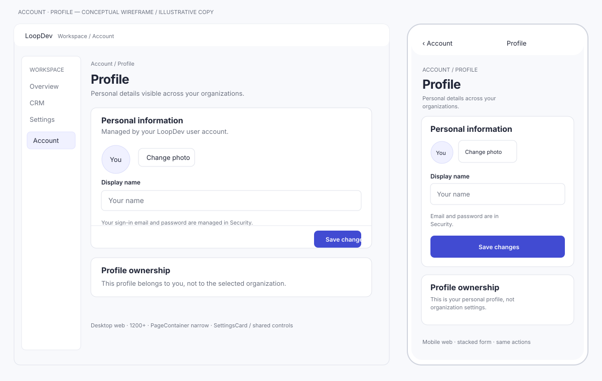
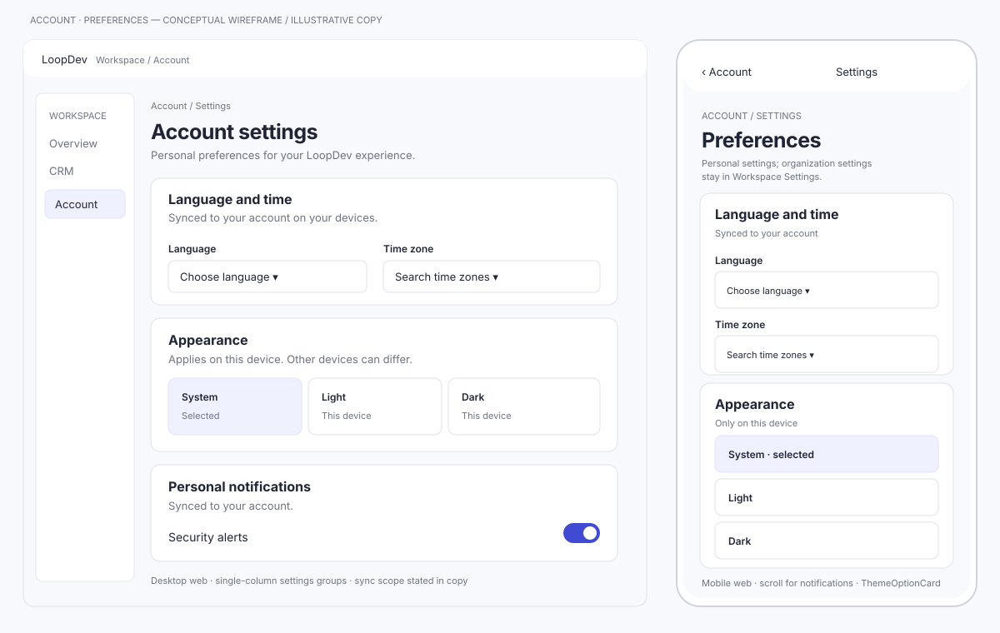
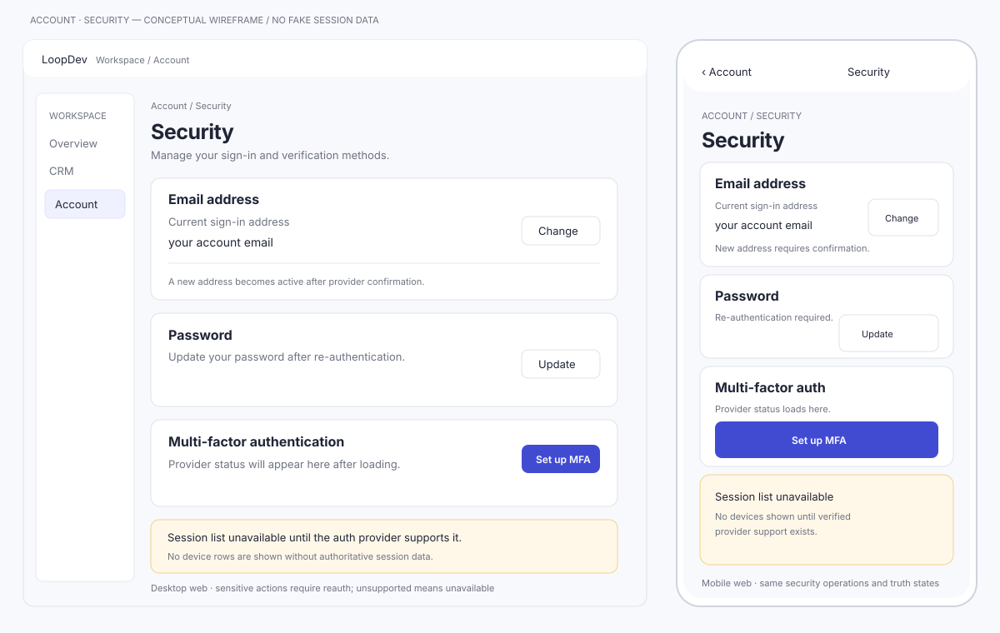
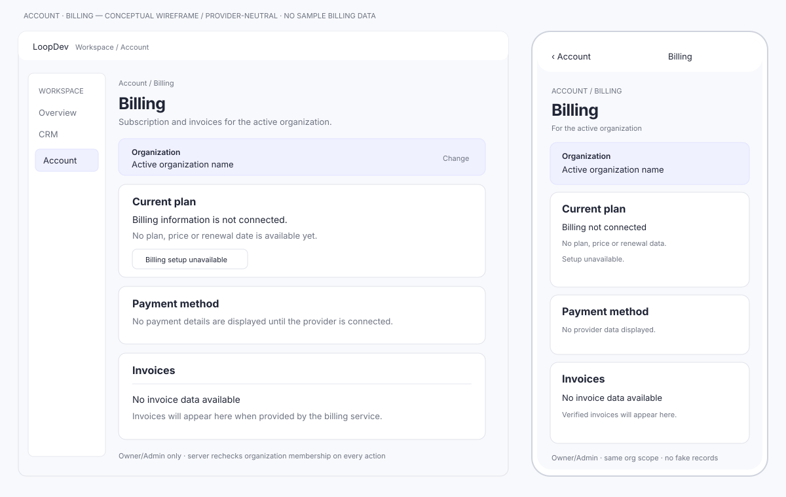

# Platform Account — diseño visual

## Control y estado de aprobación

| Campo | Valor |
|---|---|
| Run / span | `MOD-ACCOUNT-20261010-001` / `MOD-ACCOUNT-20261010-001:01-visual-design` |
| Parent | `01-design`; aprobación explícita del usuario para iniciar el gate visual |
| Fuente normativa | Este documento y `view-state-matrix.md` |
| Evidencia visual | `wireframes/profile.svg`, `preferences.svg`, `security.svg`, `billing.svg` |
| Alcance de renderer | Desktop web, mobile web, iOS y Android |
| Estado conceptual | `pending_review`; la aprobación de diseño habilita elaborar wireframes, no aprueba todavía estos wireframes |
| Estado runtime | `not_run`; requiere implementación posterior y comparación separada |
| Revisión de biblioteca visual | Auditoría contra referencias web, inventario multiplataforma y consumidores web/nativos; Rivera aplica a desktop y mobile web |
| Billing | Presentación neutral al proveedor; sin precios, tarjetas, facturas o datos de demostración |

Todos los textos de wireframe son etiquetas/fixtures ilustrativos, no datos de
LoopDev. Billing deliberadamente muestra el estado sin configurar y ningún
precio/método/factura inventado. No son pantallas productivas ni se validaron
en runtime.

## 1. Inventario Rivera/LoopDev

| Elemento | Regla visual | Fuente actual verificada |
|---|---|---|
| Tipografía | Geist; headings usan escala fluida y tracking ajustado; texto secundario legible | `src/index.css` typography rules (`font-family: Geist`; h1–h6) |
| Fondo/texto | Canvas `--background: 220 30% 98.8%`, foreground `222 32% 11%`, card blanca | `src/index.css` `:root` tokens |
| Acento | Indigo/blue semántico `--primary: 234 80% 58%`; usar con etiqueta/icono, no solo color | `src/index.css` primary/info/success/warning/destructive tokens |
| Bordes/radios | `--border: 220 22% 92%`, strong border `220 20% 85%`, radius `0.5rem`, small `0.375rem` | `src/index.css` semantic tokens |
| Elevación | `--shadow-modern` es una sombra leve compartida; cards discretas, no paneles flotantes | `src/index.css` shadow tokens; `.surface-card` consumidores actuales |
| Espaciado | Page rhythm común `space-y-6`; settings/cards `p-5`, secciones `gap-5`, responsive `md:p-6` | `PageContainer.tsx`, `SettingsCard.tsx`, `FormSection.tsx` |
| Page width | Settings y formularios de una columna usan `max-w-3xl`; contenido estándar `max-w-6xl` | `src/components/common/PageContainer.tsx` |
| Page heading | Breadcrumbs arriba, heading/description y actions que apilan en móvil | `src/components/common/PageHeader.tsx` |
| Form/settings | Usar `DataCard`/`SurfaceCard`, presente en las páginas Rivera existentes; `SettingsCard` existe pero no se toma como patrón probado para estas pantallas | `src/template/rivera/pages/account/{Profile,Settings,Security,Billing}.tsx`, `src/components/common/DataCard.tsx`, `SurfaceCard.tsx` |
| Inputs/actions | Reutilizar `Button`, `Input`, `Label`, `Select` y `Switch`; sus alturas web base son 32/36/40px según variante de botón, 40px input/select y 24px switch | `src/components/ui/{button,input,label,select,switch}.tsx` |
| Apariencia | Reutilizar `ThemeOptionCard` y `DataCard` del patrón Rivera, no dibujar un segmented control nuevo | `src/template/rivera/pages/account-settings/AppearancePage.tsx`, `src/components/settings/ThemeOptionCard.tsx` |
| Identidad | `UserAvatar`/`Avatar` aporta imagen/fallback; no aporta por sí solo una operación de subida | `src/components/common/UserAvatar.tsx`, `src/components/ui/avatar.tsx` |
| States | `DataCard` ya soporta loading/empty/error; para feedback aislado, `EmptyState`, `LoadingState`, `ConfirmDialog` y `AlertDialog` | `src/components/common/DataCard.tsx`, `EmptyState.tsx`, `LoadingState.tsx`, `ConfirmDialog.tsx` |
| Shell | El acceso actual `/account/*` usa `RiveraShell`; las rutas propuestas `/app/account/*` usan `LoopdevShell`, ambos dentro de `AppShell` con Topbar común. No se debe duplicar ninguno | `PLATFORM_V2_SHELL_REFERENCE.md`; `src/components/layout/AppShell.tsx`, `Topbar.tsx` |
| Densidad | Las páginas Account son ajustes personales, no CRM data tables; usar una columna de settings y espacio generoso, no densidad de pipeline | `SettingsCard`, `FormSection`, `PageContainer`; adaptar CRM density no aplica |
| Tema oscuro | Mantener los mismos tokens semánticos y estados en `.dark`; wireframes muestran tema claro por ser referencia estructural | `src/index.css` `.dark` token overrides |

La normativa web es conservar los tokens Rivera y los componentes compartidos
existentes, no copiar la lógica de las páginas demo de Rivera. Los SVG son
estilizados para revisión conceptual; no autorizan primitivas nuevas.

## 1.1 Verificación del catálogo contra la implementación

| Necesidad | Rivera/LoopDev reutilizable verificado | Decisión para Account | Evidencia y límite |
|---|---|---|---|
| Shell y menú | `AppShell`, `Topbar`, `LoopdevShell`/`RiveraShell` | Usar shell/Topbar existentes; las rutas `/app/account/*` aprobadas como propuesta heredan `LoopdevShell`. Migrar los links actuales y proteger/redirect de rutas legacy es trabajo futuro, no comportamiento existente | `AppShell.tsx`; `Topbar.tsx`; `AppRoutes.tsx`; `LoopdevRoutes.tsx` no registra aún las nuevas rutas |
| Heading y ancho | `PageHeader`, `AppBreadcrumbs`, `PageContainer` | Reusar heading/breadcrumb; `PageContainer narrow` para forms enfocados | Barrel `src/components/common/index.ts`; implementaciones comunes |
| Cards de settings | `DataCard`, `SurfaceCard` | Son el patrón del wireframe. `DataCard` es preferido porque las páginas Profile, Settings, Security y Billing de Rivera ya lo consumen | `src/template/rivera/pages/account/{Profile,Settings,Security,Billing}.tsx` importan `DataCard`; `src/components/common/DataCard.tsx` |
| `SettingsCard` | Componente exportado y documentado en el inventario UI | No se elige en este diseño: no aparece como consumidor directo en las páginas actuales examinadas, mientras `DataCard` sí | `rg` de consumidores del source halló definición/barrel y documentación, no uso en las páginas revisadas |
| Datos/inputs/actions | `Button`, `Input`, `Label`, `Select`, `Switch`, `ThemeOptionCard` | Reusar sin wrapper visual alternativo; usar `ThemeOptionCard` para opciones System/Light/Dark | Los controles web ya están en `src/components/ui/`; `ThemeOptionCard` se importa en la página Rivera `AppearancePage.tsx` |
| Avatar | `UserAvatar`, `Avatar`, `AvatarFallback`, `AvatarImage` | Reusar solo para identidad/preview. La subida remota de avatar no queda cubierta por estos componentes | `UserAvatar.tsx`; Profile mock demuestra fallback, pero su acción de cambio se identifica explícitamente como mock |
| Subida de avatar | `FilePicker` delega a `FilesDropzone` | **No reutilizar para avatar por ahora**: solo prueba/transforma archivos localmente; no establece storage owner-scoped de perfil ni escritura remota segura | `FilePicker.tsx`, `FilesDropzone.tsx`, `processLocalUpload`; operación de perfil queda condicionada a Files/Profile contract |
| Security | Controls web + `Dialog`/`ConfirmDialog` | Reusar solo la presentación. No copiar demo de contraseña, TOTP, sesión ni confirmaciones que persisten localmente o informan éxito simulado | `src/template/rivera/pages/account/Security.tsx` contiene arrays de sesiones y acciones mock; AuthPort/provider manda |
| Billing | `DataCard`, table primitives, `EmptyState`, `ConfirmDialog` | Reusar estructura/surface; no copiar sus planes, importes, tarjetas, datos fiscales ni facturas de demo | `src/template/rivera/pages/account/Billing.tsx` tiene defaults locales y catálogo/facturas ficticios; fuente de verdad será Billing server/provider |
| Preferencias personales | `DataCard`, `Select`, `Switch`, `ThemeOptionCard` | Reusar componentes, no workspace name/landing/density ni la persistencia local del mock Settings | `src/template/rivera/pages/account/Settings.tsx`; restringir al scope aprobado en `design.md` |
| Estados/error | `DataCard` + primitives de feedback | Reusar y alimentar con resultados reales; unsupported/forbidden no se disfrazan como success ni empty data | `DataCard.tsx`, `EmptyState.tsx`, `LoadingState.tsx`, `ConfirmDialog.tsx` |
| Native iOS/Android | `apps/mobile` usa Expo/React Native, `mobileTheme` y componentes del catálogo `apps/mobile/components/ui` | Reutilizar renderer, componentes y tokens nativos existentes; crear/extender solo cuando una capacidad requerida no esté cubierta. No importar DOM ni exigir paridad de paleta Rivera | `apps/mobile/components/ui/index.ts`, consumidores nativos y `apps/mobile/theme/tokens.ts` |

Las páginas Rivera de Profile/Settings/Security/Billing son ejemplos visuales,
no contratos de negocio: tienen `localStorage`, datos semilla/ficticios,
acciones simuladas y defaults de Rivera. Reusar exclusivamente sus componentes
de presentación confirmados; no sus stores, catálogos, mutations ni copy que
declare una acción exitosa.

La matriz de componentes de plataforma llama reutilizable a `SettingsCard`,
pero los consumidores concretos revisados aquí usan `DataCard`; para no
convertir inventario en evidencia de uso, los wireframes adoptan `DataCard`.
Esto es una decisión de reutilización, no un rechazo permanente del componente.

## 2. Composición compartida y responsive

- **Rutas/reuso propuesto en el diseño aprobado:** `/app/account/profile`,
  `/app/account/settings`, `/app/account/security`,
  `/app/account/billing`; rutas anteriores son redirects. Breadcrumbs salen
  del shell; no duplicar el menú lateral dentro de la página.
- **Desktop web (≥1200px):** `AppShell` muestra `LoopdevShell` para `/app/*`;
  formulario en una columna `PageContainer narrow`; panels `DataCard`,
  controls/actions Rivera compartidos. No mostrar dos paneles compitiendo por
  atención.
- **Tablet/mobile web (<768px):** shell usa navegación drawer; contenido
  apilado y viewport scrollable. No reducir controles críticos ni depender de
  hover; CTA se mantiene junto al formulario, no fijo si tapa contenido.
- **iOS/Android:** esta entrega no importa controles web en React Native.
  Mantener actions, validation, ownership, states, copy keys y permisos
  comunes; adaptar safe areas, back, teclado y pickers con primitives nativos.
  Reutilizar primero `MobilePageContainer`, `MobilePageHeader`, `MobileCard`,
  `MobileInput`, `MobileSelectSheet`, `MobileButton`, feedback y overlays
  disponibles. La composición detallada por vista está en
  `native-compositions.md`.
- **Breakpoint intermedio 768–1199px:** sidebar en mini según shell actual;
  contenido conserva ancho legible y una columna para forms.
- **Sin desviaciones aprobadas:** no se introduce color, tipografía, radio,
  patrón de diálogo o control distinto del baseline actual.

## 3. Wireframes estilizados

Los cuatro SVG muestran composición desktop y móvil web lado a lado. Son una
fuente conceptual revisable, no screenshots del runtime. Las composiciones
nativas separadas están en `native-compositions.md`; no son wireframes web ni
screenshots del runtime.

### Profile

### Account Preferences

### Security

### Billing

## 4. Matriz de reutilización por zona

| Vista/zona | Clasificación | Primitive/contract | Owner | Rationale / evidence |
|---|---|---|---|---|
| Shell, topbar, breadcrumbs | `shared` | `AppShell`, `LoopdevShell`, `Topbar`, `AppBreadcrumbs` | Platform | Mantener navegación y focus behavior existentes; no segundo shell |
| Page title/description/actions | `primitive` | `PageHeader` | Platform UI | Composición actual de páginas |
| Ancho/vertical rhythm | `primitive` | `PageContainer narrow` | Platform UI | Adecuado para formulario individual |
| Profile identity row/form | `shared` | `DataCard`, `UserAvatar`, `Input`, `Label`, `Button` | Platform UI/Profile | Rivera presentation primitives; no elevar avatar mock a fuente de negocio |
| Avatar chooser/preview | `EXTEND_PLATFORM` condicionado | `Avatar`/`UserAvatar` para preview; uploader remoto todavía no elegido | Platform Files/Profile | `FilePicker`/`FilesDropzone` actual no garantiza persistencia remota owner-scoped |
| Preference groups | `shared` | `DataCard`, `Select`, `Switch`, `ThemeOptionCard` | Platform UI / Preferences | Controles vistos en los settings Rivera; copy explica sincronización |
| Security methods | `shared` | `DataCard`, `Input`, `Button`, `Dialog`, `ConfirmDialog`, `Switch` | Platform Auth | Solo presentación compartida; AuthPort/proveedor define resultado |
| MFA setup | `EXTEND_PLATFORM` condicionado | Auth provider flow + `Dialog`/`ConfirmDialog` | Platform Auth | UI depende de tipo de factor/proveedor; no copiar QR/code mock de Rivera |
| Session inventory | `EXTEND_PLATFORM` condicionado | Auth session capability aún abierta; DataCard/EmptyState | Platform Auth | No dibujar dispositivos ficticios; no forzar tabla si provider no puede listar |
| Billing scope banner | `shared` | Tenant Context snapshot + `DataCard` | Platform/Tenant | Debe nombrar organización activa y no compartir datos entre tenants |
| Billing summary/invoices | `MODULE_SPECIFIC` renderer, Billing owner externo | Futuro Billing contract; `DataCard`, `EmptyState`, table primitive si hay datos | Billing/Finance | No hay Billing domain/adapters activos; wireframe vacío informativo |
| Payment/plan provider handoff | `EXTEND_PLATFORM` condicionado | Backend Billing session, `Button`/link y browser/SDK seguro | Billing/Finance | Portal/provider no elegido; nunca URL estable o secret en cliente |
| Empty/loading/error/forbidden feedback | `shared` | `DataCard`, `EmptyState`, `LoadingState`, `ConfirmDialog` | Platform UI | Estados existentes y reusables |
| Native screen root/header | `shared` semantics + native primitives | `MobilePageContainer`, `MobilePageHeader` | Mobile Platform | Componentes existentes; usar navegación, safe area, teclado y scroll nativos |
| Native cards/forms | `shared` semantics + native primitives | `MobileCard`, `MobileInput`, `MobileSelectSheet`, `MobileButton`, React Native `Switch` | Mobile Platform | Componentes existentes; selects mediante sheet y acciones con hit area táctil |
| Native identity/avatar | `shared` profile contract + native renderer | `MobileAvatar` | Platform Mobile/Profile | Solo iniciales; no muestra imagen ni resuelve upload. Extender tras contrato Files/Profile |
| Native feedback/destructive actions | `shared` state/action contract + native renderer | `MobileStatusBadge`, `MobileEmptyState`, `MobileLoadingState`, `MobileConfirmDialog` | Mobile Platform | Componentes existentes; estados y resultados deben ser autoritativos |
| Native billing handoff | `shared` Billing contract + native provider flow | No se verificó componente de handoff | Platform Mobile/Billing | Mantener provider-neutral; añadir primitive solo si el flow aprobado lo requiere |

No se necesita Notes, Tasks, Activity, Relations ni Files aparte de evaluar
avatar. No hay excepción que autorice crear design system paralelo.

## 5. Shared operation contract visual

El diseño visual solo compone los IDs existentes en
`delivery-ledger.json`; no crea un catálogo alternativo.

| Capability | Stable operation IDs | Acción/copy key | Estado y semántica |
|---|---|---|---|
| Navigation | `open_profile_destination`, `open_account_settings_destination`, `open_security_destination`, `open_billing_destination` | `account.action.<operation_id>` | Link con nombre claro; auth y autorización se revalidan al entrar |
| Profile | `read_profile`, `update_display_name`, `change_avatar` | `account.action.<operation_id>` | Guardar solo tras confirmación; label de avatar expresa cambiar/quitar según Files contract |
| Preferences | `read_preferences`, `change_language`, `change_timezone`, `change_appearance`, `change_personal_notifications` | `account.action.<operation_id>` | Copy explica qué sincroniza por usuario; appearance puede ser local |
| Security | `read_security_status`, `change_password`, `change_email`, `manage_mfa`, `sign_out_other_sessions` | `account.action.<operation_id>` | Challenge/reauth y unsupported visibles; cerrar otras sesiones requiere confirmación y estado provider-backed |
| Billing | `read_subscription`, `change_plan`, `cancel_subscription`, `manage_payment_methods`, `view_invoice` | `account.action.<operation_id>` | Org activa visible; rol Owner/Admin en cada llamada; provider pending no es success |

Cada key requiere traducción española e inglesa y announce labels equivalentes.
Los mensajes de error se anuncian junto al campo/resumen y con live region.

## 6. Accesibilidad, responsive, i18n y RTL

- Web keyboard: tab order sigue heading → fields → action; focus ring actual;
  selects/menus se operan por teclado; Escape cierra diálogo y restaura foco.
- Mobile: touch targets de al menos 44×44 CSS px para acciones; no acción
  codificada solo en swipe; reflow sin scroll horizontal a 320 CSS px.
- Screen readers: landmark `main`, un h1 por pantalla, labels explícitos,
  descriptions en campos, estado busy/error de mutación en live region.
- MFA: QR nunca es única alternativa; texto/copy de seed solo si el proveedor
  lo permite, con advertencia y ocultación tras completar; no persistir OTP.
- Provider return: anunciar retorno y estado confirmado, regresar el foco al
  botón que inició el flujo. Billing no abre iframes (Stripe documenta que el
  portal no se puede mostrar en iframe).
- i18n: los labels y errores son copy keys comunes; evitar texto concatenado,
  fechas/timezones se formatean desde preference/locale del usuario.
- RTL: cards apilan, actions fluyen según dirección lógica, iconos no
  direccionales se mantienen; revisar foco y truncado con cadenas largas.
- Estados se distinguen por icono + texto + jerarquía, no solo color. Respetar
  `prefers-reduced-motion` y tema oscuro.

## 7. Estados, modo offline y fallos visuales

`view-state-matrix.md` es la fuente normativa por vista, operación y
plataforma. Los wireframes muestran el estado inicial/conceptual; no inventan
datos para cubrir estados. En particular, Billing y sign-out-other-sessions usan
estados no configurado/unsupported hasta tener respuesta autoritativa.

## 8. Rollout, review y dos niveles de evidencia

1. **Conceptual approval (pendiente):** Product/Platform revisan fuente,
   scope, jerarquía, states, reuse, accessibility y las cuatro composiciones.
   Registrar approver, fecha y artefactos en checkpoint `01-visual-design`.
2. **Runtime comparison (futuro, post-build):** abrir rutas reales y comparar
   desktop web/mobile web contra estos wireframes; validar iOS/Android en
   simulador/dispositivo, screenshots/visual diffs, focus/touch/deep links.
   Esa evidencia no existe todavía y no puede suplir aprobación conceptual.

**Rollback visual:** retirar feature flag de rutas nuevas y mostrar navegación
segura; nunca volver a páginas mock activas para guardar valores o simular
seguridad/billing. Capability Billing/Security puede permanecer disabled/read
only hasta que la autoridad correspondiente sea operativa.

## Decisiones visuales y estado

| ID | Owner | Impacto | Default propuesto | Aprobación requerida |
|---|---|---|---|---|
| `VIS-ACCOUNT-001` | Product/Platform | Canonical path `/app/account/*` requiere redirects desde `/account/*` | Mantener ruta canónica propuesta y redirect | Confirmar en revisión conceptual |
| `VIS-ACCOUNT-002` | Platform Auth | Inventario/revocación por sesión no está verificado | Mostrar `operation_unsupported` y no lista ficticia | Auth owner aprueba fuente real o copy/alcance reducido |
| `VIS-ACCOUNT-003` | Product/Finance | LoopDev es la entidad vendedora y operará inicialmente desde España; proveedor y portal aún abiertos | Card de estado neutral, sin precios, logotipo de proveedor ni detalles ficticios | Aprobar la fuente de billing cuando exista |
| `VIS-ACCOUNT-004` | Platform Files/Profile | Política/capacidad de avatar aún no definida | Mantener avatar como acción condicionada y preview | Files/Profile owner valida picker, dimensiones y permisos |
| `VIS-ACCOUNT-005` | Platform Mobile / Product | iOS/Android no deben depender de componentes Rivera web | Reutilizar el catálogo React Native y tokens móviles; crear/extender componentes solo ante gaps de capacidades aprobadas | **Resuelto por el usuario:** Rivera es la base de desktop/mobile web; native conserva su renderer y sistema visual |

## Revisión de componentes solicitada

La base web para continuar es suficiente y está comprobada en código: los
wireframes corresponden a `DataCard`, `PageHeader`, `PageContainer`, los
controles `Button/Input/Select/Switch` y `ThemeOptionCard` del UI kit
Rivera/LoopDev. Se excluyeron explícitamente los componentes mock de negocio
de las páginas plantilla. Para iOS/Android se documenta por separado el uso
del catálogo nativo actual en `native-compositions.md`. La paleta nativa
`mobileTheme.colors.primary` (`#135bec`) se conserva; su diferencia con Rivera
web no es un bloqueo ni una solicitud de migración visual.

**Handoff:** el diseño visual está producido para revisión conceptual, no
aprobado. No iniciar `02-domain`, `03-access`, `04-api`, `05-sync` ni
`06-plan` hasta registrar esa aprobación y resolver/aceptar explícitamente
los límites abiertos que bloquean sus respectivas especialidades.
