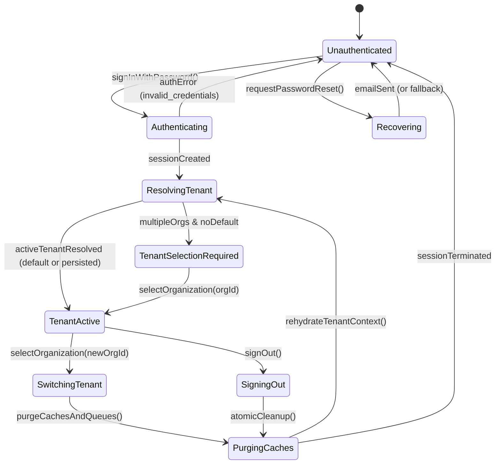

# Platform Auth & Multi-tenant Context Domain Model

## Document Control

| Field | Value |
|---|---|
| Module | Auth & Tenant Context |
| Product definition | `docs/implementation/platform/auth/HANDOFF.md` |
| Run ID | `MOD-AUTH-20260914-001` |
| Phase | `02-domain` |
| Skill | `domain-model` |
| Status | `completed` |

---

## 1. Scope & Core Invariants

The **Platform Auth and Multi-tenant Context** domain defines the canonical identity, session, organization, workspace, and role models across the LoopDev monorepo. It serves desktop web, mobile web, iOS, and Android through the neutral contracts `AuthPort` and `TenantContextPort`.

### Core Domain Invariants
1. **Isolated Execution Context**: Every authenticated interaction in the application runs under an explicit, immutable `organizationId` and optional `workspaceId`.
2. **Super Admin Transparency**: Super Admins (`isSuperAdmin: true` or membership role `owner` with global platform claim) have visibility over all organizations in the platform catalogue (`listOrganizations`), but execute actions within a single explicitly selected active organization at any given instant.
3. **Zero Cross-Tenant Leakage**: Changing the active organization or signing out guarantees the atomic invalidation and eviction of tenant data, caches (React Query), and in-memory mutation queues.
4. **Adaptive Password Recovery**: Password recovery domain entities accommodate environments without external SMTP infrastructure (local Inbucket, development CLI tokens, and fallback codes) without breaking production contracts.

---

## 2. Entities & Value Objects

| Entity / Value Object | Required Fields | Scope / Owner | Source of Truth | Remote Identity | Mutability & Lifecycle |
|---|---|---|---|---|---|
| **`PlatformUser`** | `id`, `email`, `fullName`, `avatarUrl?`, `isSuperAdmin`, `createdAt`, `updatedAt` | Global Platform Identity | Supabase `auth.users` + `public.users` projection | UUID (`sub` in JWT) | Immutable identity; profile updates emit audit trail |
| **`AuthSession`** | `accessToken`, `refreshToken`, `expiresAt`, `user` (`PlatformUser`) | Client Session Runtime | Supabase Auth Session | JWT token payload | Volatile / rotating; renewed via refresh tokens; cleared on signOut |
| **`Organization`** | `id`, `slug`, `name`, `logoUrl?`, `status` (`active`, `suspended`), `createdAt` | Multi-tenant Boundary | Supabase `public.organizations` | UUID (`org_...`) | Administrative lifecycle; managed by organization owners or Super Admins |
| **`OrganizationMembership`** | `id`, `organizationId`, `userId`, `role` (`owner`, `admin`, `editor`, `viewer`), `status` (`active`, `invited`, `suspended`), `joinedAt` | Tenant Access Link | Supabase `public.organization_memberships` | UUID | Grants role permissions; revoked on membership removal |
| **`Workspace`** | `id`, `organizationId`, `slug`, `name`, `isDefault`, `createdAt` | Sub-tenant Scope | Supabase `public.workspaces` | UUID | Grouping for departmental modules, files, and note collections |
| **`TenantContextSnapshot`** | `activeOrganizationId`, `activeWorkspaceId?`, `organization`, `workspace?`, `userRole`, `permissions`, `isSuperAdmin` | Runtime App State | Resolution from `TenantContextPort` | Composite snapshot | Inmutable per tenant selection; regenerated upon tenant switch |
| **`AuthError`** | `code` (e.g. `invalid_credentials`, `session_expired`, `email_service_unavailable`, `unauthorized_tenant`), `message`, `status?` | Value Object | `AuthPort` & `TenantContextPort` | Standard error envelope | Structured error payload with user-friendly diagnostics |

---

## 3. Role Hierarchy & Permission Matrix

Roles are strictly hierarchical within an organization:

```text
owner > admin > editor > viewer
```

| Permission Key | Description | Viewer | Editor | Admin | Owner | Super Admin |
|---|---|:---:|:---:|:---:|:---:|:---:|
| `org.read` | View organization metadata | ✓ | ✓ | ✓ | ✓ | ✓ (All orgs) |
| `org.update` | Edit organization name, branding | ✗ | ✗ | ✓ | ✓ | ✓ |
| `org.delete` | Delete or archive organization | ✗ | ✗ | ✗ | ✓ | ✓ |
| `members.read` | List organization members | ✓ | ✓ | ✓ | ✓ | ✓ |
| `members.invite` | Invite new members & assign roles | ✗ | ✗ | ✓ | ✓ | ✓ |
| `members.manage` | Promote, demote or revoke members | ✗ | ✗ | ✗ | ✓ | ✓ |
| `notes.read` | View shared & related notes | ✓ | ✓ | ✓ | ✓ | ✓ |
| `notes.create` | Create quick & rich notes | ✗ | ✓ | ✓ | ✓ | ✓ |
| `notes.edit` | Edit author notes | ✗ | ✓ | ✓ | ✓ | ✓ |
| `notes.delete` | Soft-delete / tombstone notes | ✗ | ✗ | ✓ | ✓ | ✓ |

---

## 4. Session & Tenant Lifecycle State Machine



### Lifecycle Transition Rules:
1. **`Unauthenticated -> Authenticating`**: Validates email format and password length; delegates credentials verification to `AuthPort.signInWithPassword`.
2. **`Authenticating -> ResolvingTenant`**: Upon receiving valid JWT tokens, fetches the user's memberships. For `isSuperAdmin: true`, registers both owned organizations and the full platform catalogue.
3. **`ResolvingTenant -> TenantActive`**: Sets active tenant. If previously persisted organization exists in secure storage and user retains active membership, restores it; otherwise falls back to first active organization.
4. **`TenantActive -> SwitchingTenant`**: Triggered when user selects a different organization in Topbar or MobileAccountSheet. Invokes atomic purge:
   - Clears React Query caches (`queryClient.clear()`).
   - Evicts local mutation queues and memory stores.
   - Updates `TenantContextSnapshot` and persists active selection.
5. **`TenantActive -> SigningOut`**: Purges tokens from local storage / mobile secure store, resets query caches, unsubscribes from auth listeners, and returns to `Unauthenticated`.

---

## 5. Domain Commands & Queries

### Queries
- **`getSession(): Promise<AuthSession | null>`**: Retrieves current session, validating token freshness and triggering automatic rotation if needed.
- **`getTenantContext(): TenantContextSnapshot`**: Returns in-memory reactive snapshot of active organization, workspace, and permissions.
- **`listOrganizations(): Promise<Organization[]>`**: Lists all organizations available to the user (all memberships for standard users; entire platform directory for Super Admins).
- **`listWorkspaces(organizationId: string): Promise<Workspace[]>`**: Lists workspaces within the specified organization.

### Commands
- **`signInWithPassword(credentials: AuthCredentials): Promise<AuthSession>`**: Authenticates against identity provider.
- **`signOut(): Promise<void>`**: Terminates session, clears tokens, and flushes local tenant data.
- **`requestPasswordReset(email: string): Promise<PasswordResetResult>`**: Initiates recovery. In development without SMTP, returns `success: true` with `deliveryChannel: "inbucket_or_admin_cli"`.
- **`updatePassword(newPassword: string): Promise<void>`**: Completes password reset given an active recovery session.
- **`selectOrganization(organizationId: string): Promise<TenantContextSnapshot>`**: Executes atomic tenant switch, flushes caches, and binds new context.
- **`selectWorkspace(workspaceId: string | null): Promise<TenantContextSnapshot>`**: Updates active workspace within current organization.

---

## 6. Domain Events

| Event Name | Payload Attributes | Emitted By | Consumers |
|---|---|---|---|
| `auth.session_started.v1` | `userId`, `email`, `isSuperAdmin`, `timestamp` | `AuthPort` | Navigation, Audit, Telemetry |
| `auth.session_ended.v1` | `userId`, `reason` (`user_sign_out`, `token_expired`), `timestamp` | `AuthPort` | Cache purger, Topbar, ProtectedRoute |
| `auth.tenant_switched.v1` | `userId`, `previousOrgId`, `newOrgId`, `isSuperAdmin`, `timestamp` | `TenantContextPort` | React Query invalidator, Notes/CRM loaders |
| `auth.password_reset_requested.v1` | `email`, `deliveryMode` (`smtp`, `inbucket_dev`, `admin_bypass`), `timestamp` | `AuthPort` | Activity Log, Dev tools |

---

## 7. Open Decisions & Technical Risks

1. **Token Refresh Synchronization in Mobile**: Mobile secure storage access is asynchronous. The mobile `AuthPort` adapter must use an internal mutex lock during refresh token exchange to prevent race conditions on concurrent HTTP requests.
2. **Super Admin Scope in Multi-tenant CRM / Notes**: When a Super Admin views another organization, all created entities must record the active `organizationId`, and the audit record must note that the action was performed by a delegated platform administrator (`actingAsSuperAdmin: true`).

