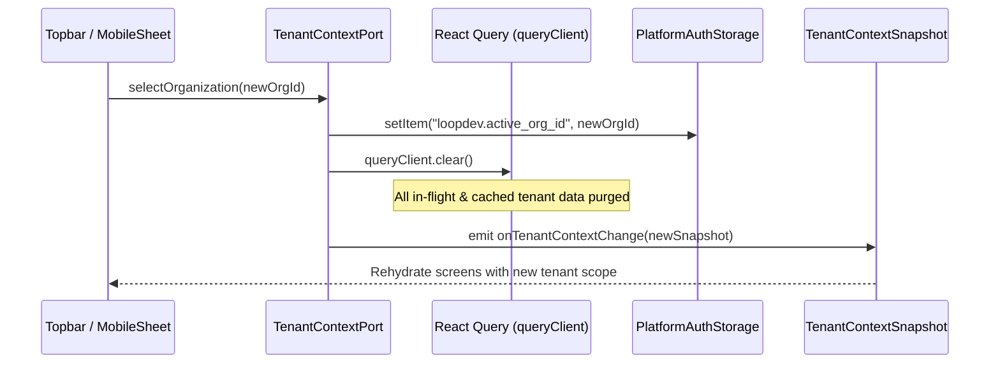

# Platform Auth & Tenant Context Sync and Session Lifecycle Design

## Document Control

| Field | Value |
|---|---|
| Module | Auth & Tenant Context |
| Product definition | `docs/implementation/platform/auth/HANDOFF.md` |
| Run ID | `MOD-AUTH-20260914-001` |
| Phase | `05-sync` |
| Skill | `sync-design` |
| Status | `completed` |

---

## 1. Storage Boundaries & Token Synchronization

| Platform | Storage Target | Encryption | Async / Sync | Tenant Boundary |
|---|---|---|---|---|
| **Desktop Web** | `localStorage` (via `PlatformAuthStorage`) | Browser sandbox | Async facade over storage | Partitioned by Supabase project key + active tenant key |
| **Mobile Web** | `localStorage` / `sessionStorage` | Browser sandbox | Async | Partitioned storage |
| **Mobile App (iOS)** | Keychain (`expo-secure-store`) | Hardware hardware-encrypted | Native Async | Strict app sandbox |
| **Mobile App (Android)** | Keystore (`expo-secure-store`) | AES-256 encrypted SharedPreferences | Native Async | Strict app sandbox |

---

## 2. Session Rotation & Token Refresh Lifecycle

1. **Auto-refresh**:
   - Access tokens expire every 3600s (1 hour).
   - `AuthPort` schedules background renewal 60 seconds prior to expiration using the rotating refresh token.
2. **Concurrency Mutex (Mobile & Desktop)**:
   - When multiple HTTP requests or concurrent queries detect an expiring token, a single refresh request is dispatched.
   - Secondary calls await the in-flight refresh promise, avoiding race conditions or token reuse rejection.
3. **Session Termination**:
   - If the refresh token is revoked or expired, the session immediately transitions to unauthenticated, triggering an event to force redirect to login without leaving corrupted session artifacts.

---

## 3. Tenant Context Synchronization & Atomic Eviction

Whenever `selectOrganization(newOrgId)` or `signOut()` is called:

### Invariant Checklist:
- **No stale query data**: `queryClient.clear()` completely wipes existing query cache across CRM, Notes, and Files.
- **Header synchronization**: All subsequent Supabase / API requests inject `x-organization-id: newOrgId`.
- **Active selection persistence**: On page reload or app restart, the saved `active_org_id` is restored provided the session retains valid membership.

---

## 4. Offline Handling & Resilience

- When offline, `getSession()` returns the cached valid session until `expiresAt`.
- If offline when expiration occurs, mutations are queued or held in a graceful retryable state (`AUTH_NETWORK_ERROR`), avoiding premature session revocation until connectivity is re-established.
- On network restoration, session validity is verified against Supabase before flushing any pending operational queues.

---

## 5. Verification & Sync Test Cases

1. **Page Reload Session Rehydration**: Reloading the web or mobile app restores the active user session and selected organization without requiring re-login.
2. **Atomic Invalidation on Switch**: Changing organization clears React Query memory caches and prevents previous organization notes or contacts from rendering.
3. **Multi-Tab Session Sync**: In desktop browsers, signing out in one tab triggers storage events that terminate the session in adjacent tabs.
4. **Token Refresh Mutex**: Firing 5 concurrent API requests during token expiration executes exactly one refresh token exchange.

